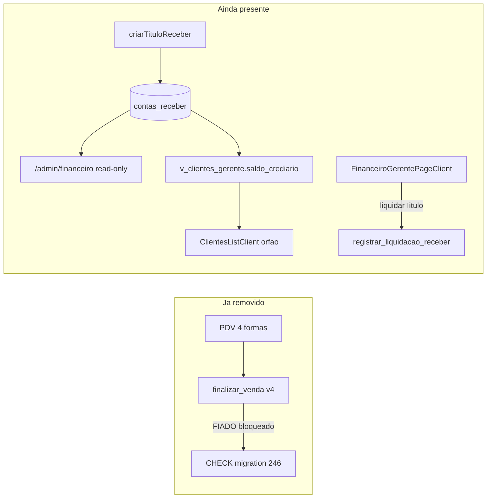
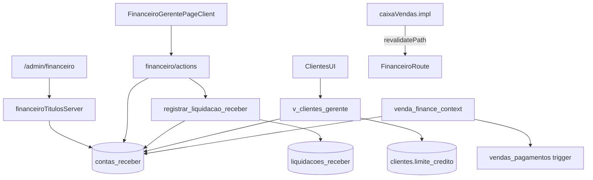

# Auditoria e Plano de Remoção do Módulo Fiado

## Estado atual (evidências)

**Decisão de produto já aplicada no banco:** migration [`246_remover_venda_fiado.sql`](backend/supabase/migrations/246_remover_venda_fiado.sql) rejeita `FIADO` na RPC `finalizar_venda_transacional_canonica_v4` e adiciona CHECK em `vendas` / `vendas_pagamentos` barrando `FIADO`.

**PDV hoje:** apenas 4 formas em [`finalizarVendaValidation.ts`](pdv-importados/app/caixa/finalizarVendaValidation.ts): `DINHEIRO`, `PIX`, `CARTAO_DEBITO`, `CARTAO_CREDITO`. Sem FIADO/CREDIARIO no seletor.

**O que ainda existe:** subsistema manual de contas a receber (`contas_receber` + `liquidacoes_receber` + RPC `registrar_liquidacao_receber`), UI de crediário/limite em clientes, telas financeiro com listagem AR, espelho `venda_finance_context` com ramo FIADO, filtro morto `CREDIARIO` em relatórios.

**Escopo confirmado:** remoção total — eliminar AR, crediário, limite de crédito e todas as referências visíveis/ocultas.



---

## 1. Localização — Arquivos encontrados

### Aplicação produção (`pdv-importados`)

| Área | Arquivos |
|------|----------|
| **Financeiro / AR** | [`app/admin/financeiro/page.tsx`](pdv-importados/app/admin/financeiro/page.tsx), [`_components/ContasReceberTable.tsx`](pdv-importados/app/admin/financeiro/_components/ContasReceberTable.tsx), [`_components/FinanceiroPanels.tsx`](pdv-importados/app/admin/financeiro/_components/FinanceiroPanels.tsx), [`app/gerente/financeiro/FinanceiroGerentePageClient.tsx`](pdv-importados/app/gerente/financeiro/FinanceiroGerentePageClient.tsx), [`app/gerente/financeiro/actions.ts`](pdv-importados/app/gerente/financeiro/actions.ts), [`actions.validation.ts`](pdv-importados/app/gerente/financeiro/actions.validation.ts), [`actions.validation.test.ts`](pdv-importados/app/gerente/financeiro/actions.validation.test.ts), [`lib/gerente/financeiroTitulosServer.ts`](pdv-importados/lib/gerente/financeiroTitulosServer.ts) |
| **Clientes / crediário** | [`app/gerente/clientes/ClientesListClient.tsx`](pdv-importados/app/gerente/clientes/ClientesListClient.tsx), [`ClienteEditarModal.tsx`](pdv-importados/app/gerente/clientes/ClienteEditarModal.tsx), [`actions.ts`](pdv-importados/app/gerente/clientes/actions.ts) |
| **Fiscal (compartilhado — manter)** | [`app/gerente/financeiro/documento/[id]/DocumentoFiscalDetalheClient.tsx`](pdv-importados/app/gerente/financeiro/documento/[id]/DocumentoFiscalDetalheClient.tsx), [`lib/fiscalEventTimeline.ts`](pdv-importados/app/gerente/financeiro/lib/fiscalEventTimeline.ts) |
| **Contas a pagar (manter)** | [`app/gerente/financeiro/contas-pagar/*`](pdv-importados/app/gerente/financeiro/contas-pagar/) |
| **Relatórios** | [`app/gerente/relatorios/vendas/RelatorioVendasClient.tsx`](pdv-importados/app/gerente/relatorios/vendas/RelatorioVendasClient.tsx) (filtro `CREDIARIO`) |
| **PDV (revalidate legado)** | [`app/caixa/server/caixaVendas.impl.ts`](pdv-importados/app/caixa/server/caixaVendas.impl.ts) L122, L388 — `revalidatePath('/gerente/financeiro')` |
| **Navegação** | [`lib/navigation/adminV2SidebarNav.ts`](pdv-importados/lib/navigation/adminV2SidebarNav.ts), [`adminSidebarNav.ts`](pdv-importados/lib/navigation/adminSidebarNav.ts), [`gerenteNavUi.ts`](pdv-importados/lib/navigation/gerenteNavUi.ts), [`shared-core/navigation/routes.ts`](shared-core/navigation/routes.ts) |
| **i18n** | [`src/lib/i18n/pt.json`](pdv-importados/src/lib/i18n/pt.json), [`zh.json`](pdv-importados/src/lib/i18n/zh.json) — chaves `clientes.em_crediario`, `field_limite_crediario`, `gerente.financeiro_stub.*` |
| **Tipos** | [`lib/supabase/database.types.ts`](pdv-importados/lib/supabase/database.types.ts) — `contas_receber`, `liquidacoes_receber`, `venda_finance_context`, `registrar_liquidacao_receber` |
| **Permissões** | [`lib/admin/policy/adminPolicy.ts`](pdv-importados/lib/admin/policy/adminPolicy.ts) — `sensitive:financeiro` |
| **E2E** | [`e2e/sync-fluxo-gerente.spec.ts`](pdv-importados/e2e/sync-fluxo-gerente.spec.ts) L202–210 |
| **Docs app** | [`docs/SECURITY_ARCHITECTURE.md`](pdv-importados/docs/SECURITY_ARCHITECTURE.md) |

### Backend / banco

| Artefato | Arquivo origem |
|----------|----------------|
| Tabelas `clientes`, `contas_receber`, `liquidacoes_receber` | [`035_fiado_fiscal_stub.sql`](backend/supabase/migrations/035_fiado_fiscal_stub.sql) |
| RLS multi-tenant + RPC v2 | [`112_clientes_contas_receber_loja_isolamento.sql`](backend/supabase/migrations/112_clientes_contas_receber_loja_isolamento.sql) |
| View `v_clientes_gerente` + `saldo_crediario` | [`253_clientes_tipo_endereco_e_view_gerente.sql`](backend/supabase/migrations/253_clientes_tipo_endereco_e_view_gerente.sql) |
| Espelho `venda_finance_context` + triggers FIADO | [`252_venda_finance_context_mirror.sql`](backend/supabase/migrations/252_venda_finance_context_mirror.sql) |
| Bloqueio venda FIADO | [`246_remover_venda_fiado.sql`](backend/supabase/migrations/246_remover_venda_fiado.sql) |
| DROP tabelas legadas | [`245_remover_venda_fiado.sql`](backend/supabase/migrations/20260620222629_245_remover_venda_fiado.sql) |
| Índices AR | [`223_indices_fks_sem_cobertura.sql`](backend/supabase/migrations/223_indices_fks_sem_cobertura.sql), [`222_drop_indices_duplicados.sql`](backend/supabase/migrations/222_drop_indices_duplicados.sql) |
| RLS initplan | [`224_rls_initplan_wrap_auth_select.sql`](backend/supabase/migrations/224_rls_initplan_wrap_auth_select.sql) |
| Grants | [`255_grant_baseline_tabelas_authenticated.sql`](backend/supabase/migrations/255_grant_baseline_tabelas_authenticated.sql) |
| `devolucoes` ainda aceita FIADO | [`059_cancelar_venda_split_e_auditoria_nao_dinheiro.sql`](backend/supabase/migrations/059_cancelar_venda_split_e_auditoria_nao_dinheiro.sql) |
| Smoke / testes | [`smoke_rls_painel_gerente.sql`](backend/supabase/scripts/smoke_rls_painel_gerente.sql), [`smoke_item4_integracao_recebimento_financeiro_fiscal.sql`](backend/supabase/scripts/smoke_item4_integracao_recebimento_financeiro_fiscal.sql), [`test-rls-scope.mjs`](backend/scripts/test-rls-scope.mjs), [`p0-rls-rest-smoke.mjs`](backend/scripts/p0-rls-rest-smoke.mjs) |

### Documentação / protótipos (não runtime)

- Docs raiz: [`AUDITORIA_DRIFT_PRODUCAO_REPOSITORIO.md`](AUDITORIA_DRIFT_PRODUCAO_REPOSITORIO.md), [`docs/FEATURE_FREEZE_PILOTO.md`](docs/FEATURE_FREEZE_PILOTO.md), [`docs/AUTHORIZATION_MATRIX.md`](docs/AUTHORIZATION_MATRIX.md), [`docs/GOVERNANCA_PMO_JINLONG.md`](docs/GOVERNANCA_PMO_JINLONG.md), etc.
- Jinlong (untracked): [`Jinlong/Arquitetura.md`](Jinlong/Arquitetura.md), [`Jinlong/PDV.md`](Jinlong/PDV.md) — descrevem fluxo PRAZO → `contas_receber` **desatualizado**
- Protótipos: `jinlong layout 20-05/ui_kits/clientes-page/*`, `relatorio-vendas-page/*`, `prototipo/*` (~20 arquivos)

### Termos buscados sem ocorrência no código

`conta_cliente`, `venda_prazo`, `pagamento posterior`, `credito_cliente`, `recebimento_fiado` — **zero matches**.

### `pdv-local`

**Zero referências** a fiado/crediário/contas_receber.

---

## 2. Interface — Onde Fiado/Crediário aparece hoje

| Módulo | Aparece? | Evidência |
|--------|----------|-----------|
| **PDV** | Não (forma fiado) | `FORMAS_PAGAMENTO_CAIXA` sem FIADO |
| **Menu Gerente** | Indireto | Item "Financeiro" → `/admin/financeiro` (AR + fiscal) |
| **Financeiro** | Sim | `/admin/financeiro` — KPIs e tabela `contas_receber` |
| **Cadastro Clientes** | Sim (órfão) | `ClientesListClient` — coluna saldo crediário, limite, badge "em crediário aberto". **Sem `page.tsx`**; `/gerente/clientes` redireciona para `/admin/catalogo` |
| **Relatórios** | Sim (filtro morto) | `RelatorioVendasClient` — opção `CREDIARIO` (DB nunca usou esse valor) |
| **Configurações** | Não | Sem referências |
| **Formas de Pagamento** | Não no PDV | Hardcoded nas 4 formas |
| **Dashboard** | Não | Sem widgets fiado |
| **Permissões** | Indireto | `sensitive:financeiro` cobre rota AR |

**Confusão de nomenclatura:** "Recebimento" no menu = estoque/remessa ([`/admin/estoque/recebimento`](pdv-importados/app/admin/estoque/recebimento/page.tsx)), **não** recebimento de fiado.

---

## 3. Fluxo atual (real vs documentado)

### Fluxo documentado (desatualizado — `Jinlong/Arquitetura.md`)

`forma_pagamento = PRAZO` → `INSERT contas_receber` na finalização → painel financeiro → baixa.

### Fluxo real hoje

1. **Seleção pagamento (PDV):** operador escolhe 1 das 4 formas → `finalizarVendaCaixa` → RPC v4.
2. **Geração venda:** FIADO rejeitado com `FINALIZAR_VENDA_CANONICA_FIADO_DESABILITADO` + CHECK DB.
3. **Financeiro:** **nenhum** `INSERT` automático em `contas_receber` em nenhuma migration de finalização.
4. **Contas a receber:** apenas via server action `criarTituloReceber` ([`actions.ts`](pdv-importados/app/gerente/financeiro/actions.ts) L55–94) — UI em `FinanceiroGerentePageClient` **sem rota montada**.
5. **Listagem:** `/admin/financeiro` via `fetchContasReceberListagem` — **somente leitura**.
6. **Histórico:** tabela `liquidacoes_receber` existe; **sem UI de histórico** no admin.
7. **Baixa:** RPC `registrar_liquidacao_receber` + action `liquidarTitulo` — UI só no componente órfão `FinanceiroGerentePageClient`.

**Conclusão:** o fluxo fiado ponta-a-ponta **não opera**; restam fragmentos de AR manual e branding crediário.

---

## 4. Dependências



| Dependência | Tipo | Uso fiado |
|-------------|------|-----------|
| `contas_receber` | Tabela | Core AR — criada no stub fiado |
| `liquidacoes_receber` | Tabela | Baixa de títulos |
| `clientes` + `limite_credito` | Tabela/coluna | Limite crediário |
| `v_clientes_gerente` | View | `saldo_crediario` computado |
| `registrar_liquidacao_receber` | RPC | Baixa atômica |
| `venda_finance_context` | Tabela + triggers | Ramo `origem_pagamento = FIADO` (morto pós-246) |
| `criarTituloReceber`, `liquidarTitulo` | Server Actions | Mutations AR |
| `fetchContasReceberListagem` | Server lib | Listagem admin |
| `documentos_fiscais_pendentes` | Tabela | **Compartilhada** — mesma migration 035, **não é fiado** |
| `devolucoes.forma_pagamento` CHECK | Constraint | Ainda lista `FIADO` (legado histórico) |

---

## 5. Banco de dados — Exclusivo vs compartilhado

### Exclusivo ao Fiado/AR (remover)

- Tabelas: `contas_receber`, `liquidacoes_receber`
- RPC: `registrar_liquidacao_receber`
- View: `v_clientes_gerente` (ou recriar sem `saldo_crediario`)
- Coluna: `clientes.limite_credito`
- Tabela espelho: `venda_finance_context` + função `sincronizar_finance_context_venda` + triggers `trg_finance_context_*`
- Índices: `idx_cr_*`, `idx_contas_receber_*`, `idx_liquidacoes_receber_*`
- Policies RLS: `contas_receber_*`, `liquidacoes_*`
- CHECK legado: `vendas_forma_pagamento_check` (035) ainda lista FIADO — redundante com 246

### Compartilhado (manter, ajustar se necessário)

- `clientes` — tabela usada só pelo módulo fiado hoje no app; **avaliar drop total** ou manter esqueleto sem `limite_credito` para CRM futuro
- `documentos_fiscais_pendentes` — fiscal, **não remover**
- `devolucoes` — remover `FIADO` do CHECK (limpeza semântica)
- Migrations históricas — **não editar**; criar nova migration de remoção

### Enums PostgreSQL

Nenhum. Domínios são `text` + `CHECK`.

---

## 6. Impacto da remoção (por dependência)

| Item | Ação | Motivo |
|------|------|--------|
| Venda FIADO no PDV | **Já removida** | Migration 246 |
| `/admin/financeiro` (parte AR) | **Remover/substituir** | Listagem só de `contas_receber` |
| `/admin/financeiro` (fila fiscal) | **Manter** | Não é fiado; refatorar página para só fiscal ou renomear menu |
| `FinanceiroGerentePageClient` | **Remover** | Órfão; funcionalidade AR |
| `gerente/clientes/*` | **Remover** | Órfão; crediário exclusivo |
| `contas_receber` / `liquidacoes_receber` | **Remover** | Escopo total |
| `clientes` tabela | **Remover ou esvaziar** | Zero uso fora fiado no app atual |
| `v_clientes_gerente` | **Remover** | Depende de AR |
| `venda_finance_context` | **Remover** | App não consulta; ramo FIADO morto |
| Filtro `CREDIARIO` relatório | **Remover** | Filtro morto |
| `revalidatePath('/gerente/financeiro')` no caixa | **Remover** | Side-effect sem propósito |
| `FEATURE_FREEZE` ("Contas a receber IN") | **Atualizar doc** | Contradiz novo escopo |
| Contas a pagar | **Permanecer** | Módulo independente |
| `documentos_fiscais_pendentes` | **Permanecer** | Fiscal |
| Smoke tests AR | **Substituir** | Remover cenários fiado |
| Protótipos `jinlong layout 20-05` | **Remover** (opcional P2) | Não afeta produção |
| `pdv-local` | **Sem impacto** | Sem referências |

**Risco de quebra em outros módulos:** baixo para PDV/vendas/estoque. Médio para rota `/admin/financeiro` (precisa redefinir como página fiscal). E2E `sync-fluxo-gerente.spec.ts` quebra se não atualizado.

---

## 7. Plano de remoção incremental

### Fase 1 — Ocultar da interface (baixo risco)

- Remover item AR da página [`admin/financeiro/page.tsx`](pdv-importados/app/admin/financeiro/page.tsx): KPIs de títulos, `ContasReceberTable`, filtros de títulos.
- Manter apenas painel de fila fiscal (`documentos_fiscais_pendentes`).
- Renomear menu de "Financeiro e fiscal" para "Fiscal" em [`adminV2SidebarNav.ts`](pdv-importados/lib/navigation/adminV2SidebarNav.ts).
- Remover filtro `CREDIARIO` de [`RelatorioVendasClient.tsx`](pdv-importados/app/gerente/relatorios/vendas/RelatorioVendasClient.tsx).
- Remover chaves i18n crediário/financeiro_stub de `pt.json` / `zh.json`.

### Fase 2 — Remover acesso por rotas

- Avaliar se [`ROUTES.admin.financeiro`](shared-core/navigation/routes.ts) vira `ROUTES.admin.fiscal` ou permanece com conteúdo só fiscal.
- Remover redirect legado `financeiro` se página mudar de propósito.
- Remover `revalidatePath('/gerente/financeiro')` de [`caixaVendas.impl.ts`](pdv-importados/app/caixa/server/caixaVendas.impl.ts).
- Atualizar E2E [`sync-fluxo-gerente.spec.ts`](pdv-importados/e2e/sync-fluxo-gerente.spec.ts) para nova rota fiscal.

### Fase 3 — Eliminar regras de negócio

- Deletar server actions AR: `criarTituloReceber`, `liquidarTitulo`, `criarCliente` (se clientes for removido) em [`financeiro/actions.ts`](pdv-importados/app/gerente/financeiro/actions.ts).
- Deletar módulo [`gerente/clientes/`](pdv-importados/app/gerente/clientes/) inteiro.
- Deletar [`financeiroTitulosServer.ts`](pdv-importados/lib/gerente/financeiroTitulosServer.ts) (queries AR).
- Manter actions fiscais (`enfileirarDocFiscalStub`, `reprocessarDocumentoFiscal`) — mover para módulo fiscal dedicado.
- Remover validações/tests: `actions.validation.ts` (partes AR), `actions.validation.test.ts`.

### Fase 4 — Eliminar código morto

- Deletar [`FinanceiroGerentePageClient.tsx`](pdv-importados/app/gerente/financeiro/FinanceiroGerentePageClient.tsx) (~755 linhas).
- Deletar [`ContasReceberTable.tsx`](pdv-importados/app/admin/financeiro/_components/ContasReceberTable.tsx).
- Simplificar [`FinanceiroPanels.tsx`](pdv-importados/app/admin/financeiro/_components/FinanceiroPanels.tsx) para só fiscal.
- Remover protótipos crediário em `jinlong layout 20-05/ui_kits/clientes-page/` e mocks `CREDIARIO`.
- Atualizar docs: `FEATURE_FREEZE`, `AUTHORIZATION_MATRIX`, `SECURITY_ARCHITECTURE`, `Jinlong/*.md`.
- Regenerar [`database.types.ts`](pdv-importados/lib/supabase/database.types.ts) após migration.

### Fase 5 — Remover estruturas do banco

Nova migration (ex.: `257_remover_modulo_fiado_ar.sql`):

```sql
-- Ordem segura (dependências FK):
DROP TRIGGER IF EXISTS trg_finance_context_conta ON contas_receber;
DROP TRIGGER IF EXISTS trg_finance_context_pagamento ON vendas_pagamentos;
DROP TABLE IF EXISTS venda_finance_context CASCADE;
DROP FUNCTION IF EXISTS sincronizar_finance_context_venda(uuid);
DROP FUNCTION IF EXISTS registrar_liquidacao_receber(uuid, numeric, text, text);
DROP TABLE IF EXISTS liquidacoes_receber CASCADE;
DROP TABLE IF EXISTS contas_receber CASCADE;
DROP VIEW IF EXISTS v_clientes_gerente;
-- Opcional: DROP TABLE clientes CASCADE se confirmado zero uso futuro
ALTER TABLE clientes DROP COLUMN IF EXISTS limite_credito; -- ou DROP TABLE clientes
-- Limpeza semântica:
ALTER TABLE devolucoes DROP CONSTRAINT IF EXISTS devolucoes_forma_pagamento_check;
ALTER TABLE devolucoes ADD CONSTRAINT devolucoes_forma_pagamento_check
  CHECK (forma_pagamento IN ('DINHEIRO','PIX','CARTAO_DEBITO','CARTAO_CREDITO'));
```

**Pré-requisitos Fase 5:**
- Verificar em produção: `SELECT count(*) FROM contas_receber WHERE status IN ('ABERTO','PARCIAL')` — se > 0, exigir migração/quitacao de dados antes do DROP.
- Backup/export de `contas_receber` + `liquidacoes_receber` para auditoria.
- Atualizar smoke scripts e [`test-rls-scope.mjs`](backend/scripts/test-rls-scope.mjs).

---

## 8. Regressões — Riscos e validações

### Riscos

| Risco | Severidade | Mitigação |
|-------|------------|-----------|
| Perda de dados AR em aberto | Alta | Export + confirmação antes Fase 5 |
| Página financeiro fica só fiscal sem UX clara | Média | Renomear menu/rota na Fase 1 |
| E2E gerente quebra | Média | Atualizar `sync-fluxo-gerente.spec.ts` |
| Drift migrations prod vs repo | Alta | Aplicar nova migration em homolog antes prod |
| `documentos_fiscais_pendentes` acidentalmente removido | Alta | Não incluir no DROP CASCADE de AR |
| Relatório vendas sem filtro crediário | Baixa | Remoção segura (filtro já morto) |

### Módulos afetados

- Admin financeiro/fiscal
- Gerente clientes (removido)
- Caixa (apenas revalidatePath)
- Relatórios vendas (filtro)
- Backend RLS/smoke tests

### Testes necessários

- Unit: remover/atualizar `actions.validation.test.ts`
- E2E: fluxo gerente financeiro → fiscal
- Smoke SQL: `smoke_rls_painel_gerente.sql` sem `contas_receber`
- PDV: finalizar venda com 4 formas (regressão — não deve mudar)
- RLS: `p0-rls-rest-smoke.mjs` sem endpoints AR
- Build: `pdv-importados` typecheck após regenerar types

### Validações manuais

- Menu admin não exibe crediário/limite/títulos
- `/admin/financeiro` (ou `/admin/fiscal`) mostra só fila fiscal
- PDV finaliza venda normalmente
- Contas a pagar (`/gerente/financeiro/contas-pagar`) intactas
- Busca global por `fiado|crediario|contas_receber|limite_credito` retorna zero em `pdv-importados/`

---

## 9. Classificação final P0–P3

### P0 — Remover imediatamente

- Filtro `CREDIARIO` em [`RelatorioVendasClient.tsx`](pdv-importados/app/gerente/relatorios/vendas/RelatorioVendasClient.tsx)
- UI crediário: `saldo_crediario`, `limite_crediario`, badges em [`ClientesListClient.tsx`](pdv-importados/app/gerente/clientes/ClientesListClient.tsx) / [`ClienteEditarModal.tsx`](pdv-importados/app/gerente/clientes/ClienteEditarModal.tsx)
- Listagem AR em [`/admin/financeiro`](pdv-importados/app/admin/financeiro/page.tsx)
- Server actions `criarTituloReceber`, `liquidarTitulo`
- i18n crediário (`em_crediario`, `field_limite_crediario`, `financeiro_stub`)
- `revalidatePath('/gerente/financeiro')` no caixa

### P1 — Remover após validação (homolog + backup dados)

- Tabelas `contas_receber`, `liquidacoes_receber`
- RPC `registrar_liquidacao_receber`
- View `v_clientes_gerente`
- Coluna `clientes.limite_credito` ou tabela `clientes` inteira
- `venda_finance_context` + triggers
- Componentes órfãos: `FinanceiroGerentePageClient`, `financeiroTitulosServer.ts`
- Smoke tests e scripts RLS de AR
- Atualização de `FEATURE_FREEZE` e docs de governança

### P2 — Legado temporário (pode permanecer curto prazo)

- Migrations históricas (`035`, `051`, `025`, etc.) — imutáveis; superseded por nova migration
- CHECK `devolucoes` com FIADO — limpar na Fase 5
- Protótipos `jinlong layout 20-05/` — não afetam runtime
- `vendas_forma_pagamento_check` (035) com FIADO — redundante com 246

### P3 — Monitorar

- Drift produção vs repo ([`AUDITORIA_DRIFT_PRODUCAO_REPOSITORIO.md`](AUDITORIA_DRIFT_PRODUCAO_REPOSITORIO.md)) — `venda_finance_context` ausente em prod
- Dados históricos `vendas` com `forma_pagamento` legada (prod reporta 0 FIADO)
- `pdv-local` — sem impacto, monitorar se sync-outbox tentar FIADO

---

## Ordem de execução recomendada

1. **Fase 1** (1 PR) — ocultar UI + i18n + filtro relatório
2. **Fase 2** (1 PR) — rotas, revalidate, E2E
3. **Fase 3–4** (1 PR) — deletar código morto e actions
4. **Validação homolog** — backup AR, smoke PDV + fiscal + contas a pagar
5. **Fase 5** (1 PR backend) — migration DROP + regenerar types + atualizar smoke scripts

**Estimativa:** 4 PRs incrementais, cada um deployável independentemente até a Fase 5 (que exige janela de manutenção se houver dados AR).
