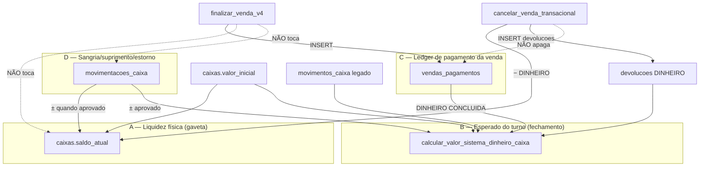

# Mapa de autoridade do caixa

**Data:** 2026-07-18  
**Ambiente auditado:** jinlong (`kbabmewnahysfvlybiak`) — defs live via `pg_get_functiondef`  
**Escopo:** quem **escreve** `caixas.saldo_atual`, `movimentacoes_caixa`, `vendas_pagamentos`  
**Não inclui:** correção de bug (só mapa)

---

## 1. Três conceitos paralelos (não são a mesma autoridade)

| Conceito | Campo / RPC | Papel declarado | Inclui venda DINHEIRO? |
|---|---|---|---|
| **A. Saldo físico** | `caixas.saldo_atual` | “Saldo físico atual (espécie) da sessão” (COMMENT mig. 045) | **Não** no path atual de venda |
| **B. Esperado** | `calcular_valor_sistema_dinheiro_caixa` | Valor esperado no fechamento | **Sim** (`vendas_pagamentos` + legado) |
| **C. Pagamentos** | `vendas_pagamentos` | Split / formas da venda | É a própria venda |
| **D. Mov. de caixa** | `movimentacoes_caixa` | Sangria / suprimento / estorno | **Não** (venda ≠ sangria) |

**Consequência estrutural (já observada na Missão 4.2):** cancelamento DINHEIRO decrementa **A**, enquanto a venda só alimenta **B** via **C**. Se **A** não acompanhou a venda, cancel falha com `CANCELAR_VENDA_SALDO_CAIXA_INSUFICIENTE`.

---

## 2. Autoridade de escrita — `caixas.saldo_atual`

### 2.1 Escritores oficiais (RPC live)

| RPC | Direção | Quando | App entry |
|---|---|---|---|
| `registrar_movimentacao` | `saldo += delta` | Status `aprovado`: suprimento dinheiro (+), sangria (−), estorno (inverso da origem) | `caixaMovimentacoes.impl.ts` → `registrarMovimentacaoImpl` |
| `aprovar_movimentacao` | `saldo += delta` | Aprova pendente e aplica o mesmo delta | `autorizarMovimentacaoGerenteImpl` (via **admin**/service_role) |
| `cancelar_venda_transacional` | `saldo -= estorno` | Parte DINHEIRO do cancel (split ou legado); guard `>= 0` | `caixaVendas.impl.ts` → `cancelarVendaImpl` |
| `devolver_ou_trocar_venda` | `saldo -=` (ABNT) | Estorno DINHEIRO de devolução/troca | (RPC produto; não mapeado no PDV web neste audit) |
| `recalcular_saldo_caixa` | **overwrite** | `valor_inicial + Σ movimentacoes_caixa aprovadas` (**sem vendas**) | Só tipado em `database.types.ts`; **app PDV não chama** (existe em `backend/scripts/test-rls-scope.mjs`) |

### 2.2 Quem **não** escreve `saldo_atual` (live)

| RPC / fluxo | Observação |
|---|---|
| `finalizar_venda_transacional_canonica_v4` | Escreve `vendas_pagamentos`; **zero** menção a `saldo_atual` / `UPDATE caixas` |
| `fechar_caixa_atomico` / `fechar_caixa_pdv_atomico` | Atualiza status/fechamento; **não** atribui `saldo_atual` |
| `calcular_valor_sistema_dinheiro_caixa` | **Somente leitura** (agrega esperado) |
| `estornar_movimentacao` | Delega a `registrar_movimentacao` (não UPDATE direto em `caixas`) |
| `cancelar_movimentacao` | Só status da mov.; **não** mexe em saldo |

### 2.3 Abertura de caixa (INSERT `caixas`)

| Writer | O que grava | `saldo_atual` |
|---|---|---|
| `abrirCaixaOperadorImpl` | `insert({ operador_id, loja_id, valor_inicial, status })` | Default DB `0` — **não** inicializa com `valor_inicial` |

Ou seja: após abrir com fundo R$300, `valor_inicial=300` e `saldo_atual=0` até alguma mov. aprovada / recalc / cancel / devolução.

### 2.4 Histórico de backfill (migração, não fluxo contínuo)

- Mig. **045**: backfill `saldo_atual = valor_inicial + vendas DINHEIRO legado + movimentos_caixa legado`.
- Mig. **212**: restaura tabela vazia `movimentos_caixa` (legado); “nenhum fluxo novo escreve aqui”.

### 2.5 Superfície RLS / grants (risco)

| Tabela | Policies | Grants `authenticated` |
|---|---|---|
| `caixas` | SELECT/INSERT/UPDATE/DELETE | INSERT/UPDATE/DELETE concedidos |
| App produção | Abre caixa via INSERT; fecha via RPC | **UPDATE direto de `saldo_atual` não é path oficial** (só testes: `cancelarVendaContrato.integration.test.ts` seeda saldo) |

---

## 3. Autoridade de escrita — `movimentacoes_caixa`

### 3.1 Escritores oficiais (RPC live)

| RPC | Operação | Efeito em `saldo_atual` |
|---|---|---|
| `registrar_movimentacao` | **INSERT** linha (`pendente` ou `aprovado`) | Se `aprovado`: aplica delta |
| `aprovar_movimentacao` | **UPDATE** `pendente` → `aprovado` | Aplica delta na aprovação |
| `cancelar_movimentacao` | **UPDATE** status → `cancelado` | Nenhum |
| `estornar_movimentacao` | Chama `registrar_movimentacao` tipo `estorno` | Via registrar |

### 3.2 Quem **não** escreve

| Fluxo | |
|---|---|
| Venda / cancelamento / devolução | Não INSERT em `movimentacoes_caixa` |
| App TypeScript | **Zero** `.from('movimentacoes_caixa').insert/update` — só SELECT + RPC |
| RLS | Apenas policy **SELECT** (`movimentacoes_caixa_select_loja`); writes passam por SECURITY DEFINER das RPCs |

### 3.3 Leitores / consumidores

- UI PDV: `obterMovimentacoesCaixaImpl`, realtime `useMovimentacoesRealtime`
- Esperado: CTE `mov_tx` em `calcular_valor_sistema_dinheiro_caixa`
- Fechamento: bloqueia se há mov. `pendente` (`fechar_caixa_*`)
- Dashboard gerente / atividades: SELECT

### 3.4 Domínio

Tipos: `suprimento` | `sangria` | `estorno`  
Formas: `dinheiro` | `pix` | `cartao_*` | `outro`  
Sangria só dinheiro. Idempotência `(caixa_id, idempotency_key)`.

---

## 4. Autoridade de escrita — `vendas_pagamentos`

### 4.1 Único INSERT em RPC live

| RPC | Operação | App |
|---|---|---|
| `finalizar_venda_transacional_canonica_v4` | **INSERT** (split `p_pagamentos` ou forma única); upsert por `(venda_id, forma)` em overloads recentes | `caixaVendas.impl.ts` |

Nenhuma outra função `public` no banco jinlong contém `INSERT INTO vendas_pagamentos` (auditoria live).

### 4.2 Quem **não** muta pagamentos

| Fluxo | Comportamento |
|---|---|
| `cancelar_venda_transacional` | **Lê** pagamentos para calcular estorno; **não DELETE/UPDATE** linhas |
| App TypeScript | Sem insert/update/delete direto em `vendas_pagamentos` |
| RLS | SELECT + INSERT por loja; **sem** policy UPDATE/DELETE (writes diretos autenticados ficam bloqueados por RLS mesmo com GRANT) |

### 4.3 Efeitos colaterais de INSERT

- **jinlong (live):** tabela `venda_finance_context` **ausente**; **nenhum** trigger em `vendas_pagamentos`. INSERT de pagamento não dispara espelho financeiro neste ambiente.
- **Repo (mig. 252):** prevê trigger `trg_finance_context_pagamento` → espelho passivo (não escreve caixa). Drift: migração no repo, não aplicada no jinlong.

### 4.4 Consumidores

- `calcular_valor_sistema_dinheiro_caixa` (DINHEIRO + venda CONCLUIDA)
- Resumo de turno (`caixaTurnoResumo.impl.ts`)
- Cancel / auditoria (soma por forma)
- Relatórios de consistência (`verificar_consistencia_venda`, etc.)

---

## 5. Matriz evento × efeitos

| Evento operacional | `saldo_atual` | `movimentacoes_caixa` | `vendas_pagamentos` | Esperado (B) |
|---|---|---|---|---|
| Abrir caixa | default `0` | — | — | +`valor_inicial` |
| Venda DINHEIRO | **—** | **—** | **INSERT** | **+valor** |
| Venda PIX/cartão | — | — | INSERT | — (não entra no esperado dinheiro) |
| Sangria/suprimento aprovado | ± | INSERT/UPDATE | — | ± |
| Sangria pendente | — | INSERT pendente | — | — |
| Aprovar sangria | − | UPDATE aprovado | — | − |
| Estornar mov. | ± | INSERT estorno | — | ± |
| Cancelar venda DINHEIRO | **−** (exige saldo≥) | — | **preserva** | −venda (−devolucao) |
| Devolver/trocar DINHEIRO | − | — | preserva | − via `devolucoes` |
| Fechar caixa | — (não recalcula) | lê pendentes | lê indireto via esperado | usado na conferência |
| `recalcular_saldo_caixa` | overwrite = VI+movs | lê | **ignora** | n/a |

---

## 6. Cadeia de autoridade (quem manda o quê)

| Pergunta | Autoridade |
|---|---|
| “Quanto entrou por forma nesta venda?” | **`vendas_pagamentos`** (C) — escrita só na finalização v4 |
| “Quanto a gaveta deveria ter agora (fechamento)?” | **`calcular_valor_sistema_dinheiro_caixa`** (B) — derivado |
| “Quanto a gaveta física está no contador interno?” | **`caixas.saldo_atual`** (A) — sangria/suprimento + cancel/devolução; **não** venda |
| “Houve sangria/suprimento?” | **`movimentacoes_caixa`** (D) — única fonte; alimenta A e B |
| “Fundo de abertura?” | **`caixas.valor_inicial`** — imutável no fluxo normal pós-INSERT |

**Não há uma única SSoT de “saldo do caixa”.** Há um contador físico (A) e um esperado derivado (B) com conjuntos de entradas diferentes.

---

## 7. Superfície app (pdv-importados) — sem mutação direta

| Arquivo | Papel |
|---|---|
| `caixaSessaoOperador.impl.ts` | INSERT `caixas` (abertura); RPC `fechar_caixa_atomico` |
| `caixaVendas.impl.ts` | RPC `finalizar_venda_transacional_canonica_v4`; RPC `cancelar_venda_transacional` |
| `caixaMovimentacoes.impl.ts` | RPC registrar/aprovar/cancelar/estornar; SELECT movs |
| `caixaFechamentoServer.ts` | RPC `calcular_valor_sistema_dinheiro_caixa` (leitura) |
| `caixaTurnoResumo.impl.ts` | SELECT `vendas_pagamentos` / caixas |
| `pdv-local` | Sem referências a estes três nomes |

---

## 8. Fricções de modelo (para decisão futura — não corrigir aqui)

1. **Venda não incrementa A; cancel decrementa A** → BUG-4.2-01.  
2. **`recalcular_saldo_caixa` ≠ fórmula do esperado (B)** — recalc = VI+movs; esperado = VI+vendas+movs−devoluções(+legado). Recalc **apaga** contribuição implícita de vendas no saldo se alguém rodasse após backfill antigo.  
3. **Abertura:** `valor_inicial` no esperado, mas `saldo_atual` nasce 0.  
4. **Dupla via de “dinheiro no turno”:** B usa pagamentos; A usa contador — UI/fechamento fala em B; cancel fala em A.  
5. **Grants amplos em `caixas`** vs escritas oficiais só via RPC — path de UPDATE direto existe no papel RLS, não no app.

---

## 9. Fontes

- Live: `pg_proc` / `pg_policies` / `pg_trigger` em jinlong  
- Repo: mig. 045, 046, 049/116, 051, 212, 229, 248, 252, 268; `caixa*.impl.ts`  
- Evidência ops: Missão 4.1/4.2 (`missao4_*_ops_*.md`)

**Próximo passo (quando houver ordem):** escolher autoridade única para estorno DINHEIRO (alinhar A↔B ou fazer venda alimentar A) — fora deste documento.
