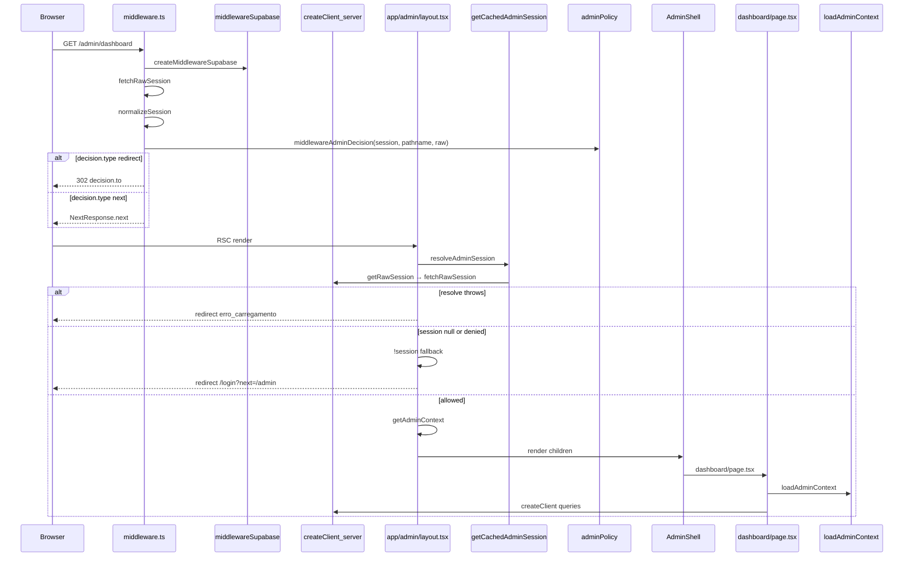

# Relatório de Auditoria Estrutural — Auth `/admin`

Escopo: [`pdv-importados`](../pdv-importados) — segmento `/admin` e dependências diretas (middleware matcher, APIs `/api/gerente/*` consumidas pelo admin, libs `lib/admin/*`).

Data de referência: código no workspace em 2026-06-07. Único `layout.tsx` com gate em `app/admin/`; diretórios `(classic)` e `(v2)` **não existem no disco** (listagem `app/admin/`: apenas rotas planas + `_components`).

Relacionado: [ADMIN_AUTH_STABILITY_CHECKPOINT.md](./ADMIN_AUTH_STABILITY_CHECKPOINT.md).

---

## 0. Autoridade formal do sistema (modelo convergido)

### 0.1 Fonte única de verdade

[`lib/admin/policy/adminPolicy.ts`](../pdv-importados/lib/admin/policy/adminPolicy.ts) é a **única** camada com regras de permissão para `/admin`.

Todo consumidor recebe um objeto unificado:

```ts
type Decision = {
  type: 'allow' | 'redirect' | 'deny'
  target: string | null   // URL de redirect ou null
  reason: string
  scope: 'edge' | 'api' | 'action' | 'resource'
}
```

| Adapter | Função | Escopo | Quem consome |
|---------|--------|--------|--------------|
| Edge | `middlewareAdminDecision` | `edge` | `middleware.ts` |
| API | `apiAdminDecision` | `api` | `requireAdminSessionApi`, `requireAdminContextApi` |
| Action | `actionAdminDecision` | `action` | `assertAdminSession` |

Regras internas (`canAccessAdmin`, `canExecuteAction`, `canAccessResource`) **não** são chamadas por middleware, layout ou pages — apenas pelos adapters acima e por `adminContext` (agregação de `permissions`, sem gate).

### 0.2 Responsabilidades por camada

| Camada | Pode | Não pode |
|--------|------|----------|
| **middleware.ts** | extrair sessão; chamar `middlewareAdminDecision`; executar redirect via `decision.target` | role/rota/permissão inline |
| **app/admin/layout.tsx** | consumir sessão; fallback `!session` para render; agregar `getAdminContext` | `layoutAdminDecision`, import de `adminPolicy`, duplicar edge |
| **app/admin/**/page.tsx** | assumir acesso validado upstream; `loadAdminContext` para contexto | recalcular autorização |
| **app/gerente/** | domínio legacy separado (`assertGerenteOuDono`, `getUsuarioAtual`) | importar `adminPolicy` |
| **SessionIdleLogout** | UX de logout idle no cliente | gate de segurança SSR |

### 0.3 Domínios de autoridade (mapa único)

```
edge (/admin, /gerente rotas)  → middlewareAdminDecision → adminPolicy
/gerente actions               → assertGerenteSession → gerenteAdminDecision → adminPolicy
/admin actions                 → assertAdminSession → actionAdminDecision → adminPolicy
/admin API                     → requireAdminSessionApi → apiAdminDecision → adminPolicy
cliente (UX)                   → SessionIdleLogout — fora da autoridade SSR
```

Adapter `/gerente`: [`lib/gerente/auth/gerenteAdapter.ts`](../pdv-importados/lib/gerente/auth/gerenteAdapter.ts) — `scope: 'gerente'`, sem regras próprias.

---

## 1. Pontos de decisão de auth (lista completa)

### 1.1 Middleware — [`middleware.ts`](../pdv-importados/middleware.ts)

**Versão congelada (thin adapter):** `fetchRawSession` → `normalizeSession` → `middlewareAdminDecision` → redirect | next.

Matcher: `['/admin/:path*', '/gerente/:path*', '/caixa/:path*']`

Infra edge (cookies Supabase): [`lib/admin/auth/middlewareSupabase.ts`](../pdv-importados/lib/admin/auth/middlewareSupabase.ts).

| # | Condição (código) | Efeito | Usa `adminPolicy`? |
|---|-------------------|--------|-------------------|
| M0 | `configOk: false` && rota protegida | `Decision.redirect` → `/login?next=...` (`reason: supabase_config_missing`) | **Sim** |
| M1 | `raw.status === 'stale'` | redirect `/login?next=...` | **Sim** (`middlewareAdminDecision` + `{ raw }`) |
| M2 | `raw.status === 'auth_error'` && protegida | redirect `/login?next=...` | **Sim** |
| M3 | `raw.status === 'db_error'` && protegida | redirect `/login?next=...` | **Sim** |
| M4 | protegida && `raw.status !== 'authenticated'` | redirect `/login?next=...` | **Sim** |
| M5 | painel (`/admin`, `/gerente`) && sessão não gerencial | redirect `/caixa` | **Sim** |
| M6 | `/caixa` && perfil gerencial | redirect `/gerente` | **Sim** |
| M7 | demais casos | `NextResponse.next()` (cookies refresh) | — |

Leitura de sessão: `createMiddlewareSupabase(req)` → `fetchRawSession(supabase)` → `normalizeSession(raw)` → `middlewareAdminDecision(session, pathname, { raw })`.

`middlewareAdminDecision` retorna `Decision` com `scope: 'edge'`. Middleware só interpreta `type === 'redirect'` + `target`. Sem Supabase, sem `NextResponse`.

---

### 1.2 Layout UI — [`app/admin/layout.tsx`](../pdv-importados/app/admin/layout.tsx)

Segment config: `dynamic = 'force-dynamic'`, `fetchCache = 'force-no-store'`, `revalidate = 0`.

| # | Condição | Efeito | Usa `adminPolicy`? |
|---|----------|--------|-------------------|
| L1 | `resolveAdminSession()` lança | `redirect('/login?reason=erro_carregamento')` | Não |
| L2 | `!session` (fallback renderização) | `redirect('/login?next=/admin')` | **Não** — segurança de render, não permissão |
| L3 | sessão presente | render `AdminShell` com `adminContext.session` | Não (autorização já no edge) |

Leitura de sessão: `resolveAdminSession()` = re-export de `getCachedAdminSession` ([`resolveAdminSession.ts`](../pdv-importados/lib/admin/auth/resolveAdminSession.ts)).

Agregação pós-gate: `getAdminContext(session, { pathname: '/admin', resource: 'route:/admin' })` — **não decide acesso** ([`adminContext.ts`](../pdv-importados/lib/admin/context/adminContext.ts) L91–94).

---

### 1.3 Página índice admin — [`app/admin/page.tsx`](../pdv-importados/app/admin/page.tsx)

| # | Condição | Efeito | Auth? |
|---|----------|--------|-------|
| P0 | sempre | `redirect('/admin/dashboard')` | **Não** (navegação interna) |

---

### 1.4 Server actions em `/admin`

| Arquivo | Função exportada | Guard | Policy |
|---------|------------------|-------|--------|
| [`app/admin/estoque/actions.ts`](../pdv-importados/app/admin/estoque/actions.ts) | `obterKardexProduto` | `assertAdminSession('estoque:kardex', { pathname, resource })` | `canAccessAdmin` + `canExecuteAction` |
| [`app/admin/vendas/actions.ts`](../pdv-importados/app/admin/vendas/actions.ts) | `obterDetalheVenda` | `assertAdminSession('vendas:detalhe', { pathname, resource })` | idem |

Negação: retorno vazio (`[]` / `null`) — **sem redirect**, **sem 401**.

---

### 1.5 API routes (`/api/gerente/*` usadas pelo admin)

| Arquivo | Guard | Policy | Resposta negação |
|---------|-------|--------|------------------|
| [`app/api/gerente/health/route.ts`](../pdv-importados/app/api/gerente/health/route.ts) | `requireAdminContextApi({ resource: 'api:gerente:health' })` | `apiAdminDecision` | `401 JSON` |
| [`app/api/gerente/atividades/recent/route.ts`](../pdv-importados/app/api/gerente/atividades/recent/route.ts) | `requireAdminSessionApi('api:gerente:atividades:recent')` | `apiAdminDecision` | `401 JSON` |
| [`app/api/gerente/atividades/history/route.ts`](../pdv-importados/app/api/gerente/atividades/history/route.ts) | `requireAdminSessionApi('api:gerente:atividades:history')` | `apiAdminDecision` | `401 JSON` |
| [`app/api/gerente/fila/status/route.ts`](../pdv-importados/app/api/gerente/fila/status/route.ts) | `requireAdminSessionApi('api:gerente:fila:status')` | `apiAdminDecision` | `401 JSON` |
| [`app/api/gerente/notificacoes/count/route.ts`](../pdv-importados/app/api/gerente/notificacoes/count/route.ts) | `requireAdminSessionApi('api:gerente:notificacoes:count')` | `apiAdminDecision` | `401 JSON` |

---

### 1.6 Páginas `/admin` — leitura de sessão / contexto

| Página | Auth explícita no arquivo | Observação |
|--------|---------------------------|------------|
| `dashboard/page.tsx` | `loadAdminContext({ pathname, resource })` | também `createClient()` para queries |
| `catalogo/page.tsx` | `loadAdminContext({ pathname, resource })` | dados via actions gerente |
| `configuracoes/page.tsx` | **nenhuma** | só `createClient()` |
| `financeiro/page.tsx` | **nenhuma** | só `createClient()` |
| `estoque/page.tsx` | **nenhuma** | chama `@/app/gerente/*` actions |
| `vendas/page.tsx` | **nenhuma** | chama `@/app/gerente/*` actions |
| `comissoes/page.tsx` | **nenhuma** | gerente actions |
| `relatorios/page.tsx` | **nenhuma** | gerente actions |
| `suspensao/page.tsx` | **nenhuma** | gerente actions |
| `categorias-financeiras/page.tsx` | **nenhuma** | gerente actions |
| `categorias-produtos/page.tsx` | **nenhuma** | gerente actions |

Todas herdam gate de [`app/admin/layout.tsx`](../pdv-importados/app/admin/layout.tsx).

---

### 1.7 Helpers indiretos (fora de `lib/admin` mas no fluxo `/admin`)

| Arquivo | Papel no fluxo admin | Decisão auth? |
|---------|---------------------|---------------|
| [`lib/admin/auth/sessionConsistency.ts`](../pdv-importados/lib/admin/auth/sessionConsistency.ts) | `fetchRawSession`, `normalizeSession`, `getCachedAdminSession` | Normalização; `null` se não gerencial |
| [`lib/admin/auth/middlewareSupabase.ts`](../pdv-importados/lib/admin/auth/middlewareSupabase.ts) | `createMiddlewareSupabase`, `isSupabaseConfigOk` | Cookies edge; sem decisão de rota |
| [`lib/supabase/server.ts`](../pdv-importados/lib/supabase/server.ts) | `createClient()` → `cookies()` | Leitura JWT SSR |
| [`lib/auth/staleSession.ts`](../pdv-importados/lib/auth/staleSession.ts) | `clearStaleSessionIfNeeded` em `fetchRawSession` | Limpa stale; não redireciona |
| [`lib/auth/usuarioAtual.ts`](../pdv-importados/lib/auth/usuarioAtual.ts) | `getUsuarioAtual` cacheado | **Não referenciado** em `app/admin/**` |
| [`lib/auth/painelGerencial.ts`](../pdv-importados/lib/auth/painelGerencial.ts) | `isPerfilPainelGerencial` | Usado em `adminPolicy` e `normalizeSession` |
| [`components/security/SessionIdleLogout.tsx`](../pdv-importados/components/security/SessionIdleLogout.tsx) | montado em `AdminShell` | logout cliente → `/login?reason=sessao_inatividade` |
| [`lib/auth/clientLogout.ts`](../pdv-importados/lib/auth/clientLogout.ts) | `performClientLogout` | signOut + POST `/auth/signout` |
| [`app/auth/signout/route.ts`](../pdv-importados/app/auth/signout/route.ts) | POST signout | limpa cookies `sb-*-auth-token` |
| `@/app/gerente/**/actions` | chamadas por pages/components admin | **auth própria do módulo gerente** |

---

## 2. Mapa de chamadas `adminPolicy`

### 2.1 Definições — [`lib/admin/policy/adminPolicy.ts`](../pdv-importados/lib/admin/policy/adminPolicy.ts)

Funções exportadas: `canAccessAdmin`, `canExecuteAction`, `canAccessResource`, `canAccessRoute`, `middlewareAdminDecision`, `middlewareAllowsAccess`, `apiAdminDecision`, `actionAdminDecision`, `toPolicyDecision`, tipo `Decision`.

Tipos: `AdminPolicyDecision`, `MiddlewareDecision`.

### 2.2 Consumidores (arquivo → função → tipo)

| Arquivo | Função policy chamada | Tipo |
|---------|----------------------|------|
| `middleware.ts` | `middlewareAdminDecision` | **adapter** (decision object) |
| `app/admin/layout.tsx` | *(nenhum)* | fallback `!session` apenas |
| `lib/admin/auth/assertAdminSession.ts` | `canAccessAdmin`, `canExecuteAction` | **direta** |
| `lib/admin/auth/requireAdminSessionApi.ts` | `apiAdminDecision` | **adapter** (×2) |
| `lib/admin/context/adminContext.ts` | `canAccessAdmin`, `canExecuteAction`, `canAccessResource` | **direta** (agregação) |
| `lib/admin/policy/adminPolicy.test.ts` | `canAccessAdmin`, `canExecuteAction`, `canAccessResource` | teste unitário |
| `tests/admin-policy-consistency.test.ts` | `middlewareAdminDecision`, `apiAdminDecision`, `actionAdminDecision` | teste convergência |

### 2.3 Cadeia interna dos adapters

```
middlewareAdminDecision(+ raw) → canAccessAdmin / isProtectedRoute / isPainelWeb / isCaixaWeb
middlewareAllowsAccess → middlewareAdminDecision (sem raw, alinhamento booleano)
apiAdminDecision → canAccessAdmin (+ canAccessResource se resource)
actionAdminDecision → canAccessAdmin (+ canExecuteAction se action)
canExecuteAction → canAccessAdmin → isPerfilPainelGerencial
canAccessResource → canAccessAdmin → isPerfilPainelGerencial
```

`toPolicyDecision`: **definida, sem consumidores** em produção.

---

## 3. Fluxo real de request `GET /admin/dashboard`



**Ordem literal (request bem-sucedida):**
1. `middleware.ts` — thin adapter + policy
2. `app/admin/layout.tsx` — `resolveAdminSession` → fallback `!session` → `getAdminContext`
3. `app/admin/_components/AdminShell.tsx` — render (sem gate)
4. `app/admin/dashboard/page.tsx` — `loadAdminContext` → `createClient`

---

## 4. Pontos de divergência potenciais

### 4.1 Sessão lida sem `normalizeSession` no consumidor

| Local | Evidência |
|-------|-----------|
| `getCachedAdminSession` / `resolveAdminSession` | encapsula `normalizeSession(getRawSession())` |
| `loadAdminContext` / `getAdminSession` | dependem de `getCachedAdminSession` |
| Páginas com só `createClient()` | não re-leem perfil; confiam no layout gate + RLS |
| `getUsuarioAtual` | ausente em `app/admin/**` |

### 4.2 Policy fora dos adapters oficiais

| Local | Funções | Natureza |
|-------|---------|----------|
| `assertAdminSession.ts` | `canAccessAdmin`, `canExecuteAction` | direta |
| `adminContext.ts` | `canAccessAdmin`, `canExecuteAction`, `canAccessResource` | direta (agregação) |

### 4.3 Decisões de auth fora de middleware / layout / API guard

| Local | Tipo | Evidência |
|-------|------|-----------|
| `middleware.ts` M0 | redirect `/login` (config env) | fora de `adminPolicy` |
| `middleware.ts` M1–M6 | redirects via `middlewareAdminDecision` | **dentro de policy** |
| `SessionIdleLogout.tsx` | client redirect inatividade | fora dos gates SSR |
| `assertAdminSession` negação | `{ ok: false }` | não redirect/401 |
| `@/app/gerente/**/actions` | guards gerente | segundo sistema |

### 4.4 Redirects/401 fora do conjunto esperado

| Arquivo | Comportamento | Classificação |
|---------|---------------|---------------|
| `app/admin/page.tsx` | redirect `/admin/dashboard` | não-auth |
| `app/auth/signout/route.ts` | 200 JSON | término de sessão |
| APIs negação | `401` via require helpers | conforme |

Allowlist estrutural: [`tests/admin-auth-resilience.test.ts`](../pdv-importados/tests/admin-auth-resilience.test.ts) — redirect auth = `middleware.ts`, `app/admin/layout.tsx`.

### 4.5 `pathname` / `resource` inconsistentes

| Camada | Valor para `/admin/dashboard` |
|--------|-------------------------------|
| middleware | `pathname` real da request |
| layout | fixo `pathname: '/admin'`, `resource: 'route:/admin'` |
| dashboard page | `pathname: '/admin/dashboard'`, `resource: 'route:/admin/dashboard'` |

Layout não avalia pathname. `middlewareAdminDecision` usa pathname real no edge.

### 4.6 Cobertura parcial de guards em APIs

1/5 rotas usa `requireAdminContextApi`; 4/5 usam `requireAdminSessionApi` — ambos chamam `apiAdminDecision`.

---

## 5. Classificação de invariantes

### 5.1 Garantido por código

| Invariante | Evidência |
|------------|-----------|
| Único `app/admin/layout.tsx` com gate UI | 1 `layout.tsx` no disco |
| `resolveAdminSession` = `getCachedAdminSession` | `resolveAdminSession.ts` L2 |
| Middleware thin adapter | `middleware.ts`: fetch → normalize → `middlewareAdminDecision` |
| Decisões M1–M6 em `adminPolicy` (com `{ raw }`) | `adminPolicy.ts` `middlewareAdminDecision` |
| Redirect auth UI só em `layout.tsx` | grep `app/admin` |
| `AdminShell` sem `redirect`/`cookies` | teste resilience |
| `adminPolicy` sem Supabase/redirect | só `AdminSession` / `RawSession` in |
| `getAdminContext` sem Supabase/redirect | `adminContext.ts` L91–94 |

### 5.2 Garantido por teste (vitest)

| Invariante | Arquivo |
|------------|---------|
| Pipeline `middleware -> layout -> shell -> page` | `tests/admin-auth-resilience.test.ts` |
| Middleware thin adapter + layout `AdminSession` gate | `tests/admin-auth-resilience.test.ts` (11 testes no arquivo) |
| `cookies()` restrito | idem |
| redirect auth restrito middleware+layout | idem |
| `canAccessAdmin === middleware === layout === api` | `tests/admin-policy-consistency.test.ts` |
| operador → redirect `/caixa` via policy | `tests/admin-policy-consistency.test.ts` |
| sessão idêntica edge/SSR/action | `lib/admin/auth/sessionConsistency.test.ts` |
| concorrência / pós-logout | `tests/admin-auth-concurrency.test.ts` |
| `getAdminContext(A) === getAdminContext(B)` | `tests/admin-context-consistency.test.ts` |
| `normalizeSession` idempotente | `sessionConsistency.test.ts` |
| `resolveAdminSession` null/gerente/operador | `resolveAdminSession.test.ts` |
| Actions `/gerente/**` passam por `adminPolicy` | `tests/admin-gerente-authority.test.ts` |
| `/gerente/**` sem `assertGerenteOuDono` / `getUsuarioAtual` (auth) | `tests/admin-gerente-authority.test.ts`, `admin-auth-resilience.test.ts` |
| Edge/SSR produzem contrato equivalente | `tests/admin-edge-ssr-equivalence.test.ts` |
| `normalizeAdminSession` é única transformação | `sessionConsistency.test.ts`, `admin-auth-resilience.test.ts` |

### 5.3 Não garantido

| Invariante | Motivo |
|------------|--------|
| Todas as páginas chamam `loadAdminContext` | só `dashboard` e `catalogo` |
| APIs usam mesmo helper | 4/5 `requireAdminSessionApi` |
| `pathname`/`resource` alinhados entre camadas | seção 4.5 |
| M0 (config env) em `adminPolicy` | permanece em `middlewareSupabase` |
| Dedup `getUser` por request Next RSC | vitest parcial |
| `SessionIdleLogout` coordenado com gates SSR | redirect cliente independente |
| Paridade `assertAdminSession` vs adapters | assert usa funções diretas |
| `toPolicyDecision` em produção | sem consumidores |
| Route groups `(classic)` / `(v2)` | não existem no disco |

---

## 6. Inventário `lib/admin/*` (auth stack)

```
lib/admin/auth/types.ts
lib/admin/auth/sessionConsistency.ts
lib/admin/auth/middlewareSupabase.ts
lib/admin/auth/resolveAdminSession.ts
lib/admin/auth/getAdminSession.ts
lib/admin/auth/loadAdminContext.ts
lib/admin/auth/assertAdminSession.ts
lib/admin/auth/requireAdminSessionApi.ts
lib/admin/policy/adminPolicy.ts
lib/admin/context/adminContext.ts
lib/gerente/auth/gerenteAdapter.ts
lib/gerente/auth/assertGerenteSession.ts
lib/gerente/auth/sessionContext.ts
```

Exports: `lib/admin/auth/index.ts`, `lib/admin/policy/index.ts`, `lib/admin/context/index.ts`, `lib/gerente/auth/index.ts`.

---

## 7. Contagem de testes relacionados

- **8 arquivos** em `lib/admin/**` e `tests/admin-*`
- Suite completa: **292 testes** passando (vitest, 2026-06-07)
- Executar validação local:

```bash
cd pdv-importados
npm run test
npm run build
```

---

## 8. Consolidação — decisões centrais vs derivadas (confirmado no código)

### 8.1 Fonte central de decisão (`lib/admin/policy/adminPolicy.ts`)

| Função | Pergunta respondida | Consumidores oficiais |
|--------|---------------------|----------------------|
| `canAccessAdmin` | perfil gerencial + `userId`? | derivado por todos os adapters |
| `middlewareAdminDecision` | rota edge: allow / redirect? | `middleware.ts` (thin adapter) |
| `apiAdminDecision` | API: allow / deny? | `requireAdminSessionApi`, `requireAdminContextApi` |
| `actionAdminDecision` | action: allow / deny? | `assertAdminSession` (actions `/admin`) |
| `canAccessResource` | recurso nomeado permitido? | `adminContext` (agregação) |

Regra compartilhada: `isPerfilPainelGerencial` ([`lib/auth/painelGerencial.ts`](../pdv-importados/lib/auth/painelGerencial.ts)) — usada em `canAccessAdmin` e em `normalizeSession`.

### 8.2 Camadas derivadas (decisão duplicada, não removida)

#### A. Edge (autoridade) + Layout (fallback render)

| Camada | Papel | Leitura de sessão |
|--------|-------|------------------|
| Edge `middleware.ts` | **autorização** via `middlewareAdminDecision` → `Decision` | `fetchRawSession` (edge) |
| SSR `app/admin/layout.tsx` | **fallback** `!session` — sem `adminPolicy` | `resolveAdminSession` → `getCachedAdminSession` |

**Convergido:** layout não reavalia permissão. Se operador passar do edge (bug), `normalizeSession` retorna `null` e layout redireciona por ausência de `AdminSession`.

**Risco remanescente:** edge e SSR usam resolvers distintos; teste de concorrência cobre parcialmente.

#### B. Actions `@/app/gerente/**` (convergido em `adminPolicy`)

Páginas `/admin` que invocam actions gerente continuam importando os mesmos módulos (`catalogo` → `produtos/actions`, etc.). Guard unificado:

| Camada | Guard | Pipeline |
|--------|-------|----------|
| Actions gerente | `assertGerenteSession` | `getCachedAdminSession` → `gerenteAdminDecision` → `actionAdminDecision` |
| Layout gerente | fallback `!session` | `resolveAdminSession` — sem import de `adminPolicy` |
| Shim legacy | `assertGerenteOuDono` | `@deprecated` — delega a `assertGerenteSession` |

Identidade pós-auth: `getGerenteLojaId` / `getGerenteUserId` (não usados para decisão de acesso).

**Convergido (seção 10):** `/gerente/**` não decide acesso sozinho; `gerenteAdminDecision` apenas re-etiqueta `scope: 'gerente'` sobre as mesmas regras de `adminPolicy`.

#### C. Cliente — `SessionIdleLogout`

Montado em [`AdminShell`](../pdv-importados/app/admin/_components/AdminShell.tsx) → [`SessionIdleLogout.tsx`](../pdv-importados/components/security/SessionIdleLogout.tsx).

| Comportamento | Evidência |
|---------------|-----------|
| Timer idle no browser | `setTimeout` + eventos `keydown`/`mousedown`/`touchstart` |
| Logout | `performClientLogout()` → Supabase signOut + POST `/auth/signout` |
| Redirect | `location.assign('/login?reason=sessao_inatividade')` (L35) |

**Divergência confirmada:** término de sessão e redirect ocorrem no cliente, sem passar por `adminPolicy` (edge/api/action).

#### D. Actions nativas `/admin` (parcialmente alinhadas)

| Arquivo | Guard | Usa `adminPolicy`? |
|---------|-------|-------------------|
| `app/admin/estoque/actions.ts` | `assertAdminSession` | **Sim** (`canAccessAdmin` + `canExecuteAction`) |
| `app/admin/vendas/actions.ts` | `assertAdminSession` | **Sim** |

Demais dados do admin vêm de actions gerente (seção B), não de `assertAdminSession`.

### 8.3 Riscos reais (evidência no código, sem suposição de deploy)

| Risco | Evidência | Mitigação existente |
|-------|-----------|---------------------|
| Edge middleware libera, layout nega (ou inverso) | leituras Supabase distintas por runtime | `normalizeAdminSession` unifica contrato; `tests/admin-edge-ssr-equivalence.test.ts` |
| Action gerente aceita/nega diferente do edge | — | convergido via `getCachedAdminNormalization` + `gerenteAdminDecision` |
| Página admin sem `loadAdminContext` confia só no layout | `configuracoes`, `financeiro`, `estoque`, etc. — só `createClient()` ou actions gerente | layout gate + RLS Supabase |
| Idle logout redireciona com sessão SSR ainda válida até próxima navegação | `SessionIdleLogout` L35 independente dos gates SSR | nenhuma coordenação documentada no código |
| `pathname`/`resource` diferentes entre camadas | layout fixo `/admin`; pages usam path específico | layout não gateia por pathname — impacto só em `permissions` agregadas |
| M0 config env fora de policy | `isSupabaseConfigOk` em `middlewareSupabase.ts` | redirect login em rota protegida |

### 8.4 Invariantes estruturais reforçados (testes)

[`tests/admin-auth-resilience.test.ts`](../pdv-importados/tests/admin-auth-resilience.test.ts):

- middleware thin adapter: `fetchRawSession` → `normalizeSession` → `middlewareAdminDecision`
- `decision.type === 'redirect'` validado no source
- sem lógica inline de rota (`isPainelWeb`, `PREFIXOS_ROTAS_PAINEL_WEB`, redirects hardcoded `/caixa`/`/gerente`)
- layout: `!session` apenas + tipo `AdminSession`; sem import `adminPolicy`

---

---

## 9. Convergência de autoridade (estado atual)

| Invariante | Status | Evidência |
|------------|--------|-----------|
| `Decision { type, target, reason, scope }` central | ✓ | `adminPolicy.ts` |
| Middleware thin adapter | ✓ | `middleware.ts` — só `middlewareAdminDecision` + `decision.target` |
| Layout sem permissão | ✓ | `layout.tsx` — só `!session`; sem `@/lib/admin/policy` |
| API/action via Decision | ✓ | `apiAdminDecision`, `actionAdminDecision` |
| `/gerente/**` via `gerenteAdminDecision` | ✓ | `tests/admin-gerente-authority.test.ts` |
| Client não influencia SSR | ✓ | `SessionIdleLogout` — sem imports `lib/admin` |
| `layoutAdminDecision` removido | ✓ | não existe mais em produção |

---

## 10. Legacy elimination — `/gerente/**`

### 10.1 Diagnóstico (antes)

| Mecanismo legacy | Uso |
|------------------|-----|
| `assertGerenteOuDono` | 18 arquivos `actions.ts` + `shared/actionHelpers.ts` |
| `getUsuarioAtual` (auth/identidade) | 11 arquivos actions |
| `isPerfilPainelGerencial` | `app/gerente/layout.tsx`, `idioma/actions.ts` |

### 10.2 Estado após convergência

| Artefato | Papel |
|----------|-------|
| `gerenteAdminDecision` | Adapter → `actionAdminDecision` / `apiAdminDecision`, `scope: 'gerente'` |
| `assertGerenteSession` | Guard actions — `getCachedAdminSession` + policy |
| `getGerenteLojaId` / `getGerenteUserId` | Identidade pós-auth (não autorização) |
| `app/gerente/layout.tsx` | Fallback `!session` — sem policy import |
| `lib/auth/gerenteOuDono.ts` | Shim `@deprecated` → `assertGerenteSession` |

### 10.3 Removido de `/gerente/**`

- `assertGerenteOuDono` (uso direto)
- `getUsuarioAtual` para decisão de acesso
- `isPerfilPainelGerencial` em layout/actions gerente

### 10.4 Invariantes (testes)

- `tests/admin-gerente-authority.test.ts` — convergência gerente
- `tests/admin-auth-resilience.test.ts` — sem auth legacy em gerente

---

## 11. Edge/SSR convergence layer

### 11.1 Diagnóstico (antes)

| Ponto | Origem | Campos / comportamento | Risco de divergência |
|-------|--------|------------------------|----------------------|
| `fetchRawSession` | Edge (`middleware`) | `RawSession` bruto (status, user, usuario) | OK — só dados brutos |
| `getCachedAdminSession` | SSR (layout/actions) | `AdminSession \| null` via `normalizeSession` | Mesma função, mas pipeline separado |
| `middlewareAdminDecision` | Edge | Recebia `session` + `context.raw` — lia `raw.status` diretamente | **Divergência**: SSR não passava `raw` |
| `assertAdminSession` | SSR actions | `getCachedAdminSession` → `actionAdminDecision` | Alinhado se normalização idêntica |
| `requireAdminSessionApi` | SSR API | idem `apiAdminDecision` | Alinhado |
| `gerenteAdminDecision` | SSR gerente | `getCachedAdminSession` + policy | `assertGerenteSession` lia `getRawSession` para mensagem |

### 11.2 Contrato único (`lib/admin/auth/types.ts`)

```typescript
AdminSessionContract = {
  userId: string
  role: 'admin' | 'gerente' | 'owner'
  permissions: string[]
  source: 'edge' | 'ssr'  // metadado; não altera decisão
}

SessionNormalization = {
  contract: AdminSessionContract | null
  session: AdminSession | null      // compat UI/contexto
  authState: 'anonymous' | 'stale' | 'auth_error' | 'db_error' | 'authenticated'
  perfil: PerfilUsuario | null
  source: SessionSource
}
```

### 11.3 Pipeline unificado

```
fetchRawSession (edge)  ─┐
getRawSession (ssr)     ─┼→ RawSession
                         ↓
              normalizeAdminSession(raw, source)
                         ↓
              SessionNormalization
                         ↓
              adminPolicy → Decision
```

| Runtime | Leitura | Normalização | Policy |
|---------|---------|--------------|--------|
| Edge middleware | `fetchRawSession` | `normalizeAdminSession(raw, 'edge')` | `middlewareAdminDecision(normalized)` |
| SSR layout | `getCachedAdminSession` | via `getCachedAdminNormalization()` | fallback `!session` |
| SSR actions | `getCachedAdminSession` | cache único | `actionAdminDecision` / `gerenteAdminDecision` |
| SSR API | `getCachedAdminSession` | cache único | `apiAdminDecision` |

### 11.4 Regras eliminadas

- `middlewareAdminDecision` **não** lê `raw.status` — usa `normalized.authState`
- `resolvePerfilFromRaw` deprecado → delega `normalizeAdminSession`
- `normalizeSession` deprecado → delega `normalizeAdminSession(...).session`
- `assertGerenteSession` **não** chama `getRawSession` — usa `normalized.authState`

### 11.5 SessionIdleLogout

- Mantido como **UX only** (`performClientLogout` + redirect cliente)
- Redirect só após logout confirmado — não cria sessão SSR paralela
- Sem imports `lib/admin` — não altera autorização real

### 11.6 Invariantes (testes)

| Invariante | Arquivo |
|------------|---------|
| Contrato equivalente edge/ssr (exceto `source`) | `tests/admin-edge-ssr-equivalence.test.ts` |
| Decisão policy idêntica independente de origem | idem |
| Pipeline edge === SSR cacheado | idem + `sessionConsistency.test.ts` |
| Middleware usa `normalizeAdminSession` | `tests/admin-auth-resilience.test.ts` |
| `adminPolicy` sem `fetchRawSession` | `tests/admin-auth-resilience.test.ts` |

---

*Autoridade única: `adminPolicy.Decision` para `/admin` e `/gerente` (via adapters). Sessão: `normalizeAdminSession` → contrato único. Atualizado 2026-06-07.*
