# Auditoria Arquitetural — Jīn Lóng é orientado a quê?

> Terceiro documento da série. [MAPA_FLUXOS_JINLONG.md](./MAPA_FLUXOS_JINLONG.md) descreveu o
> fluxo implementado; [MODELO_DOMINIO_JINLONG.md](./MODELO_DOMINIO_JINLONG.md) modelou o ideal.
> Este audita a **arquitetura**, com evidência de código e de produção.
> 31/07/2026. Nenhuma linha de código de produção foi escrita para produzir este documento.

## Como as evidências foram obtidas

- Grafo de imports entre domínios: varredura de `from '@/app/...'` em `app/**` (script ad-hoc).
- Mapa de escrita: varredura de `.from('<tabela>').insert|update|delete|upsert`.
- Mapa de RPC: varredura de `.rpc('<nome>')`.
- Regra de negócio: leitura direta de `backend/supabase/migrations` (237 arquivos).
- Estado real: consultas de leitura ao Supabase de produção (`information_schema`, `pg_constraint`,
  `pg_trigger`, contagens).

Números de produção são de 31/07/2026 e refletem uma base de piloto (29 vendas, 112 produtos).
Onde o volume baixo enfraquece a conclusão, está dito.

---

# Parte 1 — Catálogo de eventos do domínio

## 1.1 O que existe hoje

Existe **um** ledger de eventos: `venda_eventos`, criado na migration
[`228_venda_eventos_ledger.sql`](../backend/supabase/migrations/228_venda_eventos_ledger.sql).
Vocabulário completo, direto do `CHECK`:

```sql
CHECK (event_type = ANY (ARRAY['SALE_REGISTERED', 'SALE_CANCELLED', 'SALE_PARTIAL_RETURN']))
```

Ocupação em produção:

| event_type | source | linhas |
|---|---|---|
| `SALE_REGISTERED` | `web_caixa` | 29 |
| `SALE_REGISTERED` | `backfill` | 25 |
| `SALE_CANCELLED` | `gerente_panel` | 5 |
| `SALE_CANCELLED` | `backfill` | 2 |
| `SALE_PARTIAL_RETURN` | — | **0** |

**Três eventos, um domínio.** Vendas emite; nenhum outro domínio emite nada. Produto, Estoque,
Recebimento, Compras, Caixa, Financeiro, Fiscal e Funcionários não têm ledger de eventos.

## 1.2 Catálogo completo — o que o negócio produz vs. o que o sistema registra

Legenda de **Registro**: `evento` = existe no ledger · `estado` = só muda uma coluna de status ·
`linha` = só insere numa tabela · `nada` = não deixa rastro próprio.

### Produtos

| Evento de negócio | Produz | Consome | Agregados | RPC / persistência | Telas que representam | Registro |
|---|---|---|---|---|---|---|
| ProdutoCriado | Catálogo, PDV (bip), NF-e | Estoque, PDV | Produto, Estoque | `criar_produto_com_estoque_inicial` ([270](../backend/supabase/migrations/270_criar_produto_com_estoque_inicial.sql)) | `/admin/catalogo` | linha |
| ProdutoAtualizado | Catálogo | Relatórios | Produto | `ProductUpdater` → `UPDATE produtos` | `/admin/catalogo` | linha |
| PrecoAlterado | Catálogo | PDV, Relatórios | Produto, HistóricoPreço | trigger `trg_historico_precos_produto` | `/admin/catalogo` | **evento** (tabela própria append-only) |
| ProdutoPublicado / Inativado | Catálogo | PDV | Produto | `ProductLifecycle` → `UPDATE status_publicacao` | `/admin/catalogo` | estado |
| FaixaAtacadoDefinida | Catálogo | PDV | PrecoAtacado | `INSERT precos_atacado` | modal do produto | linha |

### Compras e Recebimento

| Evento | Produz | Consome | Agregados | RPC / persistência | Telas | Registro |
|---|---|---|---|---|---|---|
| OrdemCompraCriada | Compras | Recebimento | OrdemCompra | `INSERT ordens_compra` ([actions.ts:300](../pdv-importados/app/gerente/compras/actions.ts)) | `/admin/compras` | linha |
| OrdemCompraConfirmada / EmTransito / Cancelada | Compras | Recebimento | OrdemCompra | `UPDATE status` ([actions.ts:406](../pdv-importados/app/gerente/compras/actions.ts)) | `/admin/compras` | estado |
| RecebimentoIniciado | Recebimento | — | Remessa | `INSERT remessas status='EM_CONFERENCIA'` ([actions.ts:118](../pdv-importados/app/gerente/recebimento/actions.ts)) | `/admin/estoque/recebimento` | linha |
| **RecebimentoConferido** | — | — | — | **não existe** | — | **nada** |
| RecebimentoConfirmado | Recebimento | Estoque, Financeiro | Remessa, Estoque | `confirmar_remessa_entrada` ([034](../backend/supabase/migrations/034_remessas_movimentos_transferencias.sql)) | `/admin/estoque/recebimento` | estado + linha |
| NFeImportada | Recebimento | Estoque, Produtos, Financeiro, Fornecedores | Importação, Produto, Estoque, ContaPagar | `importar_nfe_transacao` | `/admin/estoque/importar-nfe` | linha |
| OrdemCompraRecebida | Recebimento | Estoque, Compras | OrdemCompra, Estoque | `receber_ordem_compra` ([110](../backend/supabase/migrations/110_receber_ordem_compra.sql)) | `/admin/compras` | estado + linha |

### Estoque

| Evento | Produz | Consome | Agregados | RPC / persistência | Telas | Registro |
|---|---|---|---|---|---|---|
| EstoqueAjustado | Estoque | Relatórios | Estoque, MovimentoLog | `ajustar_estoque_manual` ([269](../backend/supabase/migrations/269_ajustar_estoque_manual_service_ator.sql)) | `/admin/estoque` | linha (log) |
| EstoqueTransferido | Estoque | Estoque (2 lojas) | Estoque×2, MovimentoLog×2 | `transferir_estoque_seguro` | `/admin/estoque/transferencias` | linha |
| EstoqueBaixadoPorVenda | Vendas | Estoque | Estoque, EstoqueBaixa, MovimentoLog | `decrementar_estoque_seguro` ([127](../backend/supabase/migrations/127_kardex_vendas_imutavel.sql)) | — (efeito interno) | linha |
| EstoqueInicialCriado | Produtos | Estoque | Estoque, MovimentoLog | `criar_produto_com_estoque_inicial` → delega a `ajustar_estoque_manual` | `/admin/catalogo` | linha (log) |

### Vendas e Caixa

| Evento | Produz | Consome | Agregados | RPC / persistência | Telas | Registro |
|---|---|---|---|---|---|---|
| VendaEmEspera | PDV | PDV | VendaEmEspera | `colocar_venda_em_espera` | `/caixa` | estado |
| **VendaFinalizada** | PDV | Estoque, Financeiro, Fiscal, Caixa, Comissões | Venda, Item, Pagamento, Estoque, ContaReceber, DocFiscal, Comissão | `finalizar_venda_transacional_canonica_v4` | `/caixa`, `/admin/vendas` | **evento** `SALE_REGISTERED` |
| **VendaCancelada** | Gerente | Estoque, Financeiro, Caixa, Auditoria | Venda, Estoque, ContaReceber, Caixa | `cancelar_venda_transacional` | `/admin/vendas`, `/caixa` | **evento** `SALE_CANCELLED` |
| DevolucaoRegistrada | Gerente | Estoque, Financeiro, Caixa | OperaçãoPósVenda, Estoque, Devolução, Caixa | `devolver_ou_trocar_venda` ([248](../backend/supabase/migrations/248_devolver_ou_trocar_venda.sql)) | `/admin/vendas` | **evento** `SALE_PARTIAL_RETURN` — nunca emitido em produção |
| CaixaAberto | Operador | Vendas | Turno | `INSERT caixas` ([cashSession.ts](../pdv-importados/app/caixa/server/cashSession.ts)) | `/caixa` | linha |
| SangriaRealizada / SuprimentoRealizado | Operador | Caixa | MovimentaçãoCaixa, Turno | `registrar_movimentacao` | `/caixa` | linha + estado |
| MovimentacaoAprovada | Gerente | Caixa | MovimentaçãoCaixa | `aprovar_movimentacao` | `/caixa` | estado |
| CaixaFechado | Operador | Relatórios | Turno | `fechar_caixa_atomico` | `/caixa` | estado |

### Financeiro e Fiscal

| Evento | Produz | Consome | Agregados | RPC / persistência | Telas | Registro |
|---|---|---|---|---|---|---|
| ContaReceberGerada | Vendas (pgto parcial) | Financeiro | ContaReceber | dentro de `finalizar_venda_..._v4` | `/admin/financeiro` | linha |
| ContaPagarGerada | Recebimento (duplicatas NF-e) | Financeiro | ContaPagar | dentro de `importar_nfe_transacao` | `/admin/financeiro` | linha |
| PagamentoRecebido | Financeiro | Caixa | ContaReceber, Liquidação | `registrar_liquidacao_receber` | `/admin/financeiro` | linha + estado |
| PagamentoEfetuado | Financeiro | — | ContaPagar, PagamentoPagar | `registrar_pagamento_contas_pagar` | `/admin/financeiro` | linha + estado |
| ContaPagarCancelada | Financeiro | — | ContaPagar | `UPDATE` direto ([payablePayment.ts:78](../pdv-importados/app/admin/financeiro/payablePayment.ts)) | `/admin/financeiro` | estado |
| DocumentoFiscalEnfileirado | Vendas | Fiscal | DocFiscal | dentro de `finalizar_venda_..._v4` | `/admin/financeiro?tab=fiscal` | linha |
| NFCeEmitida / Rejeitada | Worker fiscal | Fiscal | DocFiscal, EventoFiscal | worker externo + triggers `tr_documentos_fiscais_eventos_*` | `/admin/financeiro?tab=fiscal` | **evento** (tabela própria) |
| ComissaoRegistrada | Vendas | Funcionários | Comissão | **trigger** `trg_registrar_comissao` em `vendas` | `/admin/comissoes` | linha |

### Inventário

Nenhum evento. O domínio não existe (§8).

## 1.3 Leitura

Três padrões coexistem, e é isso que importa mais que a lista:

1. **Evento de verdade** — `venda_eventos`, `historico_precos_produto`,
   `documentos_fiscais_eventos`. Append-only, com `occurred_at`, idempotência e ator.
2. **Estado sem evento** — a maioria. O fato só existe como o valor atual de uma coluna.
   "Quando esta OC virou EM_TRANSITO e quem fez isso" é uma pergunta sem resposta.
3. **Efeito invisível** — comissão nasce de trigger; saldo de caixa é creditado por trigger.
   Nenhum evento, nenhuma linha de código na aplicação, nenhum rastro além do dado final.

---

# Parte 2 — Máquinas de estado

Estados reais, extraídos de `pg_constraint` em produção.

## 2.1 Produto

```sql
CHECK (status_publicacao = ANY (ARRAY['DRAFT', 'PUBLICADO', 'INATIVO']))
```

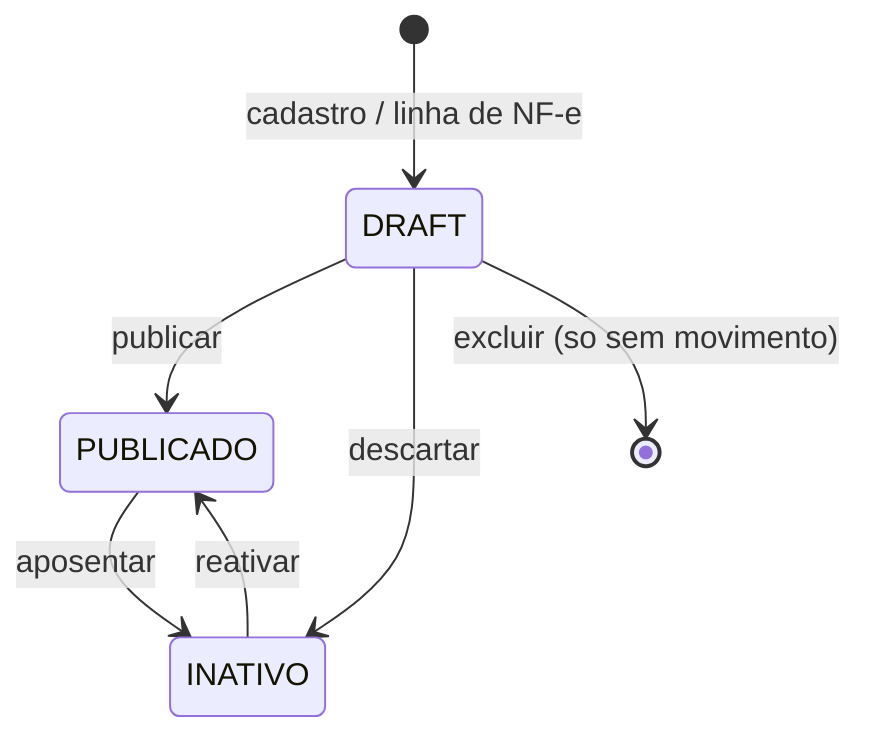

**Proibidas.** `INATIVO → DRAFT`. Excluir produto com venda ou movimento — barrado em
[`productExclusion.ts`](../pdv-importados/app/admin/produtos/productExclusion.ts).
**Regras.** Publicar exige preço; DRAFT recebe estoque mas não vende; inativar preserva histórico.
**Eventos emitidos.** Nenhum. Só `historico_precos_produto` quando o preço muda.

## 2.2 OrdemCompra

```sql
CHECK (status = ANY (ARRAY['RASCUNHO', 'CONFIRMADA', 'EM_TRANSITO', 'RECEBIDA', 'CANCELADA']))
```

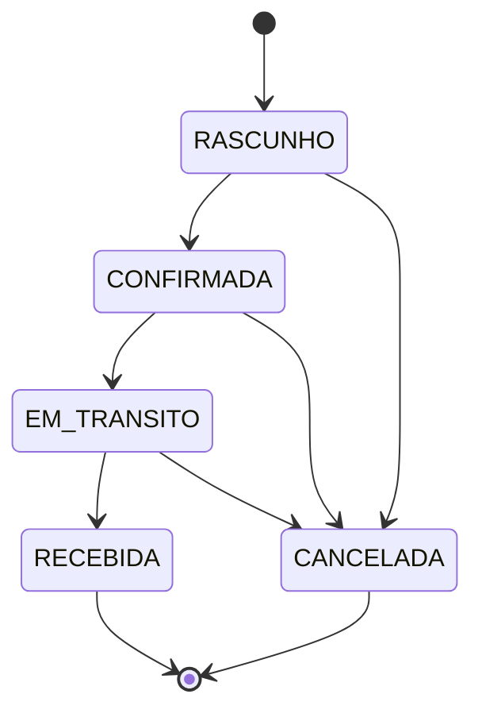

**Proibidas.** Qualquer saída de `RECEBIDA` ou `CANCELADA`; pular `CONFIRMADA`.
**Falta.** `PARCIALMENTE_RECEBIDA` não existe — recebimento parcial não tem representação.
**Onde a regra mora.** `STATUS_TRANSITIONS` em
[`compras/actions.ts:13`](../pdv-importados/app/gerente/compras/actions.ts) — **no cliente**,
conferido com um `SELECT` antes do `UPDATE`. O banco só valida o conjunto de valores, não a
transição. Duas sessões concorrentes passam pela mesma checagem.
**Eventos.** Nenhum.

## 2.3 Recebimento

```sql
CHECK (status = ANY (ARRAY['RASCUNHO', 'EM_CONFERENCIA', 'CONCLUIDA', 'CANCELADA']))
```

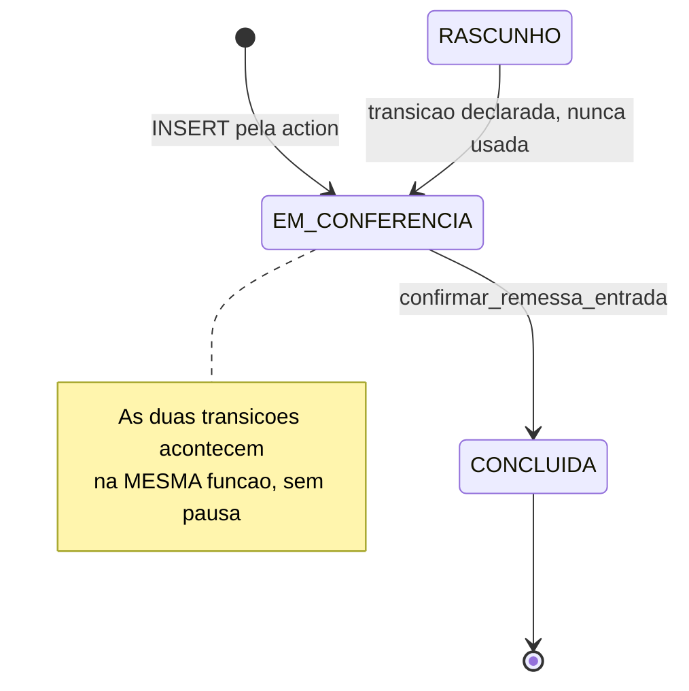

**Proibidas.** Não há `DIVERGENTE`. Não há como registrar que o conferido difere do esperado.
**Regra vigente.** `confirmar_remessa_entrada` usa
`COALESCE(quantidade_conferida, quantidade_esperada)` — **na ausência de contagem, dá entrada no
que a nota prometeu**. Combinado com a confirmação automática, o efeito é: o sistema credita o
esperado e grava que foi conferido.
**Produção.** `remessas` = 0 linhas.
**Eventos.** Nenhum.

## 2.4 Venda

```sql
CHECK (status = ANY (ARRAY['CONCLUIDA', 'CANCELADA']))
```

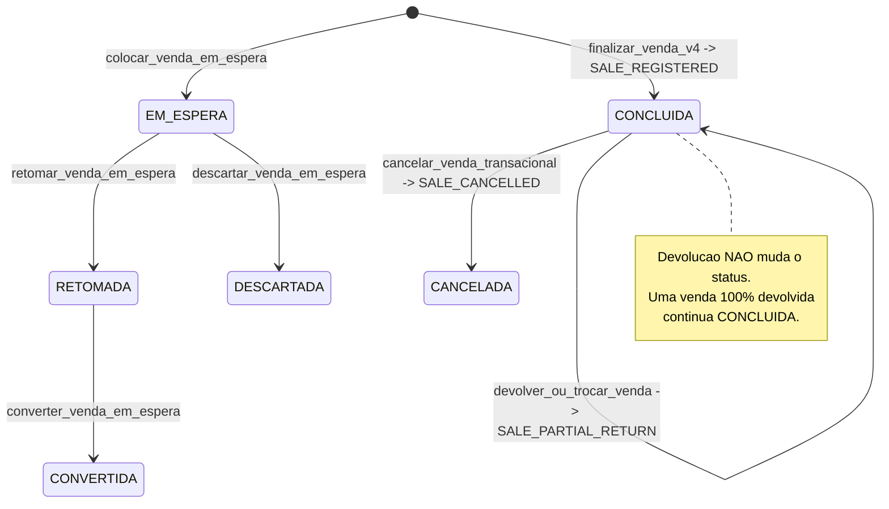

**Dois agregados, duas máquinas.** `vendas_em_espera` tem a sua
(`EM_ESPERA|RETOMADA|CONVERTIDA|DESCARTADA`) e `vendas` tem a sua. Correto — são coisas diferentes.
**Proibidas.** Sair de `CANCELADA`; finalizar sem caixa aberto (trigger `trg_vendas_caixa_aberto`).
**Buraco.** Sem `DEVOLVIDA` / `PARCIALMENTE_DEVOLVIDA`. O único registro de que houve devolução é
`venda_pos_venda_operacoes` + o evento `SALE_PARTIAL_RETURN`. Consultar `vendas.status` para saber
se uma venda foi revertida dá a resposta errada.
**Eventos.** Os três do ledger. É o único agregado que emite.

## 2.5 Caixa

```sql
-- caixas
CHECK (status = ANY (ARRAY['ABERTO', 'FECHADO']))
-- movimentacoes_caixa
CHECK (status = ANY (ARRAY['pendente', 'aprovado', 'cancelado']))
```

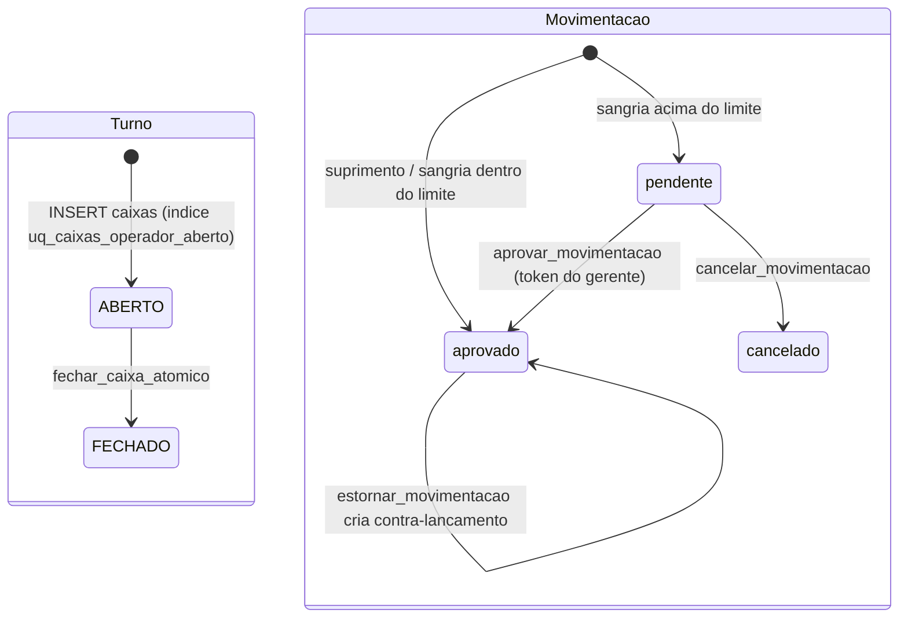

**Proibidas.** Reabrir turno; fechar com movimentação `pendente`
(`FECHAR_CAIXA_MOVIMENTACOES_PENDENTES`); dois turnos abertos por operador — garantido por
**índice único parcial**, não por checagem otimista. É o único agregado com essa proteção.
**Inconsistência de vocabulário.** `movimentacoes_caixa` usa minúsculas; todo o resto do sistema
usa maiúsculas. Sintoma de modelagem por módulo.
**Eventos.** Nenhum. O saldo é o estado; a história é reconstruída somando linhas.

## 2.6 Título Financeiro

```sql
-- contas_receber
CHECK (status = ANY (ARRAY['ABERTO', 'PARCIAL', 'QUITADO', 'CANCELADO']))
-- contas_pagar
CHECK (status = ANY (ARRAY['PENDENTE', 'PARCIAL', 'PAGO', 'ATRASADO', 'CANCELADO']))
```

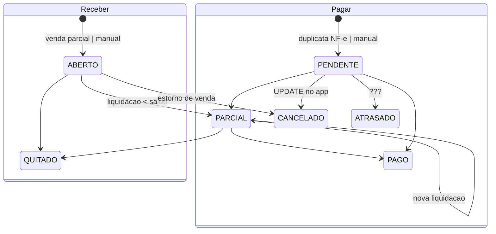

**Dois vocabulários para o mesmo conceito.** `ABERTO/QUITADO` de um lado, `PENDENTE/PAGO` de outro.
**`ATRASADO` é estado armazenado, não derivado.** Nada no código o atribui — nenhum job, nenhuma
RPC. Ou seja: é um estado inalcançável, ou vai depender de alguém rodar um `UPDATE` manual.
Vencimento deveria ser cálculo sobre `data_vencimento`, não coluna.
**Autoridade dividida.** Pagar via RPC; **cancelar via `UPDATE` no app**, com a máquina de estados
escrita como filtro de query: `.in('status', ['PENDENTE','PARCIAL','ATRASADO'])`
([payablePayment.ts:83](../pdv-importados/app/admin/financeiro/payablePayment.ts)).
**Eventos.** Nenhum.

## 2.7 Documento Fiscal

```sql
CHECK (status = ANY (ARRAY['PENDENTE', 'EM_PROCESSAMENTO', 'EMITIDO', 'ERRO', 'CANCELADO']))
```

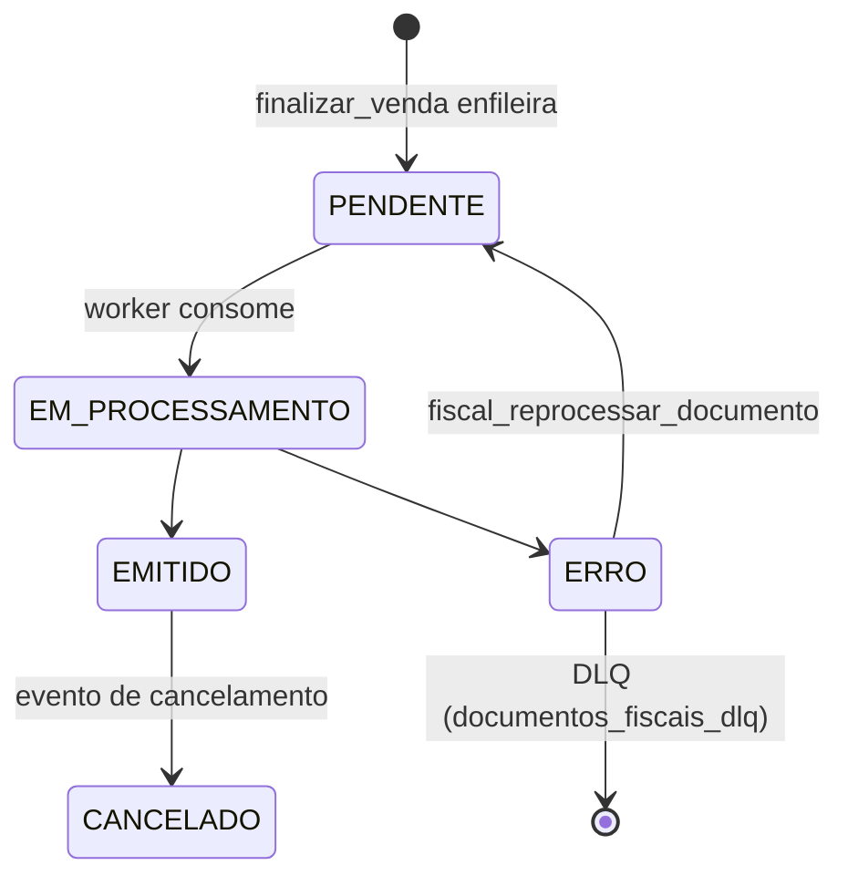

**O melhor modelado dos oito.** Toda transição gera linha em `documentos_fiscais_eventos`, por
**trigger** (`tr_documentos_fiscais_eventos_ai/_au`) — não por disciplina de quem escreve. Tem DLQ.
Tem view de auditoria `v_fiscal_doc_status_event_mismatch`, que hoje retorna **0 linhas**.
**Eventos.** Sim, completos e automáticos. É o padrão que os outros agregados deveriam copiar.

## 2.8 Inventário

Não existe. Proposta completa em §8.

---

# Parte 3 — Dependências entre domínios

## 3.1 O que o grafo de imports mostra

Varredura de `from '@/app/...'` entre pastas de domínio — **8 arestas no total**:

```
Estoque      -> Produtos    (3)      Estoque   -> Caixa/PDV   (1)
Compras      -> Estoque     (2)      Estoque   -> Recebimento (1)
Financeiro   -> Compras     (2)      Recebimento -> Estoque   (1)
Financeiro   -> Clientes    (1)      Vendas    -> Caixa/PDV   (1)
```

Um único ciclo: **Estoque ↔ Recebimento**. E ele é falso — é artefato de layout de pastas:

```
app/admin/estoque/recebimento/page.tsx  ->  app/gerente/recebimento/RecebimentoGerentePageClient
app/gerente/recebimento/actions.ts      ->  app/admin/estoque/inventoryMovementWriter
```

A rota aninhou Recebimento **dentro** de Estoque, enquanto o domínio diz o contrário: Recebimento
depende de Estoque, não é parte dele. Ciclo de diretório, não de domínio.

## 3.2 O que o grafo de imports esconde

Oito arestas para dez domínios é pouco demais para um ERP. O acoplamento real não passa por
import — passa por **RPC** e por **trigger**.

`finalizar_venda_transacional_canonica_v4` ([274](../backend/supabase/migrations/274_bl2_promocao_rpc_e_precedencia.sql))
escreve, numa transação:

```
vendas · itens_venda · vendas_pagamentos · descontos_venda
tokens_desconto_gerente · contas_receber · documentos_fiscais_pendentes
  └─ chama decrementar_estoque_seguro → estoque · estoque_baixas · movimentos_estoque_log
  └─ chama ensure_venda_evento_registrado → venda_eventos
  └─ trigger trg_registrar_comissao → comissoes_vendedores
  └─ trigger trg_vendas_pagamentos_credita_caixa → caixas.saldo_atual
```

**Sete domínios tocados por uma chamada.** No TypeScript, `caixaVendas.impl.ts` não importa nada
de Estoque, Financeiro, Fiscal, Comissões ou Caixa.

### Triggers — acoplamento sem código de aplicação

| Tabela | Trigger | Efeito cross-domain |
|---|---|---|
| `vendas` | `trg_registrar_comissao` | Vendas → **Funcionários** |
| `vendas` | `trg_vendas_caixa_aberto_bi/_bu` | Vendas lê estado de **Caixa** |
| `vendas_pagamentos` | `trg_vendas_pagamentos_credita_caixa` | Pagamento → **saldo do Caixa** |
| `documentos_fiscais_pendentes` | `tr_documentos_fiscais_eventos_ai/_au` | Fiscal → ledger fiscal |
| `produtos` | `trg_historico_precos_produto` | Produto → histórico de preço |
| `produtos`, `precos_atacado`, `regras_preco` | `trg_*_margem_*` | margem derivada no banco |

## 3.3 Mapa real de dependências

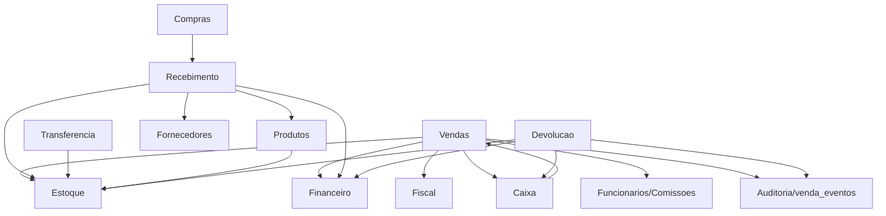

`Vendas → Caixa` e `Caixa → Vendas`: a venda credita o saldo do turno (trigger) e o turno
condiciona a venda (trigger `trg_vendas_caixa_aberto`). **É um ciclo real**, no banco, entre dois
agregados — mas é um ciclo *bem-comportado*: cada direção usa um mecanismo diferente
(escrita vs. validação) e ambos rodam na mesma transação. Não é bug; é acoplamento forte e
não declarado.

---

# Parte 4 — Autoridade de estado

## 4.1 Matriz

| Coluna de estado | Quem decide hoje | Mecanismo | Autoridade única deveria ser |
|---|---|---|---|
| `vendas.status` | RPCs `finalizar` / `cancelar` | RPC | ✅ já é única |
| `vendas_em_espera.status` | 4 RPCs de espera | RPC | ✅ já é única |
| `caixas.status` | `fechar_caixa_atomico` + `INSERT` na app | RPC + app | RPC de turno |
| `caixas.saldo_atual` | **4+**: trigger de pagamento, `registrar_movimentacao`, `aprovar_movimentacao`, `fechar_caixa_atomico`, `devolver_ou_trocar_venda`, `cancelar_venda_transacional` | trigger + 5 RPCs | ⚠️ §4.2 |
| `movimentacoes_caixa.status` | `registrar` / `aprovar` / `cancelar` / `estornar` | RPC | ✅ já é única |
| `ordens_compra.status` | **app** (`STATUS_TRANSITIONS` + `UPDATE`) | app | RPC ou constraint |
| `remessas.status` | app (`INSERT`) + RPC (`CONCLUIDA`) | dividido | RPC de recebimento |
| `produtos.status_publicacao` | `ProductLifecycle` | app (uma porta) | ✅ já é única |
| `contas_receber.status` | `registrar_liquidacao_receber` | RPC | ✅ já é única |
| `contas_pagar.status` | RPC (pagar) + **app** (cancelar) | dividido | RPC de título |
| `contas_pagar.status = 'ATRASADO'` | **ninguém** | — | derivar de `data_vencimento` |
| `documentos_fiscais_pendentes.status` | worker + RPC de reprocesso, auditado por trigger | RPC + trigger | ✅ já é única |
| `comissoes_vendedores.status` | trigger (cria) + `marcar_comissoes_pagas` | trigger + RPC | ✅ aceitável |

## 4.2 O caso de `caixas.saldo_atual`

Esta é a coluna com mais autoridades no sistema. `grep "UPDATE public.caixas"` nas migrations
retorna escrita em **13 arquivos**. Os caminhos vivos:

1. `trg_creditar_saldo_caixa_venda_dinheiro` — trigger em `vendas_pagamentos`
   ([20260731195933](../backend/supabase/migrations/20260731195933_credita_saldo_caixa_venda_dinheiro.sql), de hoje)
2. `registrar_movimentacao` / `aprovar_movimentacao` / `estornar_movimentacao` — sangria e suprimento
3. `cancelar_venda_transacional` — estorno em dinheiro
4. `devolver_ou_trocar_venda` — estorno em dinheiro
5. `fechar_caixa_atomico` — congela no fechamento

Não é um defeito de descuido: cada caminho é legítimo e todos rodam em transação. O problema é
que **"quanto tem na gaveta" não tem um dono**, e a prova disso é que existe uma função separada
só para recalcular a mesma coisa por outro caminho —
`calcular_valor_sistema_dinheiro_caixa`, usada no fechamento. O sistema mantém um saldo
incremental **e** sabe recalculá-lo do zero. Enquanto os dois concordarem, ninguém percebe.

**Autoridade única proposta:** `caixas.saldo_atual` deixa de ser fonte e vira *cache* de
`calcular_valor_sistema_dinheiro_caixa`. Um único ponto calcula; os cinco caminhos param de somar
e passam a invalidar.

## 4.3 O padrão que se repete

Onde a autoridade está dividida, o divisor é sempre o mesmo: **a transição feliz mora na RPC, a
exceção mora no app.**

- OC: criação e recebimento na RPC; mudança de status no app.
- Conta a pagar: pagamento na RPC; cancelamento no app.
- Remessa: confirmação na RPC; abertura no app.

Cancelar, corrigir e reabrir é exatamente onde a concorrência e a auditoria doem mais.

---

# Parte 5 — Autoridade de escrita

Varredura completa de `.from('<tabela>').insert|update|delete|upsert` em `app/**` e `lib/**`.

## 5.1 Matriz

| Entidade | Quem escreve hoje | Quem deveria escrever | Plano incremental |
|---|---|---|---|
| `produtos` | `productUpdater.ts`, `productLifecycle.ts`, `productExclusion.ts`, `produtos/actions.ts` (rollback de lote), **`lib/adapters/supabase/produtoRepository.ts` (morto)** | `ProductWriter`/`Updater`/`Lifecycle`/`Exclusion` | apagar o repositório morto; mover o rollback de lote para dentro do serviço |
| `estoque` | `gerente/estoque/actions.ts` (2 INSERTs), `produtos/actions.ts` (DELETE de compensação), `productExclusion.ts` (DELETE) | `InventoryMovementWriter` + `InventoryAdjustmentService` | §5.2 |
| `clientes` | `customerWriter.ts`, `customerUpdater.ts`, `customerExclusion.ts` | os três (uma autoridade por operação) | ✅ nada a fazer |
| `fornecedores` | `fornecedores/actions.ts` | idem | ✅ |
| `ordens_compra` / `_itens` | `compras/actions.ts` | `PurchaseOrderWriter` | extrair porta; mover `STATUS_TRANSITIONS` para shared-core |
| `remessas` / `remessa_itens` | `recebimento/actions.ts` | `ReceivingWriter` | §7 |
| `contas_pagar` | `payablePayment.ts` (RPC + UPDATE de cancelamento) | `PayableWriter` | mover cancelamento para RPC |
| `contas_receber` | `receivableWriter.ts` | idem | ✅ |
| `caixas` | `cashSession.ts` (INSERT) + 5 RPCs | `CashSessionWriter` | §4.2 |
| `configuracoes_gerais` | `configuracoes/actions.ts`, `suspensao/actions.ts` | um `ConfigWriter` com dono por chave | baixo risco, baixo ganho |
| `usuarios` | `funcionarios/actions.ts`, `caixa/idioma/actions.ts`, `gerente/idioma/actions.ts` | `FuncionarioWriter` + preferência de UI à parte | separar preferência de identidade |
| `precos_atacado` | `precosAtacadoActions.ts` | `PricingWriter` | ✅ suficiente |
| `lojas`, `pdv_config` | `configuracoes/actions.ts` | `ConfigWriter` | — |

## 5.2 `estoque` — o caso que importa

Três arquivos escrevem direto na tabela de saldo, fora do writer:

```
app/gerente/estoque/actions.ts:47    INSERT (client admin)  — criarLinhaEstoqueZerada
app/gerente/estoque/actions.ts:138   INSERT (client user)   — garantirLinhaEstoque
app/gerente/produtos/actions.ts:408  DELETE                 — rollback de importação em lote
app/admin/produtos/productExclusion.ts  DELETE              — exclusão de produto
```

As duas primeiras são a **mesma operação** escrita duas vezes com clientes diferentes. As duas
últimas apagam saldo sem deixar movimento — o inverso exato de um ledger.

## 5.3 O que já está limpo

Depois da Onda 0, o mapa de RPC mostra **51 RPCs com um único caller cada**, exceto:

- `calcular_preco_produto` — 3 callers (§6.2)
- `pdv_config_flags_visuais` — 3 callers (leitura de flag visual, inofensivo)

Nenhum bypass de port de estoque sobrou; a guarda `check:entity-ssot` cobre isso.

---

# Parte 6 — Fontes de verdade

## 6.1 Saldo de estoque — **duplicação medida, não teórica**

Consulta em produção, comparando `estoque.quantidade_atual` com a soma de
`movimentos_estoque_log.quantidade_delta`:

> **Correção (01/08).** A primeira versão desta seção dizia "85 linhas sem ledger, 88% do estoque
> inauditável". O número estava errado: a consulta tratava ausência de movimento como divergência,
> quando saldo `0` sem movimento é **consistente** (soma vazia = 0). Refeita com `COALESCE(soma,0)`:

| Situação | Linhas | Divergentes |
|---|---|---|
| sem movimento, saldo **zero** | 75 | 0 — consistente |
| sem movimento, saldo **≠ 0** | 10 | **10** |
| com movimento, saldo ≠ 0 | 24 | **11** |
| com movimento, saldo zero | 1 | **1** |
| **total** | **110** | **22 (20%)** |

**20% das linhas de estoque não fecham com o histórico** — não 88%.

Também estava errada a causa apontada:
[`270_criar_produto_com_estoque_inicial.sql`](../backend/supabase/migrations/270_criar_produto_com_estoque_inicial.sql)
**já** delega a `ajustar_estoque_manual` quando há saldo inicial, e essa RPC grava o delta correto
em `movimentos_estoque_log` ([269, linhas 79-110](../backend/supabase/migrations/269_ajustar_estoque_manual_service_ator.sql)).
O caminho de criação de produto é auditável hoje. A origem das 22 divergências é anterior a esse
caminho e não foi investigada — ver Onda A.

Conclusão revista: `movimentos_estoque_log` é um ledger **incompleto**, não inexistente. A fonte de
verdade continua sendo `estoque.quantidade_atual`, e falta um detector para impedir que a lacuna
cresça.

Há ainda `estoque_baixas` (29 linhas), que serve a outro propósito: idempotência do par
venda+produto. Não é ledger concorrente; é chave de deduplicação com nome enganoso.

## 6.2 Preço — duplicação **gerenciada**

Duas implementações da mesma cadeia, por requisito de negócio (PDV desktop offline):

| Implementação | Onde | Consumidor |
|---|---|---|
| SQL `calcular_preco_produto` | migrations | caixa web, catálogo admin |
| TS `calcularPrecoCanonico` | `shared-core/src/pricing/` | PDV desktop offline |

Existe guarda de equivalência:
[`pdv-local/src/pricing/offlineRpcEquivalence.golden.test.ts`](../pdv-local/src/pricing/offlineRpcEquivalence.golden.test.ts).
`PRICE_RESOLUTION_CHAIN` é declarada uma vez em `shared-core/src/pricing/resolution.ts`.

**Veredito: aceitável.** Duas implementações com um invariante testado é a resposta certa para
offline-first. O que falta é fechar a terceira porta: `regras_preco` ainda existe (0 linhas) com
triggers de margem ativos.

## 6.3 Desconto

Fonte: `descontos_venda` + `itens_venda.desconto_*`, com trigger
`trg_itens_venda_limite_desconto` validando o limite. Autorização em `tokens_desconto_gerente`.
**Uma fonte, um validador.** ✅

## 6.4 Comissão

Nasce por trigger `trg_registrar_comissao` em `vendas`; regras em
`comissoes_regras_funcionario` com histórico em `comissoes_regras_historico`.
**Uma fonte.** Ressalva: como é trigger, uma venda cancelada depende de a comissão ser estornada
pelo mesmo caminho — não verifiquei se `cancelar_venda_transacional` desfaz a comissão.
**Ponto aberto, não conclusão.**

## 6.5 Caixa

Duas: `caixas.saldo_atual` (incremental) e `calcular_valor_sistema_dinheiro_caixa` (recalculado).
Ver §4.2.

## 6.6 Contas / pagamentos de venda

`vendas.total_liquido` vs. `Σ vendas_pagamentos.valor`. A divergência é conhecida e **monitorada**:
a view `v_venda_consistencia_anomalias` existe exatamente para isso e hoje retorna **25 linhas**
(de 29 vendas), todas com `sem_pagamento = true` e `created_at` em 2026-04-08 — carga de seed
anterior à tabela `vendas_pagamentos`. Não é bug ativo, mas é uma segunda fonte com view de
policiamento em vez de invariante.

## 6.7 Documentos fiscais

`documentos_fiscais_pendentes.status` vs. `documentos_fiscais_eventos`. Também monitorado por view
(`v_fiscal_doc_status_event_mismatch`), hoje **0 linhas**. Como os eventos são gravados por trigger,
a divergência é estruturalmente improvável. ✅

## 6.8 Devolução — correção de um documento anterior

O MODELO_DOMINIO afirmou que havia "duas trilhas de devolução com os dados na antiga". **Impreciso.**
Números reais:

| Tabela | Linhas |
|---|---|
| `devolucoes` | 5 (todas com `operacao_id` **NULL**) |
| `venda_pos_venda_operacoes` | 0 |
| `estoque_reposicoes_devolucao` | 0 |
| `estoque_reposicoes_cancelamento` | 5 |

As 5 linhas de `devolucoes` vieram de **cancelamento de venda**, não de devolução. O fluxo de
devolução pós-venda nunca foi exercido em produção. O problema real não é "trilha antiga vs. nova"
— é que `devolucoes` é escrita por dois eventos de negócio diferentes (cancelar e devolver) e
`operacao_id` é o único jeito de distinguir.

---

# Parte 7 — Recebimento, remodelado

## 7.1 Premissa

Um fluxo. NF-e, ordem de compra e chegada sem documento são **origens**, e origem só determina
como o recebimento é pré-preenchido — nunca como se comporta.

## 7.2 Máquina de estados proposta

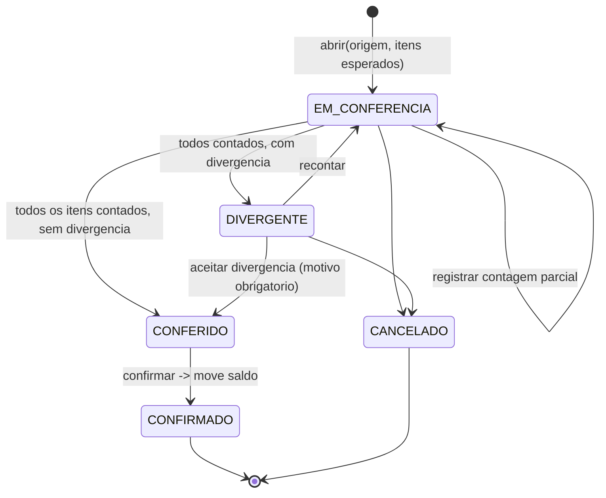

**Transições proibidas.** `EM_CONFERENCIA → CONFIRMADO` direto (é isso que o sistema faz hoje);
sair de `CONFIRMADO` ou `CANCELADO`; confirmar com item não contado.

**Regras de domínio.**

1. Quantidade que entra no estoque é a **contada**, nunca a esperada — elimina o
   `COALESCE(conferida, esperada)` de hoje.
2. `quantidade_conferida = 0` é resposta válida ("contei, não veio"); `NULL` é "não contei".
   Hoje os dois casos se confundem.
3. Divergência aceita exige motivo.
4. Só `CONFIRMADO` move saldo, e move em uma transação com o documento de origem e as duplicatas.
5. Produto `INATIVO` não recebe; `DRAFT` recebe.

**Eventos emitidos.**

| Transição | Evento |
|---|---|
| → `EM_CONFERENCIA` | `RECEIVING_OPENED` |
| contagem | `RECEIVING_COUNTED` |
| → `DIVERGENTE` | `RECEIVING_DIVERGED` |
| → `CONFIRMADO` | `RECEIVING_CONFIRMED` → consumido por Estoque e Financeiro |
| → `CANCELADO` | `RECEIVING_CANCELLED` |

## 7.3 Modelo de dados

`remessas` já tem 4 dos 5 estados e `remessa_itens` já tem `quantidade_conferida` e
`divergencia_obs`. Falta:

```sql
ALTER TABLE public.remessas
  ADD COLUMN origem_tipo text NOT NULL DEFAULT 'SEM_DOCUMENTO'
    CHECK (origem_tipo IN ('NFE','ORDEM_COMPRA','SEM_DOCUMENTO')),
  ADD COLUMN origem_ref text,            -- chave NF-e | id da OC
  ADD COLUMN divergencia_motivo text,
  ADD COLUMN conferido_por uuid REFERENCES public.usuarios(id),
  ADD COLUMN conferido_em timestamptz;
-- + acrescentar 'DIVERGENTE' e 'CONFERIDO' ao CHECK de status
```

Aditivo, com default. `remessas` tem 0 linhas — não há backfill.

## 7.4 Compatibilidade

`importar_nfe_transacao` e `receber_ordem_compra` continuam existindo e passam a **abrir um
recebimento** em vez de creditar saldo direto. Quem chama hoje continua funcionando; muda o que
acontece depois. O port único já existe (`InventoryMovementWriter.receiveOrdemCompra`, Onda 0).

---

# Parte 8 — Inventário

## 8.1 Máquina de estados

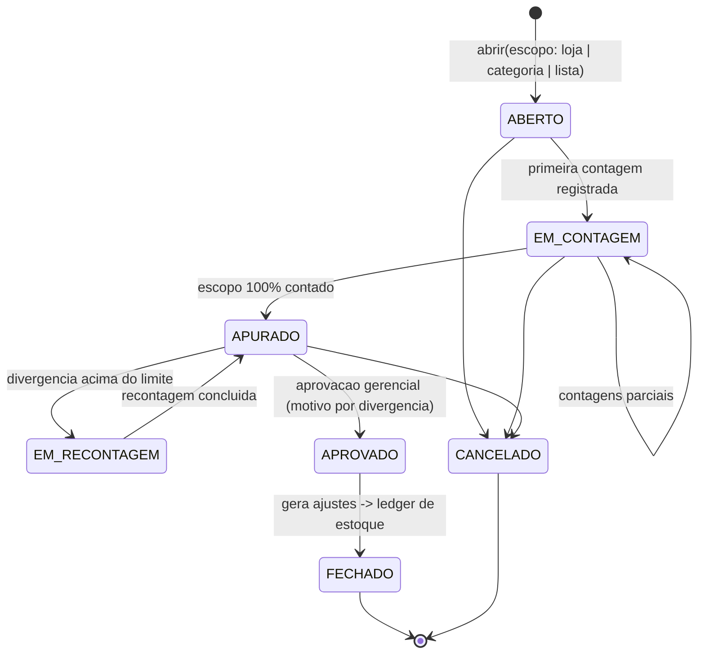

**Proibidas.** Aprovar com item não contado; fechar sem aprovação; alterar contagem depois de
`APROVADO`; dois inventários `ABERTO` para o mesmo escopo (índice único parcial, como o turno).

## 8.2 Regras de domínio

1. **Congelamento do esperado.** Ao abrir, grava-se `quantidade_sistema` por item — um *snapshot*.
   Vendas continuam acontecendo; a divergência é medida contra o snapshot, não contra o saldo vivo.
2. **Contagem cega por padrão.** Quem conta não vê o esperado. Mesmo princípio do
   `blind_closure_enabled` do caixa, que já existe e funciona.
3. **Recontagem obrigatória** acima de um limite configurável (valor ou percentual).
4. **Aprovação separa quem conta de quem aceita.** Divergência aprovada exige motivo por item.
5. **Fechar gera os ajustes**, um por item divergente, com motivo `ACERTO_INVENTARIO` e referência
   ao inventário.

## 8.3 Conversa com o ledger de estoque

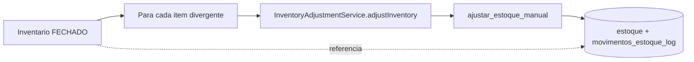

**Reaproveita a autoridade existente** — nenhuma escrita nova em `estoque`. Cada movimento gerado
carrega `inventario_id`, então "por que o saldo mudou em 12/08" tem resposta rastreável até a
ficha de contagem e a assinatura da aprovação.

**Dependência.** Inventário só é confiável depois de §6.1: hoje o "esperado" que ele congelaria
é um número que 88% das linhas não conseguem justificar.

## 8.4 Tabelas

```
inventarios            (id, loja_id, escopo_tipo, escopo_ref, status,
                        aberto_por, aberto_em, aprovado_por, aprovado_em,
                        fechado_em, contagem_cega bool, limite_recontagem numeric)
inventario_itens       (inventario_id, produto_id, quantidade_sistema_snapshot,
                        quantidade_contada, quantidade_recontada, divergencia_motivo,
                        contado_por, contado_em)
inventario_eventos     (append-only: OPENED, COUNTED, RECOUNTED, APPRAISED,
                        APPROVED, CLOSED, CANCELLED)
```

---

# Parte 9 — Orientação atual, com evidência

## Veredito

**O Jīn Lóng é orientado a RPC-e-tabela, com uma ilha de eventos em Vendas.**

Não é mais orientado a telas — isso foi resolvido. Não é orientado a módulos, porque os módulos são
finos demais para carregar o domínio. Não é orientado a eventos, porque nove dos dez domínios não
emitem nada.

## Evidências, uma a uma

**Orientado por telas? Não — e foi resolvido recentemente.**
`/gerente/*` é catch-all de redirect; 14 telas órfãs removidas na Onda 0; `ProdutoFormModal` único
serve criar/editar/duplicar; financeiro unificado em 3 abas. Sobram 3 telas no DS legado
(`ds-legacy-burndown`: `GerenteTable` em 6 arquivos, contra 13 antes).

**Orientado por módulos? Não.**
8 arestas de import entre 10 domínios. As pastas `app/gerente/<dominio>/actions.ts` são fachadas
finas; a lógica está em `lib/`, em `app/admin/*Service` e, sobretudo, no banco. Um módulo que não
se relaciona com os outros não está organizando nada.

**Orientado por RPC? Sim — e é a resposta mais correta.**
51 RPCs mapeadas. `finalizar_venda_transacional_canonica_v4` escreve em 7 tabelas de 5 domínios e
dispara 2 triggers que atingem outros 2. O acoplamento, a transação e a regra estão todos ali.
A camada TypeScript é um adaptador de chamada: valida entrada, chama, traduz erro.

**Orientado por domínio? Parcialmente, e nas bordas.**
`shared-core` tem 17 módulos de domínio com ports, policies puras e códigos de erro estáveis —
`cash`, `inventory`, `pricing`, `financial`, `products`. É modelagem real e boa. Mas ela cobre a
**borda** (validação de entrada, tradução de erro, contratos), não o **núcleo** (a transação).
Prova: `PRICE_RESOLUTION_CHAIN` é declarada em `shared-core` e implementada duas vezes — uma em
TS, outra em SQL — com um golden test para garantir que não divirjam. O domínio descreve; o banco
decide.

**Orientado por eventos? Não.**
Um ledger (`venda_eventos`), três tipos, um domínio, e um deles (`SALE_PARTIAL_RETURN`) com zero
ocorrências. `documentos_fiscais_eventos` e `historico_precos_produto` são bons ledgers locais mas
não formam barramento — ninguém se inscreve neles. Não existe consumidor de evento: existe
consumidor de *tabela*. `revalidarDominio` (Onda 0) foi o primeiro vocabulário de evento na
aplicação, e ele só invalida cache.

## O que isso custa hoje

| Sintoma | Evidência |
|---|---|
| Efeito colateral invisível na revisão de código | comissão e saldo de caixa nascem de trigger; nenhum arquivo TS menciona |
| Impossível responder "quando e por quem" | OC, remessa, título e turno mudam de estado sem registro histórico |
| Auditoria por view em vez de invariante | `v_venda_consistencia_anomalias` (25), `v_fiscal_doc_status_event_mismatch` (0) |
| Saldo de estoque inauditável | 85/110 linhas sem movimento correspondente |
| Regra duplicada por requisito legítimo | preço em SQL + TS, com golden test |

## O que **não** está errado

O modelo RPC-cêntrico não é um acidente. Um PDV precisa de atomicidade real (venda + estoque +
caixa + fiscal, tudo ou nada) e de garantia sob concorrência. Colocar isso numa transação Postgres
é a decisão certa. O índice `uq_caixas_operador_aberto` resolve corrida de forma que nenhuma
checagem em TypeScript resolveria.

**A recomendação não é tirar regra do banco.** É parar de deixar que a transação seja o *único*
lugar onde o domínio aparece.

---

# Parte 10 — Roadmap

Cada onda foi avaliada contra os dez critérios obrigatórios. Nenhuma reescreve nada.

## Onda A — Fechar o ledger de estoque

**Problema.** 22 de 110 linhas de saldo não fecham com o histórico (§6.1).

**Ação (executada — ver [ONDA_A_LEDGER_ESTOQUE.md](./ONDA_A_LEDGER_ESTOQUE.md)).**
1. ~~`criar_produto_com_estoque_inicial` passa a gravar movimento~~ — já grava, via
   `ajustar_estoque_manual`. Coberto por teste de contrato para não regredir.
2. ~~Exclusão de produto gera movimento de saída~~ — impossível e desnecessário: `produto_id` é FK
   em `movimentos_estoque_log`, e a exclusão já é bloqueada quando existe movimento.
3. View `v_estoque_ledger_divergencia` como detector permanente.
4. Backfill das 22 linhas: **não feito** — exige decidir caso a caso qual número está certo.

| Critério | |
|---|---|
| Reduz complexidade | = mantém (acrescenta linhas ao log) |
| Reduz acoplamento | = |
| Fortalece o domínio | ✅ saldo passa a ser explicável |
| Fortalece o SSoT | ✅✅ é a definição de SSoT de estoque |
| Testabilidade | ✅ invariante verificável por query |
| Observabilidade | ✅✅ kardex passa a fechar |
| Reduz dívida | ✅ |
| Compatibilidade | ✅ aditivo; nenhum consumidor muda |
| Incremental | ✅ passos 1–4 independentes |
| Reversível | ✅ backfill é deletável por tipo |

**Pré-requisito de tudo que envolva estoque, inclusive Inventário.**

## Onda B — Recebimento com conferência real

Ver §7. Aditivo (`remessas` = 0 linhas), reversível, e o port único já existe desde a Onda 0.

| Critério | |
|---|---|
| Complexidade | ⚠️ **aumenta** — 3 passos onde havia 1 |
| Acoplamento | ✅ origens deixam de ser fluxos |
| Domínio / SSoT | ✅✅ |
| Testabilidade | ✅ máquina de estados pura |
| Observabilidade | ✅✅ divergência passa a existir |
| Compatibilidade / incremental / reversível | ✅ |

**É a única onda que aumenta complexidade — de propósito.** A operação tem uma etapa que o sistema
finge não ter. Vale dizer com todas as letras: isso torna receber mercadoria mais trabalhoso.
Se o piloto não quer essa etapa, a alternativa honesta é **remover** os campos de conferência, não
mantê-los preenchidos automaticamente.

## Onda C — Estado no agregado

**Ação.** `STATUS_TRANSITIONS` da OC sai de `compras/actions.ts` para `shared-core`; cancelamento
de conta a pagar sai do `UPDATE` no app para RPC; `contas_pagar.ATRASADO` vira derivado.

| Critério | |
|---|---|
| Complexidade | ✅ reduz (uma declaração, não duas) |
| Acoplamento | ✅ |
| Domínio / SSoT / testabilidade | ✅ |
| Observabilidade | = |
| Compatibilidade | ✅ mesma semântica |
| Incremental / reversível | ✅ um agregado por vez |

## Onda D — `caixas.saldo_atual` vira cache

Ver §4.2. Uma autoridade calcula; os cinco caminhos invalidam.

| Critério | |
|---|---|
| Complexidade | ✅ reduz de 6 escritores para 1 |
| SSoT | ✅✅ |
| Observabilidade | ✅ divergência entre cache e cálculo vira alerta |
| Compatibilidade | ⚠️ **toca o caminho crítico do caixa** |
| Reversível | ✅ trigger e RPCs voltam por migration |

**Maior risco do roadmap.** Só depois de A, B e C, e com o `pdv_diagnostico_pre_producao` cobrindo.

## Onda E — Barramento de eventos, começando pelo que já existe

**Não construir infraestrutura.** Generalizar `venda_eventos` para `dominio_eventos`, com
`aggregate_type` + `aggregate_id` + `event_type`, e passar a emitir nas transições que hoje são
mudanças mudas de coluna: OC, recebimento, título, turno.

| Critério | |
|---|---|
| Complexidade | ⚠️ aumenta (uma escrita a mais por transição) |
| Acoplamento | ✅✅ leitores param de depender de tabela de estado |
| Domínio / SSoT | ✅✅ |
| Observabilidade | ✅✅✅ "quando e por quem" passa a ter resposta |
| Compatibilidade | ✅ aditivo; colunas de status continuam |
| Incremental | ✅ um agregado por vez |
| Reversível | ✅ tabela nova; nada depende dela no começo |

Esta é a onda que muda a orientação da arquitetura. Deliberadamente por último: só faz sentido
depois que cada agregado tiver uma autoridade de estado (C) e um ledger que fecha (A).

## Onda F — Inventário

Ver §8. Domínio novo, depende de A.

## Onda G — Higiene

`regras_preco`, `movimentos_caixa`, `perfis` (todas 0 linhas); `produtoRepository.ts` morto;
`pdv-importados/supabase/migrations` e `supabase/` na raiz — os dois diretórios falsos que me
levaram a errar sobre versionamento; 3 telas no DS legado.

## Sequência

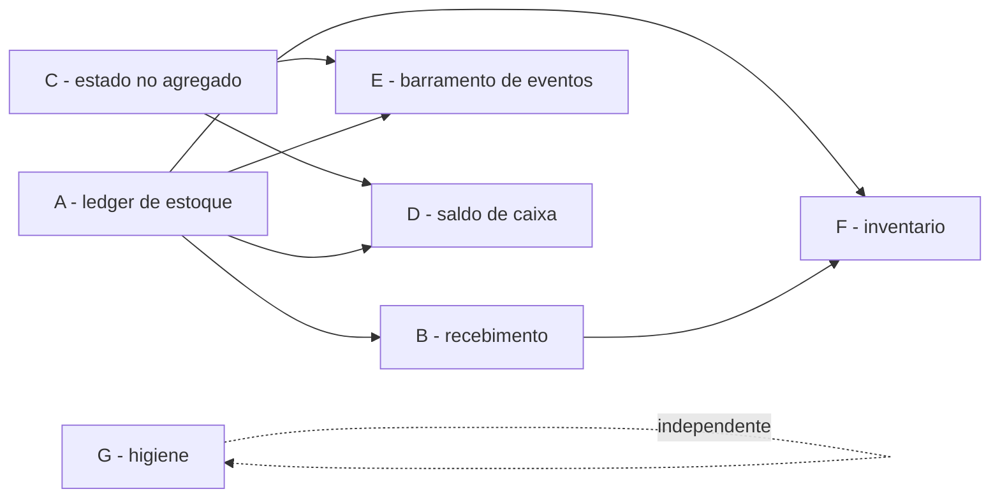

**Comece por A.** É a única onda cujo problema está medido em produção, e é pré-requisito de
metade do resto.

---

## Anexo — o que eu não verifiquei

Para não confundir conclusão com suposição:

- Se `cancelar_venda_transacional` estorna a comissão criada pela trigger (§6.4).
- Se as 12 linhas com ledger divergente (§6.1) têm causa distinta das 85 sem ledger.
- Comportamento do PDV desktop (`pdv-local`) além da cadeia de preço.
- As 25 anomalias de `v_venda_consistencia_anomalias` foram inspecionadas por amostra (5 linhas),
  não integralmente.
