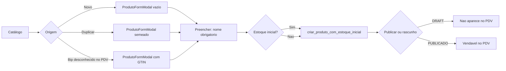
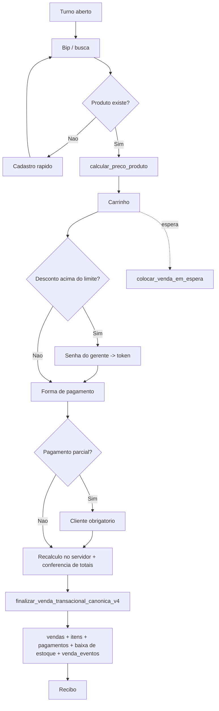
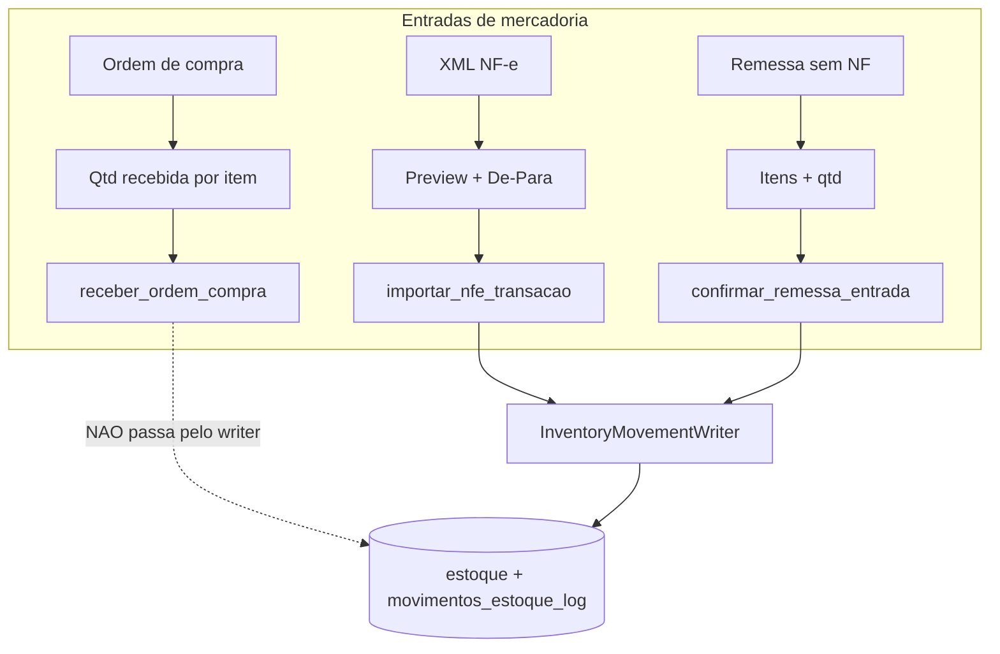
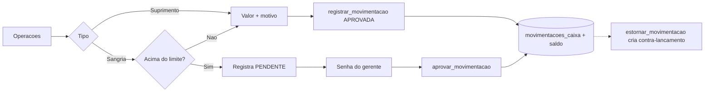

# Mapa de Fluxos Operacionais — Jīn Lóng

> Sprint "Primeiro modelamos o fluxo. Depois desenhamos as telas."
> Levantado em 31/07/2026 a partir do código em `pdv-importados/` e do schema em produção.

## Método e limites deste levantamento

O que foi lido: as 41 `page.tsx` de `app/`, todas as `actions.ts` (server actions), os
`*.impl.ts` do caixa, os serviços de estoque/financeiro em `lib/` e `app/admin/estoque/`,
a política de autorização (`lib/admin/policy/adminPolicy.ts`) e o inventário de tabelas do
Supabase de produção.

**Onde mora a regra:** as migrations SQL estão versionadas em
**`backend/supabase/migrations`** (237 arquivos), não em `pdv-importados/supabase/migrations`
(que tem 7 arquivos soltos e é enganoso) nem em `supabase/` na raiz (vazio). As 48 funções
RPC que carregam a regra de negócio estão todas lá. Neste documento, as regras de cada fluxo
foram derivadas do **contrato de chamada** (parâmetros, erros tratados, retorno consumido);
o corpo das funções está disponível no repositório para quem quiser descer um nível.

---

## 1. Arquitetura de rotas — o que já está resolvido

Antes do mapa, um fato que muda a leitura da auditoria:

**`/gerente/*` não é mais uma área do sistema.** É um catch-all de redirect
(`app/gerente/[...path]/page.tsx` → `legacyGerenteRedirect()`). Toda navegação canônica é
`/admin/*` + `/caixa`. As pastas `app/gerente/*` sobreviveram como **camada de domínio**:
guardam as server actions consumidas pelas páginas `/admin/*`.

```
app/admin/<rota>/page.tsx     →  Server Component (tela canônica, DS admin-v2)
        │
        └── importa ──────────→  app/gerente/<domínio>/actions.ts   (server actions)
                                        │
                                        └── lib/ + app/admin/estoque/*Service  (domínio)
                                                    │
                                                    └── supabase.rpc(...)      (regra de negócio)
```

Isso significa que **duplicação de rota já foi eliminada** numa sprint anterior. O que
sobrou é duplicação de **componente** e de **camada de escrita** — que é onde a auditoria
desta sprint encontra o problema real.

### Papéis

| Perfil | Acesso |
|---|---|
| `OPERADOR` | apenas `/caixa` |
| `GERENTE`, `DONO` | `/caixa` + todo `/admin/*` exceto provisionamento/implantação/diagnóstico |
| `ADMIN` (equipe FastProduct) | tudo, incluindo `/admin/provisionamento`, `/admin/implantacao`, `/admin/diagnostico-caixa` |

Fonte única: `ROUTE_PERMISSIONS` em `lib/admin/policy/adminPolicy.ts`, aplicada no
`middleware.ts` (matcher `/admin/*`, `/gerente/*`, `/caixa/*`) e reaplicada por página via
`loadAdminContext({ resource: 'route:...' })`.

---

## 2. Mapa completo dos fluxos

Quatorze fluxos existem no sistema. Um da lista da sprint (**Inventário**) não existe, e
outro (**Conferência de recebimento**) existe só no nome — detalhado em §2.15 e §2.5.

---

### 2.1 Cadastro de produto

| | |
|---|---|
| **Início** | `/admin/catalogo` → botão "Novo produto"; ou bipar um código desconhecido no PDV → "Cadastrar"; ou "Duplicar" numa linha da tabela |
| **Tela** | `CatalogoTable` / `CatalogoNovoButton` → `NovoProdutoModal` → **`ProdutoFormModal`** |
| **Obrigatório** | `nome`. Só isso — margem, categoria, marca, fornecedor, fiscal e estoque inicial são opcionais |
| **Decisões** | salvar como **rascunho** (`DRAFT`) ou **publicar**; informar estoque inicial ou não; criar categoria/marca/fornecedor inline (`SelectComCadastroRapido`); preencher faixas de atacado |
| **Fim** | modal fecha, lista revalida, toast com atalho para "ajustar estoque" ou "imprimir etiqueta" |
| **Registros** | `produtos`; `estoque` (linha zerada ou com saldo inicial); `precos_atacado` (se faixas); `produto_create_requests` (idempotência); `historico_precos_produto` (via trigger); `cadastro_produto_telemetry_events` |
| **Regras** | RPC `criar_produto_com_estoque_inicial` — transação única produto+estoque, idempotente por `request_id`. Status inicial vem de `defaultStatusNovoProduto`. Publicação passa por `podeSalvarComoRascunho` / gate de publicação em lote. GTIN consultado em `gtin_lookup_cache` (cache global, sem `loja_id`) |



---

### 2.2 Abertura de caixa

| | |
|---|---|
| **Início** | operador entra em `/caixa`; se não há turno aberto, `CaixaAbrirTurnoModal` bloqueia a tela |
| **Obrigatório** | `valor_inicial` (fundo de troco) |
| **Decisões** | nenhuma |
| **Fim** | turno `ABERTO`, PDV liberado |
| **Registros** | `caixas` (INSERT direto, não RPC) |
| **Regras** | um caixa aberto por operador — validado duas vezes: *check-then-insert* em `cashSession.ts` **e** índice parcial `uq_caixas_operador_aberto` no banco, que segura a corrida entre dois terminais |

---

### 2.3 Venda no PDV

O fluxo mais crítico e o único marcado `FREEZE: CORE TRANSACIONAL` no código
(`caixaVendas.impl.ts`).

| | |
|---|---|
| **Início** | turno aberto + bipar código de barras, buscar por nome, ou retomar venda em espera |
| **Etapas** | bip → resolução de preço → carrinho → (desconto) → (cliente) → forma(s) de pagamento → finalizar → recibo |
| **Obrigatório** | ≥1 item; forma de pagamento; **cliente é obrigatório se o pagamento for parcial** (`pagamentoParcialExigeCliente`) |
| **Decisões** | desconto acima do limite → exige senha de gerente (token com expiração); split payment (2+ meios); vender em espera; cancelar item; consulta rápida sem carrinho |
| **Fim** | venda `CONCLUIDA`, estoque baixado, recibo na tela, carrinho limpo, foco volta para a busca |
| **Registros** | `vendas`, `itens_venda`, `vendas_pagamentos`, `estoque_baixas`, `movimentos_estoque_log`, `venda_eventos` (ledger append-only), `descontos_venda`, `tokens_desconto_gerente`, `documentos_fiscais_pendentes`, `contas_receber` (se parcial), `comissoes_vendedores`, `caixa_scan_telemetry_events` |
| **Regras** | RPC única **`finalizar_venda_transacional_canonica_v4`**. Preço nunca vem do cliente: `recalcularItensNoServidor` + `calcular_preco_produto` (cadeia `precos_atacado` → catálogo → varejo). Totais declarados são conferidos contra os recalculados (`totalsMatchDeclared`) antes de chamar a RPC. Idempotência por `estoque_baixas` (par venda+produto). Fingerprint de dispositivo e `pricing_version_id` gravados por venda |



---

### 2.4 Venda em espera

| | |
|---|---|
| **Início** | carrinho montado → "Colocar em espera" |
| **Obrigatório** | carrinho não vazio |
| **Decisões** | retomar, descartar (com motivo) |
| **Fim** | três saídas: retomada→finalizada→**convertida**; descartada; ou pendente indefinidamente |
| **Registros** | `vendas_em_espera` |
| **Regras** | **não reserva estoque** (comentário explícito na tabela). Token de desconto do gerente **não é persistido** — ao retomar, o desconto exige nova autorização. `converter_venda_em_espera` roda *depois* da venda finalizada, não na retomada: se o operador retomar o cupom errado, o pedido original não se perde |

---

### 2.5 Recebimento de mercadorias

**Três caminhos independentes** para a mesma operação de negócio. Esta é a maior
fragmentação encontrada.

#### (a) Importação de NF-e — `/admin/estoque/importar-nfe`

| | |
|---|---|
| **Início** | upload/colagem do XML da NF-e |
| **Etapas** | parse → preview linha a linha → De-Para (vincular a produto existente / criar novo) → confirmar |
| **Obrigatório** | chave de acesso válida (44 dígitos); ação definida por linha |
| **Decisões** | por linha: vincular ou criar; atualizar custo ou não; gerar duplicatas (contas a pagar) |
| **Fim** | estoque incrementado, produtos criados/vinculados, contas a pagar geradas |
| **Registros** | `importacoes_nfe` (idempotência por chave), `produtos`, `estoque`, `movimentos_estoque_log`, `vinculos_fornecedor_produto` (memória do De-Para), `fornecedores`, `contas_pagar` |
| **Regras** | RPC `importar_nfe_transacao` via `InventoryMovementWriter.importNfe`. Uma chave = uma importação por ambiente. O De-Para aprendido é reutilizado nas próximas notas do mesmo fornecedor |

#### (b) Recebimento de ordem de compra — `/admin/compras`

| | |
|---|---|
| **Início** | OC existente em status que permita recebimento |
| **Obrigatório** | quantidade recebida por item |
| **Decisões** | recebimento parcial |
| **Fim** | OC muda de status, estoque incrementado |
| **Registros** | `ordens_compra`, `ordens_compra_itens`, `estoque`, `movimentos_estoque_log` |
| **Regras** | RPC `receber_ordem_compra`. Transição de status validada no cliente por `STATUS_TRANSITIONS` |

#### (c) Remessa / entrada sem NF — `/admin/estoque/recebimento`

| | |
|---|---|
| **Início** | "Nova remessa", descrição da origem |
| **Obrigatório** | origem; ≥1 item com quantidade esperada e conferida |
| **Decisões** | nenhuma — ver ressalva abaixo |
| **Fim** | remessa criada **e confirmada na mesma ação** |
| **Registros** | `remessas`, `remessa_itens`, `estoque`, `movimentos_estoque_log` |
| **Regras** | `confirmar_remessa_entrada` via `InventoryMovementWriter`. Produtos `DRAFT` são aceitos (mercadoria chega antes de ser publicada); `INATIVO` é bloqueado |

> **A conferência de recebimento não existe como etapa.** `criarRemessaConferencia`
> (`app/gerente/recebimento/actions.ts:91`) faz INSERT com status `EM_CONFERENCIA` e chama
> `confirmRemessaEntrada` **na mesma função, sem interrupção**. `quantidade_esperada` e
> `quantidade_conferida` são digitadas na mesma tela, ao mesmo tempo, pela mesma pessoa.
> Não há estado intermediário, não há divergência, não há segunda pessoa conferindo.
> Em produção: `remessas` = 0 linhas.



---

### 2.6 Ajuste de estoque

| | |
|---|---|
| **Início** | `/admin/estoque` → linha do produto → `AjusteSaldoModal` |
| **Obrigatório** | nova quantidade; **motivo** (`ACERTO_INVENTARIO`, `COMPRA`, `PERDA`, `QUEBRA`, `OUTRO`) |
| **Decisões** | ajustar também o estoque mínimo; observação livre |
| **Fim** | saldo sobrescrito, movimento no kardex |
| **Registros** | `estoque`, `movimentos_estoque_log` |
| **Regras** | RPC `ajustar_estoque_manual` via `InventoryAdjustmentService`, executada com `service_role` — por isso exige `p_ator_id` explícito (mig. 269). `ajustarComLinhaGarantida` cria a linha de estoque zerada se o produto for legado e não tiver nenhuma. É um ajuste **absoluto** (define o saldo), não um delta |

---

### 2.7 Transferência entre lojas

| | |
|---|---|
| **Início** | `/admin/estoque/transferencias` |
| **Obrigatório** | produto, loja origem, loja destino, quantidade |
| **Decisões** | nenhuma |
| **Fim** | saldo debitado na origem e creditado no destino, em transação única |
| **Registros** | `movimentos_estoque_log` (2 linhas), `estoque` (2 linhas), `transferencias_idempotencia` |
| **Regras** | RPC `transferir_estoque_seguro`. Saldo disponível pré-checado por `obter_estoque_disponivel_transferencia`. Sem etapa de trânsito: a transferência é instantânea, não há "mercadoria em transporte" |

---

### 2.8 Sangria · 2.9 Suprimento

Um único fluxo parametrizado por `tipo` — modelagem correta, vale registrar como
referência do que fazer nos outros casos.

| | |
|---|---|
| **Início** | PDV → menu Operações → "Sangria" ou "Suprimento" |
| **Obrigatório** | valor > 0; motivo |
| **Decisões** | **sangria acima do limite** (`obter_limite_sangria_sem_gerente`) nasce `PENDENTE` e exige senha do gerente para virar aprovada |
| **Fim** | movimentação `APROVADA` (saldo alterado) ou `PENDENTE` (aguardando gerente) |
| **Registros** | `movimentacoes_caixa`, `tokens_desconto_gerente` (quando há aprovação), `gerente_auth_attempts` |
| **Regras** | RPC `registrar_movimentacao` (idempotente por `idempotency_key`) e `aprovar_movimentacao` (roda com `service_role` + token de gerente). Cancelamento: `cancelar_movimentacao`. Estorno: `estornar_movimentacao`, que **cria uma nova movimentação vinculada** à origem em vez de apagar a anterior |



---

### 2.10 Fechamento de caixa

| | |
|---|---|
| **Início** | PDV → Operações → "Fechar caixa" |
| **Obrigatório** | valor contado; **motivo obrigatório se houver divergência** |
| **Decisões** | cegamento (`blind_closure_enabled`) esconde o valor do sistema até o operador declarar o contado |
| **Fim** | turno `FECHADO` com `valor_sistema`, `valor_contado` e `diferenca` gravados |
| **Registros** | `caixas` (UPDATE) |
| **Regras** | RPC `fechar_caixa_atomico`. Três bloqueios tratados por código de erro: `FECHAR_CAIXA_MOVIMENTACOES_PENDENTES` (sangria não aprovada impede fechar), `FECHAR_CAIXA_DIVERGENCIA_SEM_MOTIVO`, `FECHAR_CAIXA_CAIXA_NAO_ENCONTRADO`. Idempotente: `o_ja_fechado` indica reentrada. Valor esperado calculado por `calcular_valor_sistema_dinheiro_caixa`, que soma vendas em dinheiro + suprimentos − sangrias − devoluções em dinheiro |

---

### 2.11 Cancelamento de venda

| | |
|---|---|
| **Início** | `/admin/vendas` (tabela ou detalhe) → `VendaCancelarModal`; ou PDV, no histórico do operador |
| **Obrigatório** | motivo (2–500 caracteres) |
| **Decisões** | nenhuma |
| **Fim** | venda `CANCELADA`, estoque reposto |
| **Registros** | `vendas`, `vendas_canceladas_auditoria`, `estoque_reposicoes_cancelamento`, `venda_eventos` |
| **Regras** | RPC `cancelar_venda_transacional`. Perfil exigido: `GERENTE`/`DONO`/`ADMIN` (`perfilPodeCancelarVenda`) — o operador vê o botão mas a ação é barrada no servidor |

---

### 2.12 Devolução / troca

| | |
|---|---|
| **Início** | `/admin/vendas` → detalhe → `VendaDevolucaoModal` |
| **Obrigatório** | itens + quantidades; motivo; tipo (devolução ou troca); forma de estorno; `idempotency_key` |
| **Decisões** | devolução parcial; troca aponta para `venda_substituta_id` |
| **Fim** | operação registrada, estoque reposto, valor estornado (impacta o fechamento do caixa do dia) |
| **Registros** | `venda_pos_venda_operacoes`, `venda_pos_venda_itens`, `estoque_reposicoes_devolucao`, `devolucoes`, `venda_eventos` |
| **Regras** | RPC `devolver_ou_trocar_venda`, idempotente por chave. `valor_caixa_estornado` é devolvido separado de `valor_estornado` — só a parte em dinheiro afeta o caixa |

---

### 2.13 Recebimentos financeiros (contas a receber)

| | |
|---|---|
| **Início** | automático (venda com pagamento parcial cria o título) ou manual em `/admin/financeiro?tab=receber` |
| **Obrigatório** | cliente, valor total; para liquidar: valor e forma de pagamento |
| **Decisões** | liquidação parcial (vários pagamentos por título) |
| **Fim** | título liquidado ou parcialmente liquidado |
| **Registros** | `contas_receber`, `liquidacoes_receber` |
| **Regras** | RPC `registrar_liquidacao_receber` via `ReceivableLiquidationService`. Criação de título via `ReceivableWriter` |

---

### 2.14 Contas a pagar

| | |
|---|---|
| **Início** | automático (duplicatas da NF-e importada) ou manual em `/admin/financeiro?tab=pagar` |
| **Obrigatório** | para pagar: valor, data, forma |
| **Decisões** | pagamento parcial; cancelar a conta |
| **Fim** | conta paga / parcialmente paga / cancelada |
| **Registros** | `contas_pagar`, `contas_pagar_pagamentos` |
| **Regras** | RPC `registrar_pagamento_contas_pagar`. Exportação CSV disponível |

---

### 2.15 Inventário — **não existe**

Não há tela, action, tabela ou RPC de inventário. O que existe é o **motivo**
`ACERTO_INVENTARIO` no ajuste unitário de estoque (§2.6).

O que falta para o fluxo existir: contagem por lista/ciclo, congelamento do saldo durante a
contagem, registro de contado × sistema por item, apuração de divergência, e aprovação do
acerto. Hoje um inventário de 112 produtos é feito abrindo 112 modais de ajuste.

---

### 2.16 Fluxos secundários (mapeados, sem detalhamento)

| Fluxo | Rota | Registros |
|---|---|---|
| Emissão fiscal (fila) | `/admin/financeiro?tab=fiscal` | `documentos_fiscais_pendentes`, `documentos_fiscais_eventos`, `documentos_fiscais_dlq` |
| Comissões | `/admin/comissoes` | `comissoes_vendedores`, `comissoes_regras_funcionario`, `comissoes_regras_historico` |
| Cadastro de cliente | `/admin/clientes` + modal no PDV + inline no financeiro | `clientes` |
| Cadastro de fornecedor | `/admin/fornecedores` + inline no form de produto | `fornecedores` |
| Cadastro de funcionário | `/admin/funcionarios` | `funcionarios`, `usuarios` |
| Categorias / marcas | `/admin/categorias-produtos`, `/admin/marcas-produtos`, `/admin/categorias-financeiras` | `categorias`, `marcas`, `categorias_financeiras` |
| Suspensão de vendas | `/admin/suspensao` | `configuracoes_gerais` |
| Impressão de etiquetas | `/admin/estoque/imprimir-etiquetas` | — |
| Implantação / GO-LIVE | `/admin/implantacao` | `implantacao_checklists`, `implantacao_checklist_itens` |
| Provisionamento de loja | `/admin/provisionamento` | `lojas`, `usuarios` |
| Auditoria | `/admin/auditoria` | leitura de `venda_eventos` |

---

## 3. Inventário de telas

**41 arquivos `page.tsx` → 33 telas reais + 8 redirects.**

### Telas canônicas

| # | Rota | Perfil | Fluxo principal |
|---|---|---|---|
| 1 | `/login` | público | Autenticação |
| 2 | `/auth/esqueci-senha` | público | Autenticação |
| 3 | `/auth/redefinir-senha` | público | Autenticação |
| 4 | `/auth/alterar-senha` | autenticado | Autenticação |
| 5 | **`/caixa`** | OPERADOR+ | Venda, espera, sangria, suprimento, abertura, fechamento, consulta |
| 6 | `/admin/dashboard` | GERENTE+ | Visão geral |
| 7 | `/admin/catalogo` | GERENTE+ | Cadastro de produto |
| 8 | `/admin/estoque` | GERENTE+ | Ajuste de estoque, kardex |
| 9 | `/admin/estoque/recebimento` | GERENTE+ | Recebimento (remessa) |
| 10 | `/admin/estoque/importar-nfe` | GERENTE+ | Recebimento (NF-e) |
| 11 | `/admin/estoque/transferencias` | GERENTE+ | Transferência |
| 12 | `/admin/estoque/imprimir-etiquetas` | GERENTE+ | Etiquetas |
| 13 | `/admin/compras` | GERENTE+ | Ordem de compra + recebimento |
| 14 | `/admin/vendas` | GERENTE+ | Consulta, cancelamento, devolução, turnos de caixa |
| 15 | `/admin/financeiro` | GERENTE+ | A receber · A pagar · Fila fiscal (3 abas) |
| 16 | `/admin/financeiro/documento/[id]` | GERENTE+ | Detalhe fiscal |
| 17 | `/admin/relatorios` | GERENTE+ | Vendas, top produtos, sem giro, curva ABC |
| 18 | `/admin/comissoes` | GERENTE+ | Comissões |
| 19 | `/admin/auditoria` | GERENTE+ | Timeline de eventos |
| 20 | `/admin/clientes` | GERENTE+ | Cadastro de cliente |
| 21 | `/admin/fornecedores` | GERENTE+ | Cadastro de fornecedor |
| 22 | `/admin/funcionarios` | GERENTE+ | Cadastro de funcionário |
| 23 | `/admin/categorias-produtos` | GERENTE+ | Cadastro auxiliar |
| 24 | `/admin/marcas-produtos` | GERENTE+ | Cadastro auxiliar |
| 25 | `/admin/categorias-financeiras` | GERENTE+ | Cadastro auxiliar |
| 26 | `/admin/configuracoes` | GERENTE+ | Configuração |
| 27 | `/admin/suspensao` | GERENTE+ | Suspensão de vendas |
| 28 | `/admin/implantacao` | ADMIN | GO-LIVE |
| 29 | `/admin/provisionamento` | ADMIN | Nova loja |
| 30 | `/admin/diagnostico-caixa` | ADMIN | Diagnóstico |
| 31 | `/termos` | público | Legal |
| 32 | `/privacidade` | público | Legal |
| 33 | `/demo-fluxo` | — | Demo E2E (não-produção) |

### Redirects (não são telas)

`/` → `/login` · `/admin` → `/admin/dashboard` · `/admin/catalogo/novo` → `/admin/catalogo?modal=novo` ·
`/admin/financeiro/contas-pagar` → `/admin/financeiro?tab=pagar` · `/gerente/**` → `/admin/**` ·
`/gerente/estoque/imprimir-etiquetas` · `/gerente/financeiro/contas-pagar`

---

## 4. Matriz Fluxo × Tela

Legenda: **●** tela principal do fluxo · ○ tela secundária/consulta

| Fluxo | Tela principal | Telas secundárias |
|---|---|---|
| Cadastro de produto | ● `/admin/catalogo` | ○ `/caixa` (cadastro rápido no bip) · ○ `/admin/estoque/imprimir-etiquetas` |
| Abertura de caixa | ● `/caixa` | — |
| Venda no PDV | ● `/caixa` | ○ `/admin/vendas` |
| Venda em espera | ● `/caixa` | — |
| Recebimento — NF-e | ● `/admin/estoque/importar-nfe` | ○ `/admin/financeiro` (duplicatas) · ○ `/admin/catalogo` (produtos criados) |
| Recebimento — OC | ● `/admin/compras` | ○ `/admin/estoque` |
| Recebimento — remessa | ● `/admin/estoque/recebimento` | ○ `/admin/estoque` |
| Conferência de recebimento | ⚠️ *sem tela própria* — embutida em `/admin/estoque/recebimento` | — |
| Ajuste de estoque | ● `/admin/estoque` | — |
| Transferência | ● `/admin/estoque/transferencias` | ○ `/admin/estoque` |
| Sangria | ● `/caixa` | ○ `/admin/vendas` (consulta de turnos) |
| Suprimento | ● `/caixa` | ○ `/admin/vendas` |
| Fechamento de caixa | ● `/caixa` | ○ `/admin/vendas` · ○ `/admin/diagnostico-caixa` |
| Cancelamento de venda | ● `/admin/vendas` | ○ `/caixa` (histórico do operador) |
| Devolução / troca | ● `/admin/vendas` | — |
| Recebimentos financeiros | ● `/admin/financeiro?tab=receber` | ○ `/admin/clientes` |
| Contas a pagar | ● `/admin/financeiro?tab=pagar` | ○ `/admin/estoque/importar-nfe` (origem) |
| Emissão fiscal | ● `/admin/financeiro?tab=fiscal` | ○ `/admin/financeiro/documento/[id]` |
| Comissões | ● `/admin/comissoes` | ○ `/admin/funcionarios` (regras) |
| Inventário | ❌ **não existe** | — |

**Leitura da matriz:** nenhum fluxo tem duas telas principais concorrentes. O problema não
é tela duplicada — é **fluxo duplicado atrás de telas diferentes** (as três entradas de
mercadoria) e **componente duplicado atrás da mesma tela**.

---

## 5. Lista de redundâncias

Ordenadas por risco operacional.

### R1 — Três caminhos de entrada de mercadoria, duas autoridades de escrita 🔴

`importar_nfe_transacao` e `confirmar_remessa_entrada` passam pelo
`InventoryMovementWriter`. **`receber_ordem_compra` não passa** — é chamada direta em
`app/gerente/compras/actions.ts:413`. Consequência: qualquer regra adicionada ao writer
(validação, telemetria, evento) não vale para o recebimento por OC. Três telas, três
modelos de dados (`importacoes_nfe`, `ordens_compra`, `remessas`), mesma operação de
negócio: "mercadoria entrou".

### R2 — Conferência de recebimento é ficção 🔴

Descrito em §2.5. Existem tabela, status e campos `quantidade_esperada` /
`quantidade_conferida`, mas nenhuma etapa real de conferência. É pior que não ter: dá a
impressão auditável de que houve conferência quando não houve.

### R3 — Dois design systems vivos 🟠

| Legado `components/gerente/*` | Canônico `components/ui/admin-v2/*` |
|---|---|
| `GerenteLayoutShell`, `GerenteTable`, `GerenteFilterBar`, `DataTablePage`, `CadastroPageShell`, `CadastroFormModal`, `TabelaCadastroPadrao` | `AdminV2Shell`, `CrudListShell`, `DataTable`, `FilterBar`, `PageHeader`, `SectionCard`, `MetricCard` |

15 páginas `/admin` usam o admin-v2. **Três telas vivas ainda usam o legado:**
`FuncionariosListClient`, `ContasPagarListClient`, `ComprasGerentePageClient`. O resto do
DS legado existe apenas para servir telas mortas (R4).

### R4 — 14 telas órfãs em `app/gerente/*` 🟠

Clientes React completos, com estado, filtros e chamadas de action, que **nenhuma rota
renderiza** (a rota correspondente redireciona para `/admin`):

```
AtividadesPageClient · CategoriasFinanceirasPageClient · CategoriasProdutosPageClient
ComissoesPageClient · ConfiguracoesClient · ConfiguracoesGerentePageClient
FinanceiroGerentePageClient · ProdutosGerentePageClient · RelatoriosGerentePageClient
RelatorioEstoqueClient · RelatoriosSemGiroPageClient · RelatorioVendasClient
SuspensaoPageClient · VendasGerenteListClient
```

Cada uma é uma segunda implementação da mesma tela que existe em `/admin/*/_components/*Content.tsx`.
Toda regra corrigida numa das versões precisa ser lembrada na outra — e não é.

Caso especial: `ConfiguracoesClient.tsx` **e** `ConfiguracoesGerentePageClient.tsx` são duas
versões órfãs da mesma tela de configurações.

### R5 — Uma action de produto sem consumidor 🟢

`app/admin/produtos/actions.ts` é a camada de serviço legítima (`ProductWriter`,
`ProductUpdater`, `ProductReader`, `ProductLifecycle`, `ProductExclusion`), consumida pela
fachada `app/gerente/produtos/actions.ts` — 8 das 9 actions têm consumidor. Só
`buscarProdutosPaginadosAction` está sem nenhum. Achado menor; o cadastro de produto é o
fluxo **mais bem consolidado** do sistema (um único `ProdutoFormModal` servindo criar,
editar e duplicar, com wrappers finos).

### R6 — `lib/navigation/adminSidebarNav.ts` é código morto 🟡

Nenhum importador. Ainda aponta para `ROUTES.gerente.home` e lista `caixas` apontando para
`/admin/vendas`. Só `adminV2SidebarNav.ts` está em uso.

### R7 — Bloco `ROUTES.gerente` mantém 19 rotas mortas 🟡

`shared-core/navigation/routes.ts:19-39` declara `/gerente/produtos`, `/gerente/estoque`,
`/gerente/caixas` etc. como se fossem rotas. Todas caem no catch-all de redirect. Sendo a
"fonte única de rotas do produto", ela hoje afirma que existem rotas que não existem.

### R8 — `revalidatePath` para rotas inexistentes 🟡

Espalhado por todas as actions: `revalidatePath('/gerente/caixas')`,
`'/gerente/vendas/${id}'`, `'/gerente/produtos'`, `'/gerente/recebimento'`… São no-ops.
Em vários pontos a revalidação do caminho **canônico** (`/admin/*`) está ausente, então a
tela real pode não atualizar. Exemplo: `criarRemessaConferencia` revalida
`/gerente/recebimento` e `/gerente/estoque`, mas não `/admin/estoque/recebimento` nem
`/admin/estoque`.

### R9 — Tabelas duplicadas / natimortas no schema 🟠

| Par | Situação |
|---|---|
| `movimentacoes_caixa` (1 linha, ativa) vs **`movimentos_caixa`** (0) | duas tabelas para movimentação de caixa |
| `usuarios` (12) vs `funcionarios` (0) vs **`perfis`** (0) | três modelos de pessoa |
| `precos_atacado` (20, ativa) vs **`regras_preco`** (0) vs `pricing_config_versions` (0) | três mecanismos de preço; o `CIRCUITO_OPERACIONAL.md` já registra que `regras_preco` **não** é SSoT |
| `devolucoes` (5) vs `venda_pos_venda_operacoes` (0) | duas trilhas de devolução — a nova está vazia, a antiga tem os dados |
| `estoque_reposicoes_cancelamento` (5) vs `estoque_reposicoes_devolucao` (0) | duas trilhas de reposição |
| `estoque_baixas` (29) vs `movimentos_estoque_log` (46) | dois ledgers de estoque com finalidades sobrepostas |

### R10 — Duas fachadas mortas de escrita de cliente 🟢

Existem três funções de criação de cliente, mas só uma está viva:
`criarClienteAction`/`atualizarClienteAction` (`ClienteEditarModal`, tela `/admin/clientes`).
`salvarClienteAction` (`app/gerente/clientes/actions.ts:49`) não tem consumidor;
`criarCliente` (`app/gerente/financeiro/actions.ts:23`) só era chamada pelo
`FinanceiroGerentePageClient` órfão. O PDV apenas **busca** cliente
(`buscarClientesCaixa`), não cria. Some junto com R4.

### R11 — Documentação de fluxo desatualizada 🟡

`docs/CIRCUITO_OPERACIONAL.md` descreve a venda como
`finalizar_venda_transacional_canonica_v2`; o código está em **v4**. `docs/` tem 115
arquivos, muitos deles relatórios de sprint já encerrados. Um leitor novo que buscar "como
funciona a venda" encontra a versão errada primeiro.

### R12 — RLS desabilitado em 3 tabelas 🔴 *(fora do escopo da sprint, mas encontrado)*

`sync_request_nonces`, `documentos_fiscais_dlq` e `venda_engine_shadow_runs` estão com Row
Level Security desligado — expostas às roles `anon` e `authenticated`. O advisor do Supabase
sinaliza como crítico. **Não apliquei correção**: habilitar RLS sem policies bloqueia todo
acesso e derruba o sync do PDV desktop. SQL de remediação, para decisão de vocês:

```sql
ALTER TABLE public.sync_request_nonces ENABLE ROW LEVEL SECURITY;
ALTER TABLE public.documentos_fiscais_dlq ENABLE ROW LEVEL SECURITY;
ALTER TABLE public.venda_engine_shadow_runs ENABLE ROW LEVEL SECURITY;
```

---

## 6. Proposta de consolidação

O princípio da sprint — *"se dois fluxos compartilham 80–90% da lógica, uma tela
parametrizada em vez de duas"* — aplicado ao que foi encontrado.

### 6.1 Unificar a entrada de mercadoria (resolve R1, R2)

As três entradas compartilham ~85%: escolher itens, informar quantidade, gravar movimento,
atualizar saldo. Diferem só na **origem** do documento.

**Uma tela: `/admin/estoque/entrada`**, parametrizada por origem:

```mermaid
flowchart TD
  A[/admin/estoque/entrada] --> B{Origem}
  B -->|NF-e| C[Upload XML -> linhas pre-preenchidas]
  B -->|Ordem de compra| D[Selecionar OC -> itens pre-preenchidos]
  B -->|Sem documento| E[Buscar produtos -> itens em branco]
  C & D & E --> F[Conferencia: esperado x recebido]
  F --> G{Divergencia?}
  G -->|Sim| H[Motivo obrigatorio]
  G -->|Nao| I
  H --> I[Confirmar entrada]
  I --> J[InventoryMovementWriter - autoridade unica]
  J --> K[(estoque + movimentos_estoque_log + documento de origem)]
```

Ganhos: uma tela de conferência real, com divergência tratada, valendo para os três casos;
`receber_ordem_compra` passa a respeitar o writer; a etapa de conferência deixa de ser
ficção sem exigir uma tela nova.

### 6.2 Deletar a área `/gerente` como camada de UI (resolve R3, R4, R6, R7)

Sequência sugerida:

1. Migrar as 3 telas vivas (`FuncionariosListClient`, `ContasPagarListClient`,
   `ComprasGerentePageClient`) para admin-v2.
2. Apagar os 14 clientes órfãos de R4.
3. Apagar o DS legado `components/gerente/*` que ficar sem consumidor.
4. Mover as `actions.ts` de `app/gerente/*` para `app/admin/*` ou `lib/` — a camada de
   domínio é legítima, o caminho `app/gerente/` é que mente sobre o que ela é.
5. Apagar `lib/navigation/adminSidebarNav.ts` e o bloco `ROUTES.gerente`, deixando só
   `LEGACY_GERENTE_REDIRECTS` (que precisa continuar existindo para links salvos).
6. Varrer `revalidatePath('/gerente/...')` → caminho canônico (R8).

### 6.3 Navegação — de 15+5+6 itens para 6 grupos por fluxo

A sidebar hoje é uma lista de entidades (`Categorias de produtos`, `Marcas de produtos`,
`Categorias financeiras`, `Fornecedores`…). Reagrupar por **operação**:

| Grupo | Itens |
|---|---|
| **Visão geral** | Dashboard · Auditoria |
| **Vender** | Vendas e caixa · Ir para PDV · Comissões |
| **Comprar e receber** | Compras · **Entrada de mercadoria** (unificada) · Fornecedores |
| **Estoque** | Saldos e ajustes · Transferências · Etiquetas · *(Inventário — quando existir)* |
| **Catálogo** | Produtos · Categorias · Marcas |
| **Financeiro** | A receber · A pagar · Fila fiscal |
| **Cadastros e sistema** | Clientes · Funcionários · Configurações · Suspensão · *(itens ADMIN)* |

Os cadastros auxiliares (categorias, marcas, categorias financeiras) saem do nível 1: já são
criáveis inline via `SelectComCadastroRapido`, e a tela dedicada vira gestão em segundo nível.

### 6.4 Consolidar escrita por entidade (resolve R5, R10)

Uma autoridade de escrita por entidade, com as telas chamando a mesma função:

| Entidade | Situação | Ação |
|---|---|---|
| Movimento de estoque | 3 caminhos, 2 autoridades | `InventoryMovementWriter` sem exceção para OC |
| Cliente | 1 viva + 2 fachadas mortas | apagar as mortas junto com R4 |
| Produto | já consolidado | apagar `buscarProdutosPaginadosAction` |
| Movimentação de caixa | já consolidado | **usar como modelo de referência** |

### 6.5 Higiene de schema (R9)

Confirmar por consulta e então descartar: `movimentos_caixa`, `perfis`, `regras_preco`.
Decidir explicitamente entre `devolucoes` e `venda_pos_venda_operacoes` — hoje os dados estão
na tabela antiga e o código escreve na nova.

### 6.6 Inventário (§2.15)

Fluxo novo, não consolidação. Sugestão de escopo mínimo para o piloto: contagem por
categoria, lista com contado × sistema, divergência calculada, e um único acerto em lote
que reaproveita `ajustar_estoque_manual` com motivo `ACERTO_INVENTARIO`.

---

## 7. Sequência sugerida

| Ordem | Ação | Resolve | Risco |
|---|---|---|---|
| 1 | Varredura `revalidatePath` | R8 | baixo — corrige bug real de tela desatualizada |
| 2 | Apagar órfãos (R4, R5, R6) | R4, R5, R6 | baixo — nada os referencia |
| 3 | Decidir RLS | R12 | **alto se ignorado** |
| 4 | Migrar as 3 telas legadas para admin-v2 | R3 | médio |
| 5 | Unificar entrada de mercadoria | R1, R2 | médio-alto — mexe no core de estoque |
| 6 | Reagrupar navegação | §6.3 | baixo |
| 7 | Higiene de schema | R9 | médio |
| 8 | Construir Inventário | §2.15 | novo escopo |

Passos 1, 2 e 6 são reversíveis e não tocam regra de negócio. O passo 5 é o de maior valor
operacional e o que mais precisa de teste antes do piloto.
