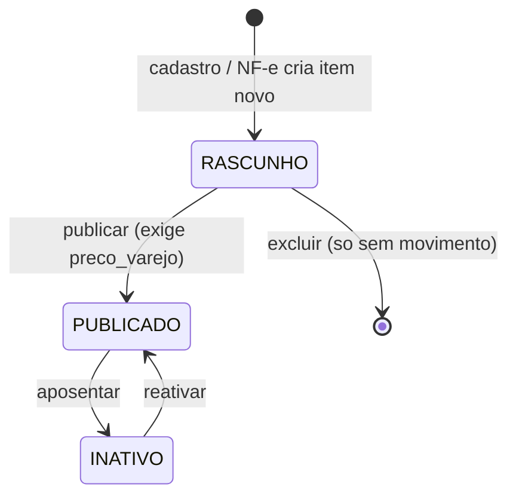
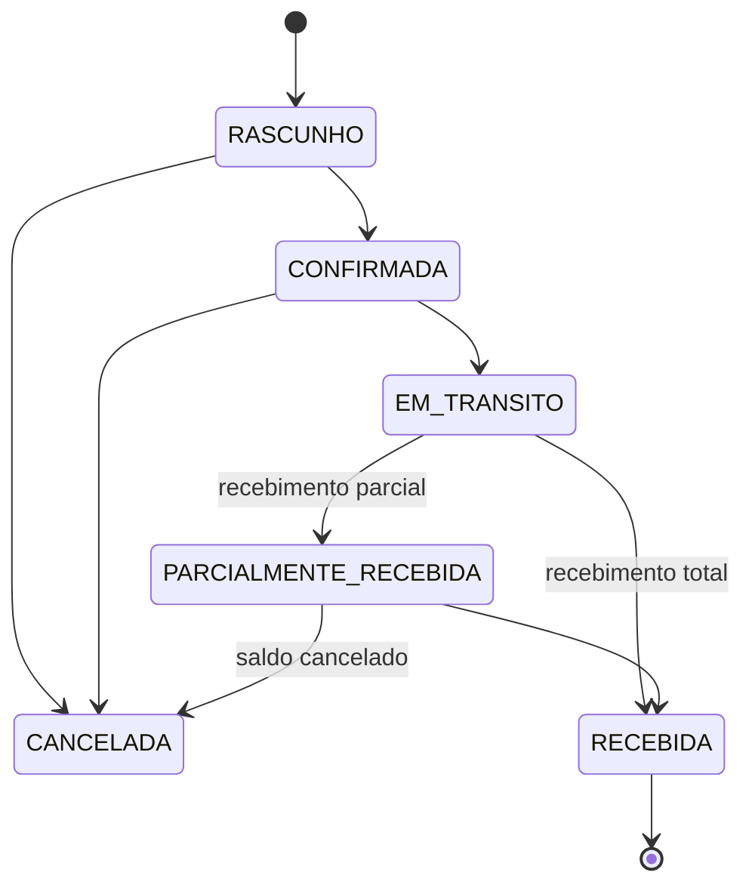
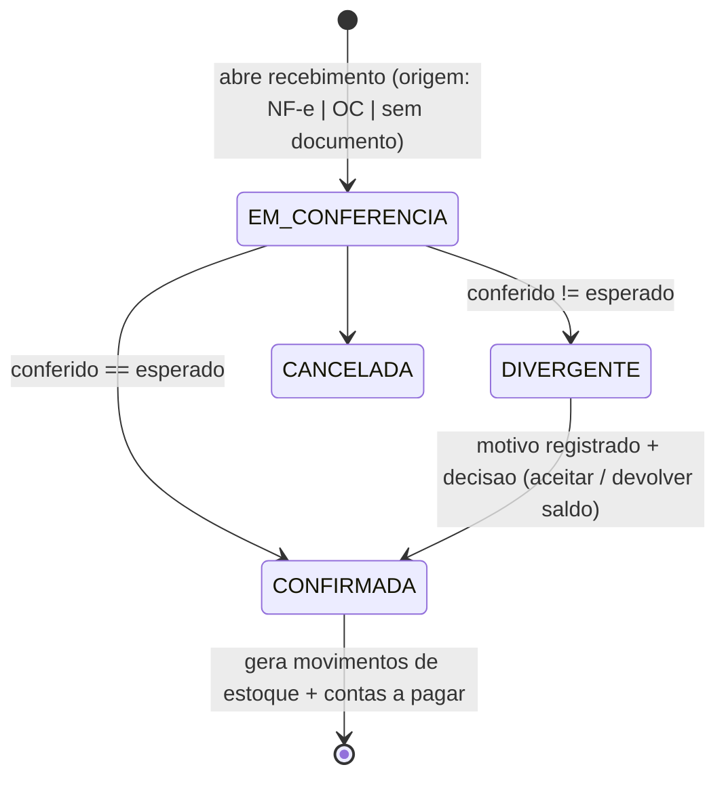
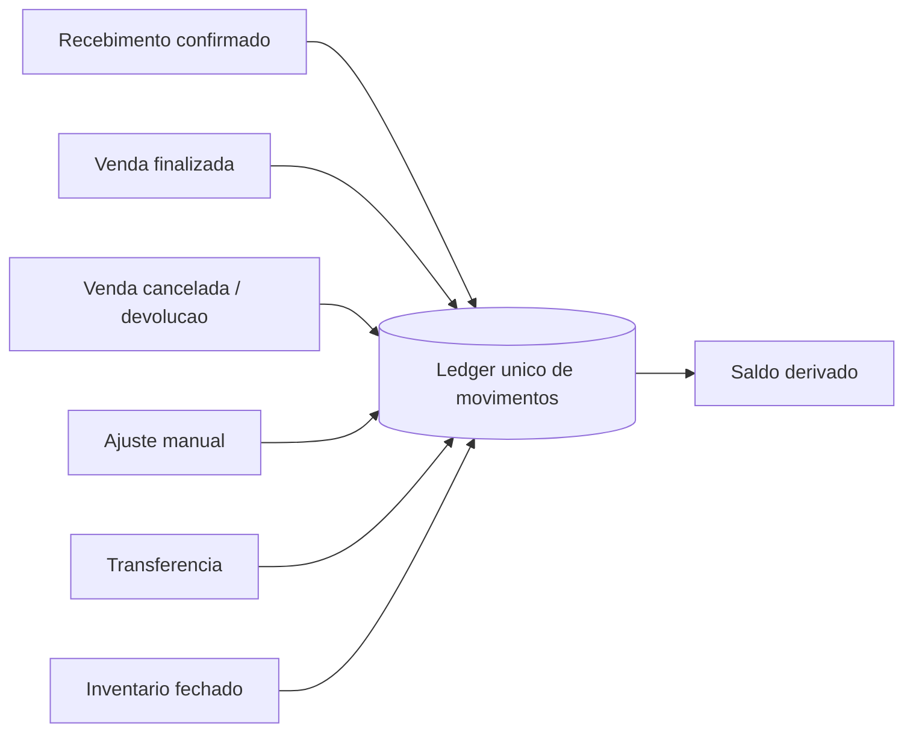
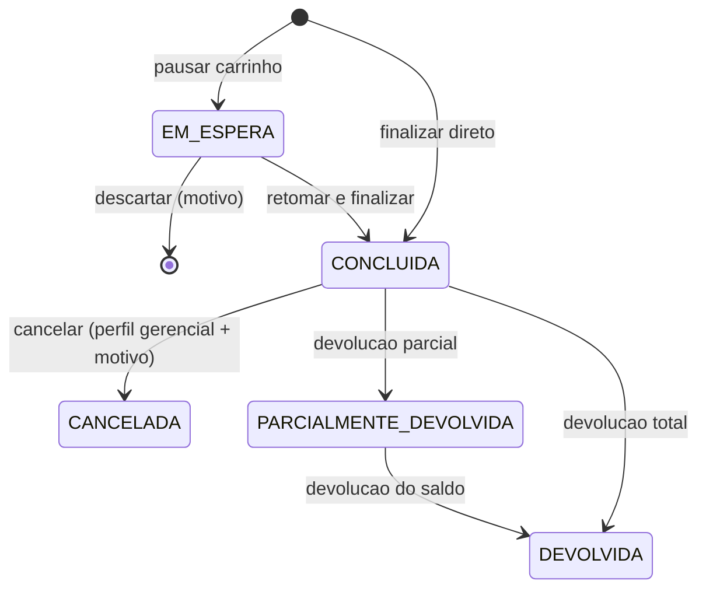
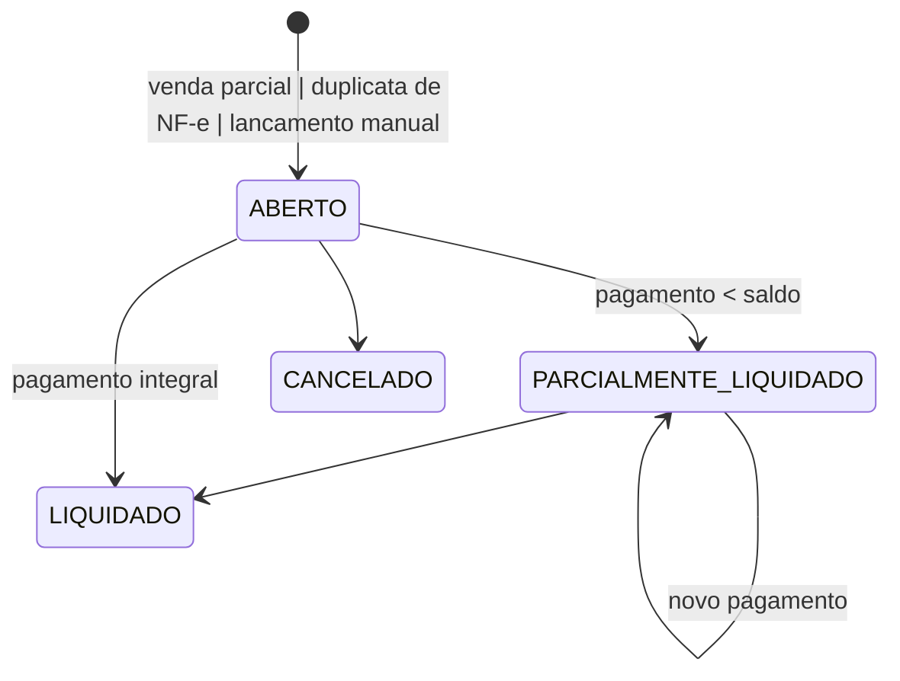
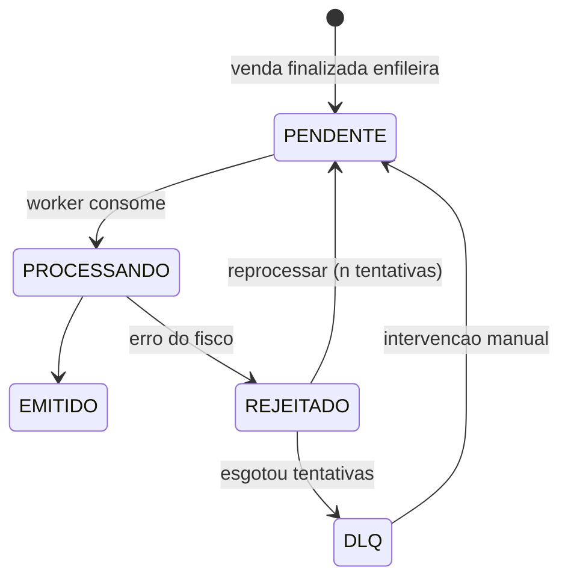
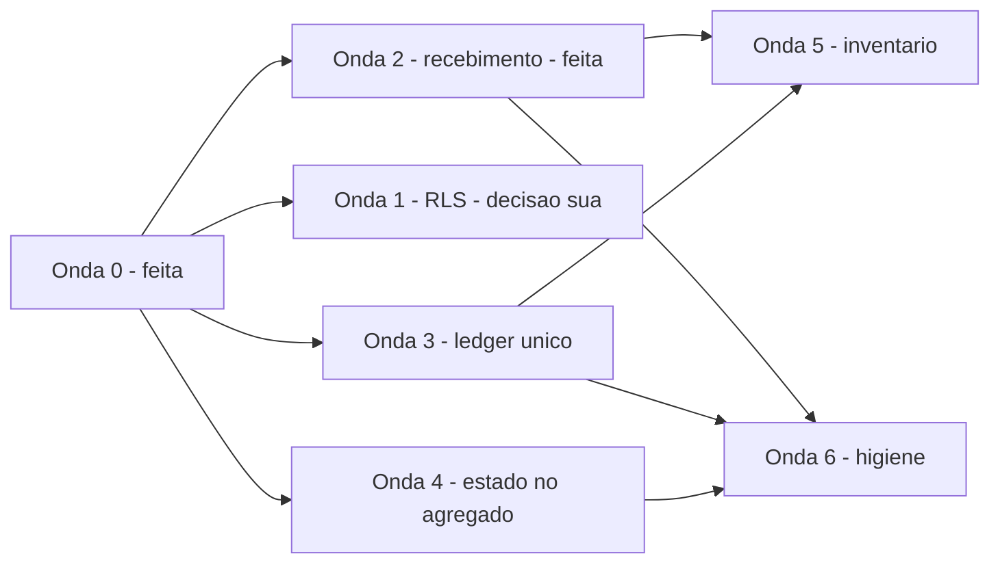

# Modelo de Domínio Operacional — Jīn Lóng

> Sprint seguinte a [MAPA_FLUXOS_JINLONG.md](./MAPA_FLUXOS_JINLONG.md).
> Aquele documento descreveu **o fluxo que o código implementa**. Este descreve
> **o fluxo que o negócio exige**, e só então compara.
> Escrito em 31/07/2026. Parte III registra o que já foi convergido.

---

## Princípios do modelo

Cinco decisões estruturais que valem para todos os domínios. O resto do documento
é a aplicação delas.

**P1 — O evento é o fato; a tela é a leitura.** Um domínio publica fatos consumados
(`venda.finalizada`, `estoque.recebido`). Telas, relatórios e caches são leitores
desses fatos. Nenhuma tela é "dona" de um processo.

**P2 — Uma entidade, uma autoridade de escrita.** Toda mutação de uma entidade passa
por um único port. Quem quiser escrever chama o port; ninguém chama a RPC direto.

**P3 — Documento é origem, não fluxo.** NF-e, ordem de compra e "chegou sem papel"
não são três processos. São três **origens** do mesmo processo: mercadoria entrou.
Um fluxo, três adaptadores de origem.

**P4 — Estado é do agregado, não da tela.** Cada agregado (Venda, Turno de Caixa,
Ordem de Compra, Título) tem uma máquina de estados explícita, com transições
válidas declaradas em um lugar. A UI habilita botões lendo a máquina; não a define.

**P5 — RPC executa, domínio decide.** Uma RPC existe para garantir **atomicidade e
concorrência** — coisas que só o banco resolve. Regra que não precisa de transação
(qual motivo é válido, qual perfil pode, qual campo é obrigatório) pertence ao
domínio em TypeScript, testável sem banco.

---

# Parte I — O modelo ideal

## 1. Produtos

**1. Objetivo operacional.** Manter a identidade comercial de cada item vendável:
o que é, como se identifica (GTIN/código interno), quanto custa, por quanto vende,
e se pode ou não aparecer no PDV.

**2. Eventos iniciadores.** Item novo chegando à loja · bipagem de código
desconhecido no PDV · linha de NF-e sem vínculo no catálogo · mudança de preço ·
aposentadoria de item.

**3. Estados.** `RASCUNHO` → `PUBLICADO` → `INATIVO`. Rascunho existe e recebe
estoque, mas não vende. Inativo não vende e não recebe. Não há estado "excluído":
produto com histórico de venda nunca some — vira inativo.

**4. Transições permitidas.**



Proibido: `INATIVO → RASCUNHO` (volta pra rascunho é regressão sem sentido
operacional); excluir item com movimento de estoque ou venda.

**5. Entidades.** Produto (raiz) · Categoria · Marca · Fornecedor (referência) ·
FaixaAtacado · HistóricoPreço.

**6. Documentos de origem.** NF-e de compra (cria item novo no De-Para) · planilha
CSV de carga inicial · cadastro manual · consulta GTIN externa.

**7. Regras do domínio.** Nome obrigatório e único por loja · GTIN, quando presente,
é único por loja · preço de venda ≥ 0; publicar exige preço definido · margem é
derivada, nunca digitada e armazenada em paralelo · faixa de atacado exige
quantidade mínima crescente e sem sobreposição · inativar não apaga histórico.

**8. RPCs que apenas executam.** `criar_produto_com_estoque_inicial` (atômica
produto+estoque, idempotente) · `list_produtos_gerente_filtrados` (leitura
paginada). Ambas justificadas: transação e paginação no banco.

**9. Autoridade de escrita.** Uma: `ProductWriter` / `ProductUpdater`.

**10. Fonte de verdade.** Uma: tabela `produtos`. Preço de atacado em
`precos_atacado`; `regras_preco` e `pricing_config_versions` **não** são fonte.

---

## 2. Compras

**1. Objetivo operacional.** Formalizar o compromisso de comprar antes da mercadoria
chegar, para que o recebimento tenha contra o que conferir.

**2. Eventos iniciadores.** Ruptura de estoque (item abaixo do mínimo) · reposição
planejada · pedido de importação.

**3. Estados.** `RASCUNHO` · `CONFIRMADA` · `EM_TRANSITO` · `PARCIALMENTE_RECEBIDA` ·
`RECEBIDA` · `CANCELADA`.

**4. Transições.**



**5. Entidades.** OrdemCompra (raiz) · ItemOC · Fornecedor · Produto.

**6. Documentos.** Pedido ao fornecedor · proforma de importação.

**7. Regras do domínio.** OC confirmada não muda de item nem de preço — só de
status · quantidade recebida nunca excede a pedida sem decisão explícita ·
cancelar OC com recebimento parcial cancela só o saldo · a máquina de estados é
uma só, declarada uma vez.

**8. RPCs.** Nenhuma necessária além da de recebimento (§3) — compra é CRUD com
máquina de estados, não precisa de transação especial.

**9. Autoridade de escrita.** Uma: `PurchaseOrderWriter`.

**10. Fonte de verdade.** `ordens_compra` + `ordens_compra_itens`.

---

## 3. Recebimento

O domínio que hoje tem o maior desvio. **Um fluxo, três origens** (P3).

**1. Objetivo operacional.** Registrar que mercadoria física entrou na loja, conferir
contra o que era esperado, e transformar isso em saldo de estoque + obrigação
financeira quando houver.

**2. Eventos iniciadores.** Chegada de carga com NF-e · chegada de carga contra OC ·
chegada sem documento (importação direta, brinde, troca de fornecedor).

**3. Estados.** `EM_CONFERENCIA` → `DIVERGENTE` → `CONFIRMADA` · `CANCELADA`.

**4. Transições.**



A transição `EM_CONFERENCIA → CONFIRMADA` é o **único** ponto que move saldo. Enquanto
o recebimento está aberto, nada entrou no estoque.

**5. Entidades.** Recebimento (raiz) · ItemRecebimento (esperado, conferido,
divergência) · OrigemRecebimento (NF-e | OC | manual) · Produto · Fornecedor.

**6. Documentos.** XML de NF-e · ordem de compra · nenhum.

**7. Regras do domínio.** Conferência é etapa com duração — abrir e confirmar são
momentos distintos · divergência exige motivo · produto `INATIVO` não recebe;
`RASCUNHO` recebe (mercadoria chega antes da publicação) · uma chave de NF-e entra
uma vez por loja (idempotência) · o De-Para fornecedor→produto é aprendido e
reutilizado · confirmação gera movimento de estoque e, havendo duplicatas, títulos
a pagar — na mesma transação.

**8. RPCs.** `confirmar_remessa_entrada` · `importar_nfe_transacao` ·
`receber_ordem_compra`. Todas justificadas: cada uma é uma transação
multi-tabela (estoque + log + documento de origem + financeiro).

**9. Autoridade de escrita.** Uma: `InventoryMovementWriter`, para as três origens.

**10. Fonte de verdade.** O **Recebimento** é a fonte do que entrou.
`importacoes_nfe`, `ordens_compra` e `remessas` são registros de origem, não
fontes concorrentes de saldo.

---

## 4. Estoque

**1. Objetivo operacional.** Responder com precisão auditável: quanto tem, onde
está, e por que mudou.

**2. Eventos iniciadores.** Recebimento confirmado · venda finalizada · venda
cancelada · devolução · transferência · ajuste manual · fechamento de inventário.

**3. Estados.** Saldo não tem estado — tem **valor**. O que tem estado é o
**movimento**, e o modelo ideal é append-only: um movimento nasce `APLICADO` e nunca
muda. Correção é um novo movimento em sentido contrário, nunca um UPDATE.

**4. Transições.** O saldo é sempre `saldo = Σ movimentos`. Nenhuma escrita direta
em `estoque.quantidade_atual` fora do writer.



**5. Entidades.** Saldo (produto × loja) · MovimentoEstoque (raiz do ledger) ·
TipoMovimento · Produto · Loja.

**6. Documentos.** Todos os do recebimento · cupom de venda · termo de
transferência · ficha de contagem de inventário.

**7. Regras do domínio.** Saldo nunca negativo sem decisão explícita · ajuste é
**absoluto** (define o saldo) e exige motivo de uma lista fechada · transferência
debita e credita na mesma transação, com idempotência · movimento carrega sempre
ator, origem e momento · perda e quebra são motivos distintos porque têm
tratamento fiscal distinto.

**8. RPCs.** `ajustar_estoque_manual` · `transferir_estoque_seguro` ·
`gerente_estoque_list_page` (leitura). Justificadas por atomicidade/concorrência.

**9. Autoridade de escrita.** **Uma** — no ideal. Hoje o ADR-008 admite duas
(inventory-led no writer, sales-led dentro da RPC de venda). Ver Parte II.

**10. Fonte de verdade.** Um ledger. Hoje são dois (`estoque_baixas` e
`movimentos_estoque_log`).

---

## 5. Vendas

**1. Objetivo operacional.** Trocar mercadoria por direito de recebimento, com
registro fiscal e baixa de estoque, em uma operação indivisível.

**2. Eventos iniciadores.** Cliente no balcão · retomada de venda em espera ·
(futuro) pedido remoto.

**3. Estados.** `EM_ESPERA` · `CONCLUIDA` · `CANCELADA` · `PARCIALMENTE_DEVOLVIDA` ·
`DEVOLVIDA`.

**4. Transições.**



Regra dura: **`CANCELADA` e `DEVOLVIDA` são caminhos diferentes.** Cancelar é
desfazer (a venda não deveria ter existido). Devolver é uma operação nova, posterior,
que reverte parcial ou totalmente uma venda válida. Fiscal e financeiramente não são
a mesma coisa.

**5. Entidades.** Venda (raiz) · ItemVenda · Pagamento (n por venda — split) ·
Desconto · Cliente (opcional) · Operador · Turno · OperaçãoPósVenda.

**6. Documentos.** Cupom · comprovante de pagamento · documento fiscal.

**7. Regras do domínio.** Preço **nunca** vem do cliente — é recalculado no servidor
e conferido contra o declarado · desconto acima do limite exige autorização de
gerente com token expirável, não persistido entre sessões · pagamento parcial exige
cliente identificado (vira contas a receber) · a soma dos pagamentos iguala o total ·
venda em espera **não** reserva estoque · finalizar é atômico: venda + itens +
pagamentos + baixa + evento, tudo ou nada · idempotência por par venda+produto.

**8. RPCs.** `finalizar_venda_transacional_canonica_v4` ·
`cancelar_venda_transacional` · `devolver_ou_trocar_venda` ·
`colocar_venda_em_espera` e família. Todas justificadas: são a definição de
atomicidade transacional.

**9. Autoridade de escrita.** Uma por operação, e o código já marca isso com
`FREEZE: CORE TRANSACIONAL`.

**10. Fonte de verdade.** `venda_eventos` (ledger append-only) para leitura
gerencial; `vendas` para o estado corrente. Duas trilhas de devolução coexistem
(`devolucoes` e `venda_pos_venda_operacoes`) — ver Parte II.

---

## 6. Caixa

**1. Objetivo operacional.** Responder quanto dinheiro deveria estar na gaveta,
quanto está, e quem mexeu.

**2. Eventos iniciadores.** Início de expediente · necessidade de troco · retirada
por excesso · fim de expediente.

**3. Estados.** Turno: `ABERTO` → `FECHADO`. Movimentação: `PENDENTE` → `APROVADA` ·
`CANCELADA` · `ESTORNADA`.

**4. Transições.**



```mermaid
stateDiagram-v2
  state Turno {
    [*] --> ABERTO: abrir (valor inicial)
    ABERTO --> FECHADO: fechar (valor contado; motivo se divergente)
  }
  state Movimentacao {
    [*] --> PENDENTE: sangria acima do limite
    [*] --> APROVADA: suprimento / sangria dentro do limite
    PENDENTE --> APROVADA: autorizacao do gerente
    PENDENTE --> CANCELADA
    APROVADA --> ESTORNADA: contra-lancamento
  }
```

**5. Entidades.** Turno (raiz) · MovimentaçãoCaixa · Operador · Gerente aprovador ·
Venda (contribui em dinheiro) · Devolução (subtrai em dinheiro).

**6. Documentos.** Comprovante de sangria · relatório de fechamento.

**7. Regras do domínio.** Um turno aberto por operador — garantido por índice único,
não por checagem otimista · movimentação pendente **impede** o fechamento · valor
esperado = inicial + vendas em dinheiro + suprimentos − sangrias − devoluções em
dinheiro · divergência acima do limite exige motivo · fechamento cego esconde o
esperado até o operador declarar · estorno é contra-lançamento, nunca DELETE ·
fechar é idempotente.

**8. RPCs.** `fechar_caixa_atomico` · `registrar_movimentacao` ·
`aprovar_movimentacao` · `estornar_movimentacao` ·
`calcular_valor_sistema_dinheiro_caixa` · `obter_status_caixa_operador`.
Justificadas. **Este é o domínio mais bem modelado do sistema** — serve de
referência para os outros.

**9. Autoridade de escrita.** Uma: `CashSessionWriter` + `CashMovementWriter`.

**10. Fonte de verdade.** `caixas` + `movimentacoes_caixa`. A tabela
`movimentos_caixa` (vazia) é ruído.

---

## 7. Financeiro

**1. Objetivo operacional.** Controlar o que a loja tem a receber e a pagar, e
reconciliar com o que efetivamente entrou e saiu.

**2. Eventos iniciadores.** Venda com pagamento parcial (gera título a receber) ·
recebimento com duplicatas (gera título a pagar) · lançamento manual · liquidação.

**3. Estados.** Título: `ABERTO` → `PARCIALMENTE_LIQUIDADO` → `LIQUIDADO` ·
`CANCELADO` · `VENCIDO` (derivado da data, não armazenado).

**4. Transições.**



**5. Entidades.** TítuloReceber · LiquidaçãoReceber · TítuloPagar ·
PagamentoPagar · Cliente · Fornecedor · CategoriaFinanceira.

**6. Documentos.** Duplicata da NF-e · carnê/crediário · comprovante de pagamento.

**7. Regras do domínio.** Título nasce de um **evento**, não de digitação — o manual
é exceção · soma das liquidações nunca excede o valor do título · liquidação em
dinheiro no caixa aberto impacta o fechamento do turno · cancelar título liquidado
exige estorno da liquidação primeiro · vencido é cálculo, não estado gravado.

**8. RPCs.** `registrar_liquidacao_receber` · `registrar_pagamento_contas_pagar`.
Justificadas: atualizam título e parcela na mesma transação.

**9. Autoridade de escrita.** Uma por lado: `ReceivableWriter` / `PayableWriter`.

**10. Fonte de verdade.** `contas_receber` / `contas_pagar`. `vendas_pagamentos`
registra o pagamento **da venda**, não o título — papéis distintos, sem
sobreposição.

---

## 8. Fiscal

**1. Objetivo operacional.** Transformar cada venda em documento fiscal válido, sem
que a falha do fisco derrube a venda.

**2. Eventos iniciadores.** Venda finalizada · venda cancelada (evento de
cancelamento) · devolução · reprocessamento manual.

**3. Estados.** `PENDENTE` → `PROCESSANDO` → `EMITIDO` · `REJEITADO` → `DLQ`.

**4. Transições.**



**5. Entidades.** DocumentoFiscal · EventoFiscal (trilha) · Venda · DLQ.

**6. Documentos.** NFC-e · NF-e de devolução · evento de cancelamento.

**7. Regras do domínio.** **Assíncrono por definição** — o fisco fora do ar não pode
bloquear a venda · toda transição registra evento (trilha completa) · reprocessar é
idempotente · documento emitido é imutável; correção é evento de cancelamento +
novo documento.

**8. RPCs.** `fiscal_enfileirar_documento_venda` · `fiscal_reprocessar_documento` ·
`fiscal_registrar_evento_enqueue_erro`. Justificadas.

**9. Autoridade de escrita.** Uma: a fila. Ninguém escreve documento fiscal fora dela.

**10. Fonte de verdade.** `documentos_fiscais_pendentes` + `..._eventos` + `..._dlq`.

---

## 9. Clientes

**1. Objetivo operacional.** Identificar quem compra, quando isso muda a operação —
crediário, pagamento parcial, histórico, nota com CPF.

**2. Eventos iniciadores.** Venda que exige identificação · abertura de crediário ·
cadastro no balcão.

**3. Estados.** `ATIVO` · `INATIVO`. Crediário: `SEM_LIMITE` · `COM_LIMITE` ·
`BLOQUEADO` (saldo devedor acima do limite).

**4. Transições.** Bloqueio é **derivado** de `saldo_crediario > limite_crediario` —
calculado, não gravado, para não haver estado desatualizado.

**5. Entidades.** Cliente (raiz) · TítuloReceber · Venda.

**6. Documentos.** Documento de identidade · termo de consentimento LGPD.

**7. Regras do domínio.** Documento (CPF/CNPJ) único por loja quando informado ·
consentimento LGPD registrado com data na criação · cliente com venda ou título
nunca é excluído — vira inativo · limite de crediário só perfil gerencial altera.

**8. RPCs.** Nenhuma — cliente é CRUD, não precisa de transação especial. Correto
que não exista.

**9. Autoridade de escrita.** Uma: `ClienteWriter`.

**10. Fonte de verdade.** `clientes`.

---

## 10. Funcionários

**1. Objetivo operacional.** Saber quem opera o sistema, com qual permissão, e
atribuir responsabilidade a cada ato.

**2. Eventos iniciadores.** Contratação · mudança de função · desligamento ·
mudança de regra de comissão.

**3. Estados.** Funcionário: `ATIVO` · `AFASTADO` · `DESLIGADO`. Credencial:
`ATIVA` · `SUSPENSA`.

**4. Transições.** Desligar funcionário **suspende** a credencial automaticamente,
mas não apaga nada: os registros que ele gerou continuam apontando para ele.

**5. Entidades.** Funcionário (pessoa) · Usuário (credencial) · Perfil (papel) ·
RegraComissão · Comissão.

> **Distinção essencial:** *pessoa* ≠ *credencial* ≠ *papel*. Um funcionário pode
> existir sem login (estoquista que não usa o sistema). Um usuário sempre pertence a
> uma pessoa. O papel é do usuário, não da pessoa.

**6. Documentos.** Contrato · acordo de comissão.

**7. Regras do domínio.** Perfil define o que se pode fazer, declarado em um lugar
só · desligado não abre caixa · regra de comissão tem precedência determinística
(produto → categoria → margem → padrão) · alteração de regra é versionada e
auditada · operador não cancela venda nem aprova a própria sangria.

**8. RPCs.** `resumo_comissoes_por_operador` · `detalhe_comissoes_operador` ·
`marcar_comissoes_pagas`. As duas primeiras são agregação (justificada); a terceira
é escrita em lote (justificada).

**9. Autoridade de escrita.** Uma: `FuncionarioWriter`.

**10. Fonte de verdade.** `funcionarios` (pessoa) + `usuarios` (credencial). A
tabela `perfis` (vazia) é ruído.

---

# Parte II — Ideal × Implementado

## 2.1 Placar por domínio

| Domínio | Fluxo oficial único | Autoridade de escrita única | Regra em 1 implementação | Estado modelado |
|---|---|---|---|---|
| Produtos | ✅ | ✅ | ✅ | ✅ |
| Compras | ✅ | ✅ | ⚠️ máquina de estados só no cliente | ✅ |
| **Recebimento** | ❌ **3 fluxos** | ✅ *(convergido nesta sprint)* | ❌ conferência inexistente | ❌ sem `DIVERGENTE` |
| **Estoque** | ✅ | ⚠️ 2 (ADR-008) | ✅ | ⚠️ 2 ledgers |
| Vendas | ✅ | ✅ | ✅ | ⚠️ 2 trilhas de devolução |
| **Caixa** | ✅ | ✅ | ✅ | ✅ **referência** |
| Financeiro | ✅ | ✅ | ✅ | ⚠️ `VENCIDO` não modelado |
| Fiscal | ✅ | ✅ | ✅ | ✅ |
| Clientes | ✅ | ✅ *(convergido)* | ✅ | ⚠️ bloqueio de crediário não existe |
| Funcionários | ✅ | ✅ | ✅ | ⚠️ pessoa/credencial não separadas de fato |

## 2.2 Diferenças estruturais

**D1 — Recebimento: três fluxos onde o negócio tem um.** O negócio faz uma coisa
("conferi e entrou"). O sistema tem três telas, três modelos de dados e três
caminhos. Consequência prática: quem recebe por OC não tem conferência; quem recebe
por NF-e não tem OC; quem recebe sem papel tem uma tela que finge conferir.

**D2 — Conferência declarada e não executada.** `remessas` tem status
`EM_CONFERENCIA` e campos `quantidade_esperada`/`quantidade_conferida`, mas
`criarRemessaConferencia` abre e confirma na mesma função. O estado `DIVERGENTE` do
modelo ideal simplesmente não existe. Isso é pior que ausência: produz trilha
auditável de uma conferência que não houve.

**D3 — Estoque com duas autoridades, por decisão.** ADR-008 separa *sales-led*
(baixa dentro da RPC de venda) de *inventory-led* (writer). A decisão tem
justificativa real — atomicidade da venda —, mas o efeito é que "quanto mudou o
estoque e por quê" tem duas implementações. O modelo ideal mantém a atomicidade e
resolve com **um ledger**, alimentado por dois caminhos, e não dois ledgers.

**D4 — Estado no cliente, não no agregado.** `STATUS_TRANSITIONS` da ordem de compra
vive em `app/gerente/compras/actions.ts` e é validado antes do UPDATE. Duas sessões
simultâneas passam pela mesma checagem otimista. Compare com o turno de caixa, que
resolve a mesma classe de problema com índice único no banco.

**D5 — Pessoa e credencial fundidas.** `funcionarios` está vazia (0 linhas);
`usuarios` tem 12. Na prática, "funcionário" hoje **é** o usuário. Funciona no
piloto e quebra no primeiro estoquista sem login.

**D6 — Inventário ausente.** Domínio que o negócio tem e o sistema não. Contar 112
produtos hoje significa abrir 112 modais de ajuste, sem congelamento, sem apuração
de divergência, sem aprovação.

## 2.3 Complexidade desnecessária

| O quê | Custo real |
|---|---|
| ~~14 telas órfãs em `app/gerente/*`~~ | **removido nesta sprint** |
| ~~53 `revalidatePath` para rotas mortas~~ | **removido** — eram no-ops mascarando telas que não atualizavam |
| ~~2 fachadas mortas de escrita de cliente~~ | **removidas** |
| Dois design systems (`components/gerente` × `admin-v2`) | 3 telas vivas ainda no legado; burndown ativo |
| 6 pares de tabelas duplicadas/vazias | leitor não sabe qual é a boa; `regras_preco` já precisou de doc para dizer "não é SSoT" |
| 115 arquivos em `docs/`, vários de sprints encerradas | `CIRCUITO_OPERACIONAL.md` descreve a venda em v2; o código está em v4 |

## 2.4 Dívida técnica, por severidade

**🔴 Bloqueante para escala**

1. **Conferência de recebimento fictícia** (D2) — em convergência, ver Onda 2.
2. **RLS desabilitado** em `sync_request_nonces`, `documentos_fiscais_dlq`,
   `venda_engine_shadow_runs` — expostas a `anon`/`authenticated`.
3. **Três diretórios `supabase/`, um só real.** As migrations vivem em
   `backend/supabase/migrations` (237 arquivos, tudo versionado).
   `pdv-importados/supabase/migrations` tem 7 arquivos soltos e
   `supabase/` na raiz está vazio — ambos induzem ao erro de achar que a regra de
   negócio não está versionada. Apagar os dois falsos.

**🟠 Estrutural**

4. `movimentos_estoque_log` **não fecha com o saldo**: 85 de 110 linhas de `estoque` não têm
   nenhum movimento correspondente. Não são "dois ledgers" — é um saldo sem ledger. Medição e
   causa em [AUDITORIA_ARQUITETURA_EVENTOS_JINLONG.md §6.1](./AUDITORIA_ARQUITETURA_EVENTOS_JINLONG.md).
5. `devolucoes` é escrita por **dois eventos de negócio distintos** — cancelamento e devolução —
   e só `operacao_id` os distingue. Medido em 31/07: `devolucoes` = 5 linhas, todas com
   `operacao_id` NULL (vieram de cancelamento); `venda_pos_venda_operacoes` = 0. O fluxo de
   devolução pós-venda nunca rodou em produção.
   *(Correção: a primeira versão dizia "trilha antiga × nova, dados na antiga". Ver
   [AUDITORIA_ARQUITETURA_EVENTOS_JINLONG.md §6.8](./AUDITORIA_ARQUITETURA_EVENTOS_JINLONG.md).)*
6. Máquina de estados da OC no cliente (D4).
7. Três telas vivas no DS legado.

**🟡 Higiene**

8. Tabelas natimortas: `movimentos_caixa`, `perfis`, `regras_preco`.
9. `ROUTES.gerente` declara 19 rotas que são redirect.
10. Documentação de fluxo desatualizada.

---

# Parte III — Plano incremental de convergência

## Onda 0 — executada nesta sprint

Tudo abaixo está no código, com typecheck limpo, 866 testes passando e guarda
automatizada contra regressão.

### ✅ C1 — Invalidação de cache por evento de domínio (P1)

`lib/navigation/revalidarDominio.ts` — mapa único **evento → telas**. A action
declara o fato (`revalidarDominio('venda.finalizada')`); o mapa resolve as telas.
20 arquivos migrados, 53 chamadas mortas eliminadas.

**Bugs reais corrigidos** (telas que nunca atualizavam):

| Operação | Antes | Depois |
|---|---|---|
| Sangria / suprimento | só `/gerente/caixas` (redirect) | `/caixa` + `/admin/vendas` |
| Abertura / fechamento de turno | só `/gerente/caixas` | `/caixa` + `/admin/vendas` + dashboard |
| Recebimento de remessa | só `/gerente/recebimento` | recebimento + estoque + catálogo + compras + financeiro |
| Recebimento de OC | só `/gerente/compras` | idem |
| Importação de NF-e | faltava `/admin/estoque` | idem |
| Comissões, suspensão, configurações, transferências | só rotas legadas | telas canônicas |

Guarda: `scripts/check-revalidate-boundary.mjs` — falha se alguém chamar
`revalidatePath` fora do módulo autoridade.

### ✅ C2 — Autoridade única de escrita na entrada de mercadoria (P2, P3)

`receber_ordem_compra` era chamada direto pela action de compras, fora do
`InventoryMovementWriter`. Agora as **três** origens passam pelo mesmo port:

```
NF-e     ─┐
Remessa  ─┼─→ InventoryMovementWriter ─→ RPC ─→ ledger
OC       ─┘
```

Novo método `receiveOrdemCompra` no contrato (`shared-core/src/inventory/contracts.ts`),
com validação de entrada e códigos de erro i18n (pt/zh).

Guarda: `scripts/check-entity-ssot-boundary.mjs` ganhou `RPC_AUTHORITY` — cada RPC de
estoque tem um único arquivo autorizado a invocá-la. Verificado por teste negativo:
reintroduzir a chamada direta faz o check falhar.

### ✅ C3 — Remoção do fluxo-fantasma

33 arquivos removidos: 14 telas órfãs, o DS legado que só as servia, a sidebar morta,
`salvarClienteAction` e `criarCliente` (segunda autoridade de escrita de cliente, que
fazia INSERT direto em `clientes`), `enfileirarDocFiscalStub` e
`buscarProdutosPaginadosAction`.

DS legacy burndown: `GerenteTable` 13→6 arquivos · `.app-btn-*` 38→16 hits ·
`text-[Npx]` 331→274 hits.

### ✅ C4 — Guardas como parte do fluxo

`npm run check:dominio` (= `check:entity-ssot` + `check:revalidate`), encadeado em
`check:golive`.

---

## Onda 1 — decisão que não posso tomar sozinho

| # | Ação | Por que precisa de você |
|---|---|---|
| 1 | **RLS nas 3 tabelas** | Habilitar sem policy derruba o sync do PDV desktop. SQL em [MAPA_FLUXOS_JINLONG.md §R12](./MAPA_FLUXOS_JINLONG.md) |

> **Correção.** A primeira versão deste documento afirmava que as migrations não
> estavam versionadas e fazia disso o gargalo de todas as ondas. Errado: elas estão
> em `backend/supabase/migrations` (237 arquivos). O engano veio de olhar apenas
> `pdv-importados/supabase/migrations` e `supabase/` na raiz. Nenhuma onda depende
> disso — a Onda 2 foi implementada.

## Onda 2 — recebimento com conferência real (D1, D2) — **implementada**

Ver Parte IV. O modelo abaixo é o que foi construído:

```mermaid
flowchart TD
  A[/admin/estoque/entrada] --> B{Origem}
  B -->|NF-e| C[XML -> linhas pre-preenchidas]
  B -->|Ordem de compra| D[OC -> itens pre-preenchidos]
  B -->|Sem documento| E[Busca -> itens em branco]
  C & D & E --> F[EM_CONFERENCIA: esperado x conferido]
  F --> G{Divergencia?}
  G -->|Sim| H[DIVERGENTE: motivo + decisao]
  G -->|Nao| I[CONFIRMADA]
  H --> I
  I --> J[InventoryMovementWriter]
  J --> K[(movimentos + saldo + contas a pagar)]
```

O port já estava unificado (C2); esta onda acrescentou a máquina de estados, a
divergência e a separação entre abrir, conferir e confirmar.

## Onda 3 — um ledger de estoque (D3)

Decidir entre `estoque_baixas` e `movimentos_estoque_log`, migrar, e fazer o caminho
sales-led escrever no mesmo ledger que o inventory-led. Mantém a atomicidade do
ADR-008; elimina a segunda contabilidade.

## Onda 4 — estado no agregado (D4)

Mover `STATUS_TRANSITIONS` da OC para `shared-core`, com constraint no banco. Usar o
turno de caixa (índice único `uq_caixas_operador_aberto`) como padrão.

## Onda 5 — inventário (D6)

Domínio novo. Escopo mínimo para o piloto: contagem por categoria, lista contado ×
sistema, divergência apurada, um acerto em lote reaproveitando `ajustar_estoque_manual`
com motivo `ACERTO_INVENTARIO`.

## Onda 6 — higiene

Descartar `movimentos_caixa`, `perfis`, `regras_preco`. Resolver
`devolucoes` × `venda_pos_venda_operacoes`. Migrar as 3 telas restantes para admin-v2
e apagar o DS legado. Podar `docs/`.

---

## Sequência



A Onda 2 abriu caminho para a 5: o inventário reaproveita a mesma máquina
abrir → conferir → divergir → confirmar, trocando "esperado pela nota" por
"esperado pelo sistema".
