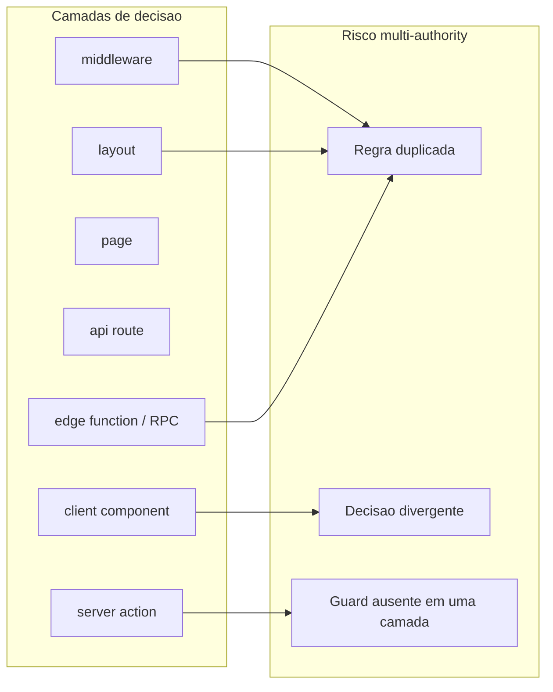

# Relatório de Auditoria — Padrão Multi-Authority no Projeto

Escopo: monorepo `fastproduct` — prioridade `pdv-importados`, com referências cruzadas a `backend/` e `pdv-local/` onde contratos de negócio se duplicam.

Data de referência: código no workspace em 2026-06-07.

Relacionado: [ADMIN_AUTH_STRUCTURAL_AUDIT.md](./ADMIN_AUTH_STRUCTURAL_AUDIT.md) (caso de convergência bem-sucedida em auth).

---

## Sumário executivo

Este relatório identifica subsistemas onde **múltiplas fontes de decisão** concorrem para o mesmo domínio de regra — o padrão que existia em auth antes da convergência para `adminPolicy`.

**Conclusão principal:**

| Estado | Subsistemas |
|--------|-------------|
| Convergido (baixo risco) | Auth `/admin` + `/gerente` + APIs gerente |
| Multi-authority real (alto risco) | Caixa operacional, contrato de venda/sync |
| Multi-authority parcial (médio risco) | Pricing web, validação gerente, i18n/perfil, roteamento pós-login, backend/fiscal |

Nenhuma alteração de código foi realizada nesta auditoria. O documento registra o estado estrutural atual.

---

## Metodologia

1. Varredura por padrões de nomenclatura: `assert*`, `canAccess*`, `validate*`, `check*`, `require*`.
2. Mapeamento por camada: middleware → layout → page → API → server action → client → edge function → DB/RLS.
3. Comparação de runtime: Edge vs SSR vs client para o mesmo conceito.
4. Cruzamento com testes que documentam exceções aceitas (ex.: `tests/admin-gerente-authority.test.ts`).



---

## 1. Subsistemas com potencial multi-authority

### 1.1 Auth e roteamento — Risco: **Baixo** (convergido)

**Núcleo central:** [`pdv-importados/lib/admin/policy/adminPolicy.ts`](../pdv-importados/lib/admin/policy/adminPolicy.ts)

| Função | Papel |
|--------|-------|
| `middlewareAdminDecision` | Decisão edge (rotas, sessão) |
| `apiAdminDecision` | Autorização API |
| `actionAdminDecision` | Autorização server actions |
| `canAccessAdmin` | Perfil gerencial (GERENTE/DONO/ADMIN) |
| `canExecuteAction` | Actions nomeadas (`estoque:kardex`, `vendas:detalhe`) |
| `canAccessResource` | Rotas, APIs, recursos `sensitive:*` |
| `derivePermissionsForSession` | Lista de permissões do contrato |

**Normalização única de sessão:** [`pdv-importados/lib/admin/auth/sessionConsistency.ts`](../pdv-importados/lib/admin/auth/sessionConsistency.ts)

| Função | Camada |
|--------|--------|
| `fetchRawSession` | Edge (dados brutos) |
| `normalizeAdminSession` | Edge + SSR (contrato único) |
| `getCachedAdminSession` / `resolveAdminSession` | SSR cacheado |

**Adapters por camada (delegam à policy, sem regras próprias):**

| Função | Arquivo | Consumidor |
|--------|---------|------------|
| `middleware` | `pdv-importados/middleware.ts` | Edge |
| `requireAdminSessionApi` | `lib/admin/auth/requireAdminSessionApi.ts` | API `/api/gerente/*` |
| `assertAdminSession` | `lib/admin/auth/assertAdminSession.ts` | Actions `/admin` |
| `assertGerenteSession` | `lib/gerente/auth/assertGerenteSession.ts` | Actions `/gerente` |
| `gerenteAdminDecision` | `lib/gerente/auth/gerenteAdapter.ts` | Adapter gerente → policy |

**Duplicação residual controlada:**

| Local | Comportamento | Tipo |
|-------|---------------|------|
| `app/admin/layout.tsx` | Fallback `!session` → redirect | Render only |
| `app/gerente/layout.tsx` | Fallback `!session` → `/caixa` | Render only |
| `lib/auth/gerenteOuDono.ts` | Shim `@deprecated` → `assertGerenteSession` | Legado |
| `isPerfilPainelGerencial` | Primitiva compartilhada (policy + UI) | Mesma função, múltiplos consumidores |

**APIs gerente com guard centralizado:** `health`, `atividades/recent`, `atividades/history`, `fila/status`, `notificacoes/count`.

**Exceção:** `app/api/caixa/scan-telemetry/route.ts` — `supabase.auth.getUser()` inline, fora de `adminPolicy`.

---

### 1.2 Caixa (PDV web) — Risco: **Alto**

Segundo modelo de autoridade paralelo: identidade via `supabase.auth.getUser()` inline e `getUsuarioAtual`, sem adapter policy.

**Arquivos com `auth.getUser()` em `app/caixa/server/`:** `caixaVendas.impl.ts`, `caixaMovimentacoes.impl.ts`, `caixaSessaoOperador.impl.ts`, `caixaGerenteDesconto.impl.ts`, `caixaConfiguracoes.impl.ts`, `caixaTurnoResumo.impl.ts`, entre outros.

| Domínio | Funções / locais | Camadas |
|---------|------------------|---------|
| Sessão operador | `auth.getUser()` nos `*.impl.ts` | Server action |
| Telemetria | `app/api/caixa/scan-telemetry/route.ts` | API |
| Finalização venda | `finalizarVendaValidation.ts` + `caixaVendas.impl.ts` | Client schema + server |
| Preço autoritativo | `caixaPrecoAutoritativoServer.ts` vs `unifiedCartStore` | Server RPC + client store |
| Desconto gerente | `CaixaGerenteModal` + `managerDiscount/policy.ts` + `caixaGerenteDesconto.impl.ts` + backend `validateGerenteAndIssueToken` | Client + server + edge fn |
| Vendas suspensas | `CaixaPageClient.tsx` (gate client); config em `gerente/suspensao/actions.ts` | Client gate; **ausente** em `caixaVendas.impl.ts` |
| Fechamento divergência | `CaixaPageClient.tsx` (limite `5`) vs `caixaFechamentoServer.ts` (`LIMITE_DIVERGENCIA_FECHAMENTO`) | Client + server |
| Sangria | `CaixaMovimentacaoModal.tsx` (limite client) vs RPC `registrar_movimentacao` | Client UX + DB |

**Padrão detectado:** regra crítica decidida no client para UX; enforcement real em RPC/DB. Gap quando server action é invocada sem passar pelo client.

**Evidência `vendas_suspensas`:** presente em `CaixaPageClient.tsx` e `gerente/suspensao/actions.ts`; **não** presente em `app/caixa/server/`.

---

### 1.3 Vendas / payload sync — Risco: **Alto**

Contrato de venda validado em três autoridades independentes (sem biblioteca compartilhada):

| Autoridade | Arquivo |
|------------|---------|
| Caixa web (Zod) | `pdv-importados/app/caixa/finalizarVendaValidation.ts` |
| Offline sync | `pdv-local/src/lib/outboxEventValidate.ts` |
| Backend ingest | `backend/supabase/functions/sync-outbox/index.ts` |

**Divergência documentada:** quantidade com até 3 decimais no schema web vs `Math.floor` no RPC de preço (`caixaPrecoAutoritativoServer.ts`).

---

### 1.4 Pricing — Risco: **Médio**

| Autoridade | Onde | Papel |
|------------|------|-------|
| `PricingService` | `shared/pricing/PricingService.ts` | Motor compartilhado (testes em `core/pricing/`) |
| RPC `calcular_preco_produto` | `caixaPrecoAutoritativoServer.ts` | Autoridade runtime web |
| Triggers DB | `backend/supabase/migrations/122_*`–`125_*` | Autoridade persistência |
| Store client | `shared-core/src/stores/unifiedCartStore.ts` | Cálculo interativo + floor `precoMinimo` |

**Padrão:** três modelos de pricing coexistem; tipos MANUAL/PROMOCAO confiam em snapshot do client no server.

---

### 1.5 Gerente — validação de formulários — Risco: **Médio**

Validação duplicada entre client (modais/pages) e server (Zod em `actions.ts` / `*.validation.ts`):

| Domínio | Client | Server |
|---------|--------|--------|
| Produtos | `NovoProdutoModal.tsx`, `ProdutosEditarCatalogoModal.tsx` | `app/gerente/produtos/actions.ts` |
| Estoque ajuste | `AjusteSaldoModal.tsx` (`MOTIVOS` local) | `estoque/actions.validation.ts` |
| Financeiro | `FinanceiroGerentePageClient.tsx` | `financeiro/actions.validation.ts` |
| NFe import | `ImportarNfePageClient.tsx` | `importar-nfe/actions.validation.ts` |
| CSV produtos | — | `lib/gerente/parseProdutoImportCsv.ts` |

**Auth gerente:** centralizado via `assertGerenteSession` na maioria das actions.

**Exceções documentadas (RLS only, sem guard app):**

| Arquivo | Observação |
|---------|------------|
| `app/gerente/relatorios/actions.ts` | Comentário "cliente + RLS"; allowlist em `tests/admin-gerente-authority.test.ts` |
| `app/gerente/relatorios/vendas/actions.ts` | Mesmo padrão |

`app/gerente/relatorios/sem-giro/actions.ts` usa `assertGerenteSession` (guard explícito).

---

### 1.6 Admin — permissões granulares — Risco: **Médio**

A policy registra `sensitive:financeiro`, `sensitive:comissoes` e actions nomeadas, porém:

- Apenas 2 admin actions usam `assertAdminSession` com action key: `estoque:kardex`, `vendas:detalhe`.
- Demais páginas admin dependem só do layout gate.
- `assertGerenteSession` não recebe `action`/`resource` em call sites — check binário de perfil.

**Padrão:** policy registry rico vs consumo efetivo limitado — autoridade nominal e autoridade efetiva divergem.

---

### 1.7 i18n / perfil — Risco: **Médio**

| Função | Camadas |
|--------|---------|
| `isGerenteOuDono` | `src/lib/idioma/usuarioIdioma.ts` (SSR) + `hooks/useIdioma.ts` (client) |
| `getUsuarioIdioma` | SSR via `getUsuarioAtual` |
| `useIdioma` | Leitura Supabase direta no client |

Ambas delegam a `isPerfilPainelGerencial` (`lib/auth/painelGerencial.ts`), mas usam **pipelines de leitura de identidade distintos** de `getCachedAdminSession`.

**UI:** `GerenteLayoutShell.tsx` usa `isPerfilPainelGerencial` para visibilidade do seletor de idioma.

---

### 1.8 Login / roteamento pós-auth — Risco: **Médio**

| Decisor | Comportamento |
|---------|---------------|
| `middlewareAdminDecision` | Gerente em `/caixa` → redirect `/gerente` |
| `LoginForm.tsx` | Pós-login: GERENTE/DONO/ADMIN → `/admin/dashboard` |
| `gerente/layout.tsx` | Sem sessão → `/caixa` (não `/login`) |

**Padrão:** destino pós-autenticação decidido em três lugares com semânticas diferentes.

---

### 1.9 Backend / fiscal / sync — Risco: **Médio** (monorepo)

| Domínio | Autoridade |
|---------|------------|
| Token desconto gerente | `backend/supabase/functions/_shared/gerente-auth.ts` |
| Sync outbox | `backend/supabase/functions/sync-outbox/index.ts` |
| Fiscal | `backend/supabase/functions/fiscal-worker/fiscal-validation.ts` |

Isolado do Next policy por design; contratos espelhados com `pdv-importados` e `pdv-local`.

---

## 2. Classificação de risco

| Subsistema | Risco | Motivo |
|------------|-------|--------|
| Auth admin/gerente | **Baixo** | Policy única + testes de invariante |
| Caixa (sessão + regras operacionais) | **Alto** | Autoridade paralela; gaps client-only |
| Vendas / sync payload | **Alto** | Triplicação de validação sem núcleo |
| Pricing web | **Médio** | RPC + store + DB; MANUAL trusted |
| Gerente forms | **Médio** | Validação duplicada client/server |
| Gerente relatórios (2 actions) | **Médio** | Guard app ausente (RLS only) |
| Admin permissões finas | **Médio** | Policy registry vs consumo efetivo |
| i18n / perfil | **Médio** | Múltiplos readers de identidade |
| Login routing | **Médio** | Decisões de destino divergentes |
| Backend / fiscal | **Médio** | Autoridade separada; contratos espelhados |

---

## 3. Padrões repetidos detectados

1. **Guard espalhado + backstop RLS** — guard app opcional; Postgres como autoridade final (`relatorios/actions.ts`).
2. **Client UX gate sem espelho server** — `vendas_suspensas`, limites de sangria, divergência de fechamento.
3. **Schema duplicado (Zod + UI)** — modais gerente vs `actions.validation.ts`.
4. **Enums/constants copiados** — formas de pagamento, motivos de ajuste, `FORMAS` financeiro.
5. **Autoridade por runtime** — Edge policy vs `getUsuarioAtual` vs client Supabase read.
6. **Policy registry subutilizado** — recursos/actions registrados mas não passados nos guards.
7. **Contrato espelhado entre módulos** — `pdv-importados` / `pdv-local` / `backend` sem lib compartilhada.

---

## 4. Recomendações estruturais (classificação only)

Diagnóstico de necessidade por subsistema — sem proposta de implementação.

| Subsistema | Necessidade | Tipo |
|------------|-------------|------|
| Auth admin/gerente | Manter como referência de convergência | Documentação |
| Caixa operacional | Decisões críticas hoje distribuídas client/server/RPC | Centralização de decisão |
| Vendas/sync payload | Contrato validado em 3 lugares | Unificação de policy |
| Pricing web | Múltiplas autoridades por tipo de preço | Centralização + documentação |
| Gerente forms | Validação em client e server | Documentação ou centralização |
| Relatórios sem guard | Exceção RLS documentada em testes | Documentação |
| Admin fine-grained | Registry policy vs uso real | Unificação de policy |
| i18n/perfil | Readers de identidade paralelos | Centralização |
| Login routing | Destinos pós-auth em 3 decisores | Documentação |
| Backend | Contratos espelhados ao app | Documentação |

---

## 5. Matriz camada × subsistema

| Subsistema | middleware | layout | page/client | API | server action | backend/RPC |
|------------|:----------:|:------:|:-----------:|:---:|:-------------:|:-------------:|
| Auth admin/gerente | policy | fallback | — | policy | policy | RLS |
| Caixa | parcial | — | UX gates | inline auth | inline auth | RPC |
| Vendas/sync | — | — | schema | — | Zod | edge fn |
| Pricing | — | — | store | — | RPC | DB triggers |
| Gerente forms | — | — | validação leve | — | Zod | RLS |
| i18n/perfil | — | — | hook client | — | SSR read | — |

---

## 6. Caso de referência: convergência auth

O subsistema auth admin/gerente foi convergido com sucesso. Estado documentado em [ADMIN_AUTH_STRUCTURAL_AUDIT.md](./ADMIN_AUTH_STRUCTURAL_AUDIT.md):

- 1 contrato: `AdminSessionContract`
- 1 normalizador: `normalizeAdminSession`
- 1 policy: `adminPolicy.Decision`
- 0 divergência Edge/SSR (testes em `tests/admin-edge-ssr-equivalence.test.ts`)

Este padrão serve como modelo estrutural para subsistemas classificados como alto/médio risco neste relatório.

---

## 7. Apêndice — inventário de funções decisoras

### Auth / policy (centralizado)

```
pdv-importados/lib/admin/policy/adminPolicy.ts
  middlewareAdminDecision, apiAdminDecision, actionAdminDecision
  canAccessAdmin, canExecuteAction, canAccessResource, canAccessRoute
  derivePermissionsForSession

pdv-importados/lib/admin/auth/sessionConsistency.ts
  fetchRawSession, normalizeAdminSession, getCachedAdminSession

pdv-importados/lib/admin/auth/assertAdminSession.ts
pdv-importados/lib/admin/auth/requireAdminSessionApi.ts
pdv-importados/lib/gerente/auth/assertGerenteSession.ts
pdv-importados/lib/gerente/auth/gerenteAdapter.ts
```

### Caixa (distribuído)

```
pdv-importados/app/caixa/finalizarVendaValidation.ts
pdv-importados/app/caixa/server/caixaVendas.impl.ts
pdv-importados/app/caixa/server/caixaPrecoAutoritativoServer.ts
pdv-importados/app/caixa/server/caixaGerenteDesconto.impl.ts
pdv-importados/app/caixa/CaixaPageClient.tsx
```

### Sync (triplicado)

```
pdv-importados/app/caixa/finalizarVendaValidation.ts
pdv-local/src/lib/outboxEventValidate.ts
backend/supabase/functions/sync-outbox/index.ts
```

### Validação gerente (por módulo)

```
pdv-importados/app/gerente/*/actions.validation.ts
pdv-importados/lib/gerente/parseProdutoImportCsv.ts
```

### Backend

```
backend/supabase/functions/_shared/gerente-auth.ts
backend/supabase/functions/sync-outbox/index.ts
backend/supabase/functions/fiscal-worker/fiscal-validation.ts
```

---

## 8. Verificações realizadas nesta auditoria

| Verificação | Resultado |
|-------------|-----------|
| `assertGerenteOuDono` em `app/gerente/**` | Ausente (convergido) |
| `vendas_suspensas` em `app/caixa/server/` | Ausente |
| `vendas_suspensas` em `CaixaPageClient.tsx` | Presente (client only) |
| `relatorios/actions.ts` sem `assertGerenteSession` | Confirmado; allowlist em testes |
| `auth.getUser()` em `app/caixa/server/` | 7+ arquivos |

---

*Auditoria read-only. Nenhuma alteração de código. Atualizado 2026-06-07.*
