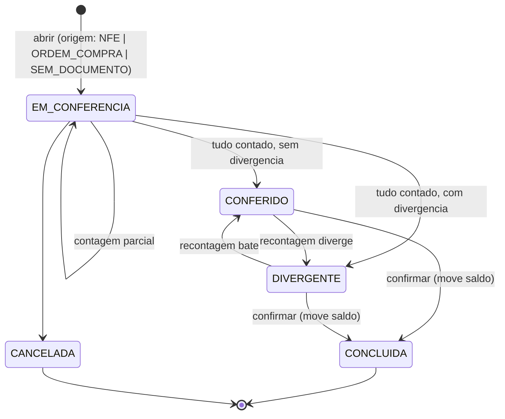

# Onda B — recebimento auditável

Escopo fechado. Referência:
[AUDITORIA_ARQUITETURA_EVENTOS_JINLONG.md §2.3 e §7](./AUDITORIA_ARQUITETURA_EVENTOS_JINLONG.md).

## O problema

`confirmar_remessa_entrada` dava entrada em
`COALESCE(quantidade_conferida, quantidade_esperada)`. Como a action criava a remessa e confirmava
na mesma função, o resultado era: **o sistema creditava o que a nota prometia e gravava status
`CONCLUIDA`** — trilha auditável de uma conferência que não aconteceu.

## Máquina de estados

**Transição proibida que a onda introduz:** `EM_CONFERENCIA → CONCLUIDA`. Era exatamente o que o
sistema fazia.

O status é **derivado dos itens**, nunca recebido por parâmetro:

| Situação dos itens | Status |
|---|---|
| algum sem contagem (`NULL`) | `EM_CONFERENCIA` |
| todos contados, algum ≠ esperado | `DIVERGENTE` |
| todos contados, todos batendo | `CONFERIDO` |

`quantidade_conferida = 0` é contagem válida ("contei, não veio"). `NULL` é "não contei". Antes os
dois casos se confundiam.

## O que mudou

**Migration** [`20260801120000_recebimento_conferencia_explicita.sql`](../backend/supabase/migrations/20260801120000_recebimento_conferencia_explicita.sql)

- `remessas.status` ganha `CONFERIDO` e `DIVERGENTE`.
- Colunas de auditoria: `conferido_por`, `conferido_em`, `divergencia_motivo`, `origem_tipo`,
  `origem_ref`.
- Nova RPC `registrar_conferencia_remessa(remessa, itens, motivo?)` — grava a contagem e deriva o
  status. Aceita recontagem.
- `confirmar_remessa_entrada` mantém a assinatura, muda a pré-condição: exige status
  `CONFERIDO`/`DIVERGENTE` e nenhum item pendente; dá entrada na quantidade **contada**.

**Domínio** [`shared-core/src/inventory/policies/recebimentoStatus.ts`](../shared-core/src/inventory/policies/recebimentoStatus.ts) —
máquina de estados pura, dentro do módulo `inventory` existente. Nenhum agregado novo, nenhuma
infraestrutura nova.

**Port** `InventoryMovementWriter.registrarConferenciaRemessa`.

**Action** `criarRemessaConferencia` passa a fazer abrir → conferir → confirmar. Os itens são
inseridos **sem** `quantidade_conferida`; a contagem só entra pela RPC de conferência.

## Compatibilidade

**A tela não mudou.** `RecebimentoGerentePageClient` continua coletando esperado e conferido no
mesmo formulário, e o operador continua com um clique. O que mudou é o rastro: três transições
registradas com ator e momento, em vez de uma inserção que já nascia confirmada.

**NF-e e ordem de compra não foram tocadas.** `importar_nfe_transacao` e `receber_ordem_compra`
seguem com fluxo próprio, sem passar por `remessas`. A coluna `origem_tipo` cria o vocabulário
para unificá-las depois sem exigir a mudança agora — era o que tornaria esta onda um redesenho.

**Sem backfill.** `remessas` tem 0 linhas em produção.

## Verificação

- 8 testes de contrato em [`tests/onda-b-recebimento.test.ts`](../pdv-importados/tests/onda-b-recebimento.test.ts) —
  travam a ausência do `COALESCE`, a pré-condição de confirmação e a ordem das três etapas.
- 9 testes de máquina de estados em
  [`recebimentoStatus.spec.ts`](../shared-core/src/inventory/policies/recebimentoStatus.spec.ts).
- Suítes completas: 880 (`pdv-importados`) + 191 (`shared-core`), typecheck e lint limpos.

## Bloqueio documentado — não resolvido nesta onda

**A conferência continua sendo um passo lógico, não operacional.** A tela ainda pede esperado e
conferido na mesma tela, ao mesmo tempo, à mesma pessoa. O banco agora **exige** que a contagem
seja declarada e recusa confirmar sem ela, mas nada impede que o operador digite o mesmo número
nos dois campos.

Separar de verdade exige duas telas — abrir o recebimento, depois conferir — e isso é mudança
funcional relevante para o piloto, fora do escopo autorizado. A menor alternativa compatível é a
que foi implementada: **tornar a etapa obrigatória e rastreável sem alterar a experiência**.

Quando o piloto comportar, a evolução é pequena: a UI passa a chamar `abrirRecebimento` e
`registrarConferencia` em momentos distintos. Nada no banco precisa mudar de novo.

## TODO

**TODO-B1 — divergência não exige motivo.** `divergencia_motivo` é nullable e a confirmação aceita
`DIVERGENTE` sem justificativa. Exigir motivo bloquearia o operador no piloto. A coluna existe e é
gravada quando informada.

**TODO-B2 — NF-e e OC ainda não abrem recebimento.** Unificar as três origens sob `remessas` é o
passo que fecha §7 da auditoria. Depende de decidir o que acontece com o histórico de
`importacoes_nfe` e `ordens_compra`.
