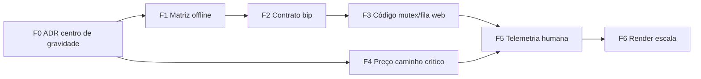

# Roadmap — invariantes operacionais PDV

Documento de **decisão + documentação + sequência de execução** para reduzir ambiguidade entre caixa **web** (`pdv-importados`) e **desktop** (`pdv-local`), e endurecer o **fluxo humano** (bip, foco, burst) sem confundir com lista de features soltas.

**Público:** produto, engenharia, suporte, operação de loja.

**Como usar:** executar **fases em ordem**; cada fase tem critério de saída. Não avançar implementação pesada na web (F2+) sem fechar **F0–F1**.

---

## Documentos que já existem (não duplicar)

| Documento | Papel |
|-----------|--------|
| [GUIA_IMPLANTACAO_WEB_VS_DESKTOP.md](./GUIA_IMPLANTACAO_WEB_VS_DESKTOP.md) | Mensagem oficial web vs desktop; matriz de decisão por cenário de loja |
| [OPERACAO_PDV_PRIORIDADES.md](./OPERACAO_PDV_PRIORIDADES.md) | E2E, observabilidade Edge, runbook, hardening local, métricas `Leitura→item` no desktop |
| [ROADMAP.md](./ROADMAP.md) | Roadmap geral do monorepo |
| [pdv-local/README.md](../pdv-local/README.md) | Papel do desktop, SQLite, outbox, sync, limitações |

Este roadmap **complementa** os acima com: ADR de centro de gravidade, matriz offline **linha a linha**, contrato do **bip**, telemetria **centrada no operador** no web.

---

## Estado atual (síntese técnica)

| Área | Situação |
|------|-----------|
| **Caixa web — bip** | [pdv-importados/app/caixa/CaixaPageClient.tsx](../pdv-importados/app/caixa/CaixaPageClient.tsx): busca remota + `getSession` + `aplicarPrecoRpcParaLinha` no caminho assíncrono; input `disabled` com `buscando`; `void handleAdicionarCodigo` **sem mutex** no início; [useScannerDetector.ts](../pdv-importados/hooks/useScannerDetector.ts) em paralelo ao formulário |
| **Carrinho** | [shared-core/src/stores/unifiedCartStore.ts](../shared-core/src/stores/unifiedCartStore.ts): totais por `reduce` sobre todos os itens; `adicionarItem` agrega mesmo `produtoId` |
| **Desktop** | SQLite (`produtos_cache`), outbox, sync — direção local-first; métricas locais já descritas em OPERACAO_PDV_PRIORIDADES |
| **Backend** | Fiscal, RLS, idempotência no **fecho** da venda — mais maduro que o **pipeline perceptivo** do bip no web |

**Risco central:** sistema **tecnicamente funcional** mas **psicologicamente lento** para o operador (espera rede + input bloqueante + concorrência implícita).

---

## Fases (passo a passo)

### Fase F0 — Centro de gravidade (ADR único)

**Objetivo:** uma decisão escrita que desambigua “o que é PDV principal” e “o que pode falhar sem parar venda”.

**Entregável:** [docs/adr/ADR-PDV-centro-de-gravidade.md](./adr/ADR-PDV-centro-de-gravidade.md) (rascunho **Proposto** — sign-off pendente). Contrato do bip: [CONTRATO_PIPELINE_BIP.md](./CONTRATO_PIPELINE_BIP.md).

**Conteúdo mínimo do ADR:**

1. **PDV canónico** por perfil de loja: web-only | desktop-first | híbrido (referenciar GUIA_IMPLANTACAO).
2. **Autoridade no milissegundo do bip:** servidor | local provisório | híbrido com regra de reconciliação.
3. **Resposta à pergunta:** “O que pode falhar sem interromper a venda (bip / subtotal / fecho)?” — lista explícita.
4. **Conflito:** se preço local ≠ servidor, quem vence e quando bloquear vs avisar.

**Critério de saída:** ADR aprovado por produto + 1 eng lead; link no [ROADMAP.md](./ROADMAP.md) e no GUIA se necessário (uma linha).

**Duração estimada:** 1 sessão de alinhamento + 1 revisão.

---

### Fase F1 — Matriz offline e degradação (documentação)

**Objetivo:** mesma pergunta para **web** e **desktop**, resposta **objetiva** (sim / não / parcial / não aplicável).

**Entregável:** secção nova no GUIA ou ficheiro `docs/MATRIZ_OFFLINE_PDV.md` com tabela:

| Capacidade | pdv-importados (web) | pdv-local (desktop) | Notas |
|------------|----------------------|---------------------|--------|
| Scan SKU | | | |
| Preço no bip | | | |
| Desconto gerente | | | |
| Finalizar venda | | | |
| Sangria / suprimento | | | |
| Fiscal / reimpressão | | | |
| TEF / PIX | | | |
| … | | | |

Preencher com **evidência** (comando, rota, env) — onde for “não implementado”, escrever explicitamente.

**Critério de saída:** tabela revista por quem opera suporte a loja; zero linhas “TODO vago”.

**Dependência:** F0 (para não prometer offline web onde o ADR proíbe).

---

### Fase F2 — Contrato operacional do bip (especificação)

**Objetivo:** transformar scanner de “evento de input” em **pipeline** com invariantes testáveis.

**Entregável:** `docs/CONTRATO_PIPELINE_BIP_CAIXA_WEB.md` (ou anexo no ADR) com:

- Ordem: FIFO ou política explícita se não FIFO.
- **Mutex / fila única** de processamento por terminal (recomendado: serializar `handleAdicionarCodigo`).
- Comportamento em burst (A+B+C em &lt;300 ms).
- **Cancelamento** de request obsoleto (opcional na v1).
- **ACK perceptivo:** aceitar linha local antes da rede? (só se F0 permitir “preço provisório”).
- **Orçamento humano** opcional: alvos p95 (ex.: bip → linha visível) — mesmo que v1 só **meça**, não cumpra ainda.

**Critério de saída:** checklist de testes manuais (sábado simulado) derivado deste doc.

**Dependência:** F0 para a política de preço no bip.

---

### Fase F3 — Implementação web mínima do contrato (código)

**Objetivo:** fechar buracos **P0** sem redesenhar o produto inteiro.

**Itens típicos (prioridade):**

1. **Mutex ou fila serial** no início de `handleAdicionarCodigo` (ref + “skip if busy” ou fila com drain).
2. **Alinhar** `useScannerDetector` + submit do form para **mesma** fila (uma entrada, uma ordem).
3. Reavaliar `disabled={buscando}`: alternativas documentadas no contrato (ex.: não bloquear teclado; mostrar “processando N leituras”) — **só** se F0/F2 aprovarem.

**Critério de saída:** teste manual burst + teste automatizado mínimo (Vitest) para “duas chamadas rápidas não corrompem estado”.

**Módulo:** apenas [pdv-importados/app/caixa](../pdv-importados/app/caixa) e hooks partilhados necessários.

---

### Fase F4 — Preço no caminho crítico (decisão + código)

**Objetivo:** cumprir o ADR: ou remove RPC do caminho **perceptivo** do bip, ou formaliza “operador espera preço autoritativo” com UX que não induza double-scan.

**Opções (escolher uma no ADR):**

- **A)** Preço do catálogo na busca + reconciliação assíncrona (ajuste de linha após RPC).
- **B)** Manter RPC síncrono mas **fila + feedback** claro (não “silêncio”).
- **C)** Desktop-first para alto giro; web mantém B com melhorias.

**Critério de saída:** métrica `buscando_duration` / latência bip registada (ver F5).

---

### Fase F5 — Telemetria humana (web alinhado ao desktop)

**Objetivo:** mesma linguagem de [OPERACAO_PDV_PRIORIDADES.md](./OPERACAO_PDV_PRIORIDADES.md) §6, no **caixa web**.

**Eventos mínimos sugeridos:**

- `scan_received_at` / `produto_resolved_at` / `ui_commit_scan` (nomes ajustáveis)
- `buscando_duration_ms`
- `finalizar_double_submit_attempt` (já existe guard parcial; medir tentativas)

**Destino:** logs estruturados (consola dev) → depois backend/PostHog/etc. conforme stack aprovada.

**Critério de saída:** documento “onde ver estas métricas” + flag dev para não poluir prod sem consentimento.

---

### Fase F6 — Render e escala (P1)

**Objetivo:** reduzir re-render global no caixa web quando o carrinho cresce.

**Itens:** selectors Zustand mais finos, `React.memo` na lista, virtualização se N&gt;100 for requisito do ADR.

**Critério de saída:** critério de produto (ex.: 200 itens sem degradação perceptiva) + medição antes/depois.

**Dependência:** F5 para medir antes de otimizar à cegas.

---

## Resumo visual (ordem)

---

## Riscos e impactos

- **Pular F0–F1:** implementação F3/F4 pode ser refeita quando produto mudar de ideia — dívida duplicada.
- **Web como “PDV industrial” sem cache local:** conflito com [GUIA_IMPLANTACAO_WEB_VS_DESKTOP.md](./GUIA_IMPLANTACAO_WEB_VS_DESKTOP.md) — não prometer o que o ADR não cobre.
- **Paridade fiscal vs bip:** fiscal pode continuar robusto enquanto operador sofre; F5 torna isso **visível** na operação.

---

## Próximo passo imediato (equipa)

1. Agendar **1 workshop** só F0 (45–60 min) com decisão escrita.
2. Abrir PR que adiciona **só** o ficheiro ADR + link neste roadmap e em `ROADMAP.md`.
3. Em paralelo, **rascunho** da matriz F1 preenchido por eng (factos do código), revisão por suporte.

Quando F0 estiver fechado, avançar **F1 → F2** em documentação; **F3** como primeiro PR de código do eixo bip.
