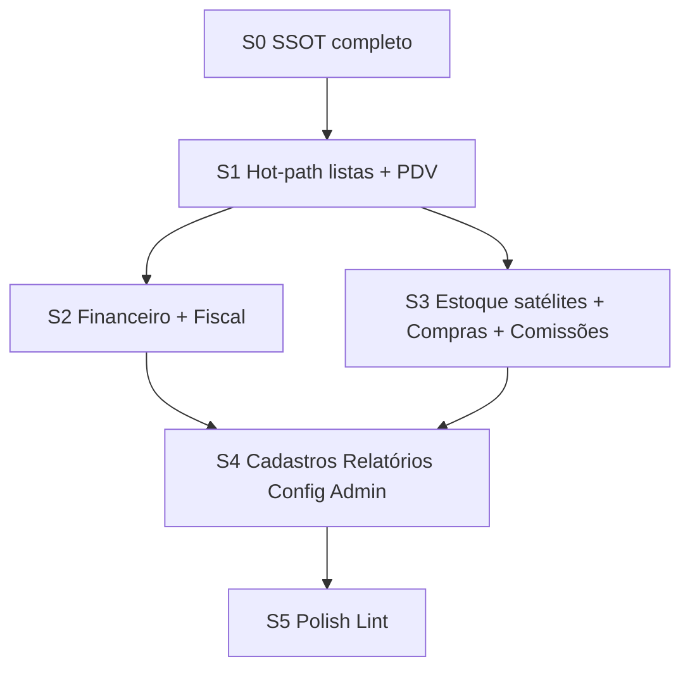

# Roadmap UI/UX — Jīn Lóng ERP

| Campo | Valor |
|--------|--------|
| **Data** | 2026-08-07 (Sprint 0 = base definitiva) |
| **Docs** | [`DESIGN_SYSTEM_GAPS.md`](./DESIGN_SYSTEM_GAPS.md) · [`UI_UX_BACKLOG.md`](./UI_UX_BACKLOG.md) · [`DESIGN_SYSTEM_GOVERNANCE.md`](./DESIGN_SYSTEM_GOVERNANCE.md) · [`INTERACTION_DESIGN_SYSTEM.md`](./INTERACTION_DESIGN_SYSTEM.md) |
| **Estado** | **Sprint 0 IMPLEMENTADA — aguardando aceite do sponsor** · Sprint 1 **bloqueada até aceite** |
| **Princípio** | S0 consolida SSOT → S1+ só aplica → zero novos paradigmas |

---

## 1. Estratégia revisada

1. **Causa raiz primeiro** — dual-track / migração incompleta (não “uma tela feia”).
2. **Sprint 0 completa** — todos os primitivos da matriz de cobertura (incl. TabNav, Stepper, DetailSheet, InlineAlert, FormSection, FileDropzone).
3. **S1+ = aplicação** — PageShell/EntityTable/FilterBar/etc. nas telas; sem inventar padrão.
4. **Hot-path operacional** após S0: PDV → Catálogo → Vendas → Estoque → Financeiro.

```
S0  Design System completo (ZERO redesign de tela)
S1  Hot-path: Vendas, Catálogo, Transferência, PDV leve
S2  Financeiro + Fiscal superfície
S3  Estoque satélites + Compras + Comissões
S4  Cadastros / Relatórios / Config / Admin gates
S5  Polish + burndown → meta aderência ≥85%
```

---

## 2. Grafo de dependências



### 2.1 Dependências por primitivo → sprint de aplicação

| Primitivo S0 | Bloqueia se ausente | Primeira aplicação |
|--------------|---------------------|--------------------|
| PageShell | Qualquer página admin “migrada” | S1 Catálogo/Recebimento |
| FilterBar + daterange | Comissões, Relatórios | S1 Vendas (pills); S3/S4 daterange |
| EntityTable | Compras, Funcionários, AP | S2/S3 |
| ConfirmDialog | Suspensão, fiscal, deletes | S2/S4 |
| TabNav | Financeiro hub, Config | S2 / S4 |
| Stepper | NF-e, Provisionamento | S3 / S4 |
| DetailSheet | Vendas, Auditoria, Fiscal, Kardex | S1 / S2 / S4 |
| InlineAlert | Stub fiscal, suspensão, gates | S2 / S4 |
| FormSection | Config, produto polish | S4 / oportunista S1 |
| FileDropzone | NF-e, CSV | S3 / S1 catálogo import |
| KeyHint / MoneyText | PDV Finalizar; tabelas $ | S1 |
| emitToast + lint | Todos | S0 baseline |

### 2.2 Retrabalho se executar fora de ordem

| Anti-padrão | Retrabalho |
|-------------|------------|
| Migrar Compras/Vendas **antes** de PageShell/EntityTable | Reembrulhar a mesma tela 2× |
| FilterBar em Comissões **antes** de `daterange` | Segundo filtro de período local |
| Sheet fiscal/vendas **antes** de DetailSheet | Terceiro overlay ad hoc |
| Hub financeiro **antes** de TabNav | TabNav local permanente |
| NF-e stepper CSS local **antes** de Stepper | Wizard paralelo |
| Lint só na S5 | Entropia sobe em S1–S4 |
| Criar componente em `components/ui` numa sprint de tela | Dual-track renasce |

**Regra:** se um PR de S1+ precisar de primitivo inexistente → **parar**, abrir hotfix S0, só então continuar.

---

## 3. Sprint 0 — escopo e critérios de conclusão

### 3.1 Objetivo

Base definitiva: toda evolução UI posterior é **aplicação** de um padrão único, sem novos paradigmas nem aumento de dívida.

### 3.2 Entregáveis S0 (IDs no backlog)

| Grupo | IDs |
|-------|-----|
| Higiene | UX-S0-01..03, 10, 11 |
| Núcleo lista/página | UX-S0-04, 06, 07 |
| Overlay/feedback | UX-S0-05, 09, 15, 16 |
| Form/nav/fluxo | UX-S0-13, 14, 17, 18 |
| Lote/export/page/lookup | UX-S0-19, 20, 21, **24** (async) |
| Filter/lint/badge | UX-S0-25, 26, 27 |
| Interaction Design System | UX-S0-22 → [`INTERACTION_DESIGN_SYSTEM.md`](./INTERACTION_DESIGN_SYSTEM.md) §0.1 validado |
| PDV/tokens helpers | UX-S0-08 |

**Proibido na S0:** redesign de rota; migrar Compras/GerenteTable *como feature de tela*; alterar RPC.  
**Permitido na S0:** criar primitivos em `components/ui/**`, lint, remover órfãos, alias toast, testes dos primitivos.

### 3.3 Critérios objetivos de conclusão (Definition of Done)

A Sprint 0 só é **DONE** se **todos** os itens abaixo forem verdadeiros:

#### Contratos e documentação

- [x] 100% dos componentes SSOT da matriz (§1 de `DESIGN_SYSTEM_GAPS`) **existem, exportados e documentados** (JSDoc + exemplo mínimo), incl. BulkActionBar, ExportAction, PaginationBar infinite.
- [x] Matriz de cobertura por módulo sem GAP aberto (primitivos; adoção de tela = S1+).
- [x] [`INTERACTION_DESIGN_SYSTEM.md`](./INTERACTION_DESIGN_SYSTEM.md) publicado; fluxos mínimos §2 marcados “cabe”.
- [x] Exceções aprovadas listadas (EXC-01..07).
- [x] [`DESIGN_SYSTEM_GOVERNANCE.md`](./DESIGN_SYSTEM_GOVERNANCE.md) vigente (checklist inclui IX) e linkado no fluxo de PR.

#### Um paradigma por família (para **código novo**)

- [x] Apenas um padrão de **botão** permitido em código novo: `Button` / `PageActions`.
- [x] Apenas um padrão de **tabela** em código novo: `DataTable` / `EntityTable`.
- [x] Apenas um padrão de **toast painel**: `emitToast` (+ viewport admin); PDV permanece EXC-02.
- [x] Apenas um padrão de **modal/confirm/sheet**: `DragonModal` / `ConfirmDialog` / `DetailSheet`.
- [x] Apenas um padrão de **FilterBar** (incl. daterange).
- [x] Apenas um padrão de **tabs**: `TabNav`.
- [x] Apenas um padrão de **stepper**: `Stepper`.
- [x] Apenas um padrão de **empty/erro**: `EmptyState` / `ErrorState`.
- [x] Apenas um padrão de **alert inline**: `InlineAlert`.
- [x] Apenas um padrão de **upload**: `FileDropzone`.
- [x] Apenas um padrão de **bulk**: `BulkActionBar`.
- [x] Apenas um padrão de **export**: `ExportAction` (csv\|pdf).
- [x] Apenas um padrão de **lookup** longo: Autocomplete / EntityLookup.
- [x] Contratos IX-* do IDS são a referência de comportamento (duas telas = mesmo IX).

#### Legado e qualidade

- [x] Nenhum componente legado (`GerenteTable`, `DataTablePage`, `.app-btn-*`, `CadastroPageShell`, etc.) usado em **código novo** (lint S0-10 + `check:ds-sprint0`).
- [x] Órfãos S0-02 removidos ou sem import (`CadastroPageShell`, `PendingSubmitButton`, `card.tsx`).
- [x] Burndown baseline atualizado (`ds-legacy-burndown.json` asOf 2026-08-07).
- [x] Lint + typecheck + testes dos pacotes tocados **verdes** (`check:ds-sprint0`, typecheck, vitest primitivos).
- [x] **Zero** rota redesenhada “por beleza” na S0 (diff de telas só para ConfirmActionButton → ConfirmDialog).
- [x] Métricas §5 coluna Pós-S0 preenchida.
- [x] Aderência DS ≥ ~55% **ou** explicação se só primitives subiram o denominador (aceitável: telas ainda não migraram; PageShell exportado, adoção = S1).

#### Gate para S1

- [ ] DS owner (ou sponsor UX) assina DoD S0.
- [x] Nenhum PR de tela S1 mergeado antes desse aceite.
- [x] Matriz §10 = todos ✅ técnicos (sponsor pendente).

---

## 4. Validação código — revalidação pós-implementação (2026-08-07)

### 4.1 Cobertura

| Dimensão | Pré-S0 | Pós-S0 (código) | Base |
|----------|-------:|----------------:|------|
| Design System (estrita / PageShell nas pages) | ~55% | **~55%*** | Telas ainda não migraram PageShell |
| Design System (proxy PageHeader) | ~69% | **~69%** | 20/28 pages |
| Interaction Design (Confirmado+Parcial / 25) | ~88% | **100%** | IDS §0.1 revalidado |
| IX Divergentes | **3** | **0** | CONFIRM/SHEET/LOOKUP → Parcial/Confirmado |
| Primitivos S0 “criar” exportados | ~0 | **17/17** | `npm run check:ds-sprint0` |

\* Denominador de adoção de tela não sobe na S0 por desenho (zero redesign). Primitivos existem; meta ≥70% de aderência exige S1+.

### 4.2 Divergências anteriores (resolvidas na S0)

1. **IX-CONFIRM** — `ConfirmDialog` + `ConfirmActionButton` migrado; `check:ds-sprint0` ban confirm nativo fora allowlist (PDV/import).  
2. **IX-SHEET** — `DetailSheet` SSOT exportado; sheets legados allowlisted até migração S1+.  
3. **IX-LOOKUP** — `EntityLookup` async (`onSearch`); Autocomplete permanece client-only para listas curtas.

### 4.3 Riscos remanescentes

| Risco | Mitigação |
|-------|-----------|
| S1 aplica sem PageShell | Checklist GOVERNANCE + reviewer |
| Allowlist de confirm/sheet cresce | `check:ds-sprint0` — lista só encolhe |
| Sponsor aceita sem ler DoD | Gate §3.3 checkbox humano |

### 4.4 Obrigatório antes da Sprint 1

Aceite do sponsor no DoD §3.3. Em seguida abrir Sprint 1 (aplicação em telas).

### 4.5 Decisão

# **Sprint 0 IMPLEMENTADA — aguardando aceite do sponsor**

**Evidência de código:** primitivos SSOT exportados; `ConfirmActionButton` → `ConfirmDialog`; `emitToast`; FilterBar `daterange` + reset `page`; PaginationBar `infinite`; EntityLookup async; órfãos removidos; `npm run check:ds-sprint0` no CI; burndown asOf 2026-08-07; typecheck + testes de primitivos verdes; **zero** Divergente IX. Sprint 1 permanece **bloqueada** até o sponsor assinar o DoD.

---

## 5. Sprints de aplicação (resumo)

### Sprint 1 — Hot-path

Vendas FilterBar + empty · Catálogo PageShell/CrudListShell + 1 CTA · Transferência Autocomplete · Recebimento PageShell · PDV KeyHint/F3/realce/barcode.

**Depende de:** S0 DoD (PageShell, FilterBar, DetailSheet opcional Vendas, KeyHint, Autocomplete já existente).

### Sprint 2 — Financeiro + Fiscal

TabNav hub · EntityTable pagar · PageShell documento · InlineAlert stub · ConfirmDialog.

**Depende de:** TabNav, EntityTable, PageShell, InlineAlert, ConfirmDialog, DetailSheet.

### Sprint 3 — Estoque satélites + Compras + Comissões

Stepper NF-e · FileDropzone · hub ações estoque · Compras PageShell+EntityTable · Comissões daterange.

**Depende de:** Stepper, FileDropzone, EntityTable, FilterBar daterange, PageShell.

### Sprint 4 — Cadastros / Relatórios / Config / Admin

Funcionários EntityTable · FormSection config · TabNav · Suspensão ConfirmDialog · Stepper provisionamento · Auditoria DetailSheet · toast viewport rename.

### Sprint 5 — Polish

Lint CI · badges/chips · auth Field · dashboard densidade · drawer sidebar se tablet · meta aderência ≥85%.

Detalhe IDs: [`UI_UX_BACKLOG.md`](./UI_UX_BACKLOG.md).

---

## 6. Métricas (atualizar fim de cada sprint)

| Indicador | Baseline (2026-08-07 medido) | Pós-S0 | Pós-S1 | Pós-S2 | Pós-S3 | Pós-S4 | Pós-S5 | Meta |
|-----------|-----------------------------:|-------:|-------:|-------:|-------:|-------:|-------:|-----:|
| Páginas auditadas | 41 | 41 | | | | | | 41 |
| Páginas P0 | 6 | 6 | ≤4 | ≤2 | ≤1 | 0 | 0 | 0 |
| Páginas P1 | 12 | 12 | ≤10 | ≤8 | ≤5 | ≤3 | ≤2 | ≤3 |
| Famílias duplicadas vivas | 8 | ≤5 | ≤5 | ≤4 | ≤3 | ≤2 | ≤2 | ≤2 |
| Padrões formulário | 2 | 2 | 2 | 2 | 1–2 | 1 | 1 | 1 |
| Padrões tabela | 3 | 3* | ≤3 | ≤2 | ≤2 | 1+raw | 1+raw | 1+raw |
| Padrões modal | 2 | 1+PDV† | 1+PDV | 1+PDV | 1+PDV | 1+PDV | 1+PDV | 1+PDV |
| Padrões toast | 2 canais | 2 / 1 API (`emitToast`) | 2 | 2 | 2 | 2 | 2 | 2 |
| Padrões FilterBar | 1+N | 1+daterange+page reset | 1 | 1 | 1 | 1 | 1 | 1 |
| Aderência DS (%) | **~55** (estrita) | ~55* (primitivos prontos) | ~75 | ~80 | ~85 | ≥85 | ≥85 | ≥85 |
| Cobertura IX (%) | **~88** (3 Divergentes) | **100 sem Divergente** | 100 | 100 | 100 | 100 | 100 | 100 |

\* EntityTable criado; GerenteTable pode existir até S3.  
† ConfirmDialog + DetailSheet no SSOT; sheets legados ainda vivos até migração.

Fórmula: `DESIGN_SYSTEM_GOVERNANCE.md` §7.2.

---

## 7. Cinco maiores riscos da migração DS

| # | Risco | Prob. | Impacto | Mitigação |
|---|-------|-------|---------|-----------|
| 1 | **S1+ inventa primitivo faltante** porque S0 ficou incompleta (ex.: sem TabNav/Stepper) | Alta se S0 enxuta demais | Alto — dual-track renasce | Matriz de cobertura §2; DoD S0 exige GAP=0; gate “parar e hotfix S0” |
| 2 | **Migração cosmética sem PageShell** (só CSS) em Compras/Financeiro | Média | Alto — heterogeneidade permanece | Checklist PR; reviewer recusa admin sem PageShell pós-S0 |
| 3 | **Big-bang GerenteTable** em um PR quebra produção | Média | Alto | 1 tela/PR; EntityTable estável na S0; testes behavior da lista |
| 4 | **Lint/burndown ignorados** sob pressão de piloto | Média | Médio-Alto — entropia volta | UX-S0-10 no CI; burndown no DoD de cada sprint; PR checklist |
| 5 | **Confundir EXC-PDV com licença para legado admin** | Média | Médio | Exceções explícitas EXC-01..07; governança §5; DS owner |

Riscos secundários: rename toast quebrando imports (mitigar alias); FileDropzone incompleto levando a dropzone local na NF-e (mitigar S0-18 antes de S3).

---

## 8. Governança (ponte)

Processo completo de PR, criação de componente, exceção e medição: **[`DESIGN_SYSTEM_GOVERNANCE.md`](./DESIGN_SYSTEM_GOVERNANCE.md)**.

---

## 9. Freeze e arquitetura

| Pode | Sponsor |
|------|---------|
| S0 primitives + aplicação SSOT em telas | Unificação total tokens / multi-tema |
| Remover órfãos / lint arquivo novo | Redesign amplo PDV |
| | Novos perfis RBAC |

Sem alteração de regra de negócio, RPC ou entity-SSoT.

---

## 10. Matriz final de prontidão (revalidação pós-S0)

| Item | Status | Bloqueia Sprint 1? |
|------|--------|--------------------|
| Componentes SSOT | ✅ | Não |
| Contratos IX | ✅ (0 Divergentes) | Não |
| Governança | ✅ (`check:ds-sprint0` no CI) | Não |
| Cobertura de módulos (primitivos) | ✅ | Não |
| Burndown legado | ✅ (asOf 2026-08-07) | Não |
| Métricas | ✅ (Pós-S0 preenchida; adoção de tela = S1) | Não |
| Documentação | ✅ | Não |
| Aceite sponsor DoD | ⬜ | **Sim** |

**Decisão: Sprint 0 IMPLEMENTADA — aguardando aceite do sponsor** (§4.5).

---

## 11. Próxima ação

1. **Sponsor assina** DoD §3.3 (checkbox humano).  
2. Abrir Sprint 1 (hot-path) com mandato de Product Designer / UX Architect (propostas de arquitetura antes de redesign).  
3. Manter `npm run check:ds-sprint0` verde em todo PR.

**Sprint 1 permanece bloqueada até o aceite explícito.**
