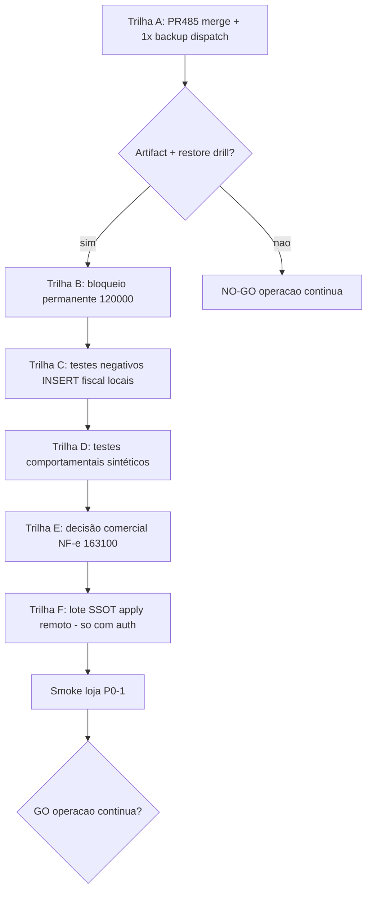

# Plano pós-OPS-02 — integridade financeira (sem execução remota)

**Data:** 2026-10-08  
**Modo:** planejamento + evidências de código (sem apply remoto, sem deploy, sem upgrade).  
**Prioridade:** preservar integridade financeira e impedir regressões em produção.  
**B1/B5:** **excluídos** deste plano — referências ambíguas no repo (billing Actions / UX blueprint / multiempresa) sem definição verificável única; não são dependências.

**OPS-02:** arquivo com esse ID **não está no Git**. Achados tratados aqui = cruzamento do pedido do sponsor + gate `migration-remote-drift` (9× `remote_ausente`) + docs SSOT + PR #485.

---

## 1. Comparação OPS-02 × PR #485 (Cursor)

| Tema OPS / risco | PR #485 (`cursor/p0-estabilizacao-jit-1966`) | Gap residual |
|---|---|---|
| Backup Free + JIT PAM | **Sim** — sonda Temporary Access **direta** antes do pooler; gate `guard:backup-jit`; docs JIT/NO-GO | PR **ainda OPEN/BLOCKED** (drift pré-existente); **nenhum** `workflow_dispatch` success pós-fix |
| RPO / restore | Documenta NO-GO até artifact + restore drill | Restore drill **não** autorizado ainda |
| Migrations financeiras/SSOT | **Não toca** migrations | 9 arquivos `remote_ausente` seguem pendentes |
| INSERT fiscal authenticated | **Não** aplica `163200` / não prova vivo remoto | REVOKE só no Git; remoto pode ainda ter GRANT do hotfix |
| Cancel / PIX / taxas / fechamento forma | Fora do PR | Cobertura de teste parcial (ver §4) |
| `20261006120000` | Não menciona bloqueio permanente | Precisa deny-list (este plano §2) |

**Conclusão:** #485 é correto e **complementar** para backup; **não** fecha integridade financeira SSOT nem INSERT fiscal em produção. Continuar #485 (merge + 1 dispatch) em trilha paralela; **não** misturar apply de migrations com validação de backup.

Estado PR (2026-10-08): `OPEN`, `mergeStateStatus=BLOCKED` por `migration-remote-drift` (não causado pelo diff do PR).

---

## 2. Migration `20261006120000` — NÃO APLICAR + bloqueio permanente

### Evidência

| Item | Achado |
|---|---|
| Arquivo | [`backend/supabase/migrations/20261006120000_financeiro_contas_formas_e_painel.sql`](../../backend/supabase/migrations/20261006120000_financeiro_contas_formas_e_painel.sql) |
| Modelo | Coluna `formas_pagamento.conta_financeira_id` + wrap `financeiro_comando` + `financeiro_capturar_venda` **sem** auto-liquidar PIX |
| Já em prod | Modelo sucessor [`20261006180000`](../../backend/supabase/migrations/20261006180000_financeiro_contas_operacionais.sql) aplicado como remoto `20261006195837` (human-gates / PR #464) — tabela `financeiro_contas_forma` + `financeiro_comando_operacional` + PIX auto-liq |
| Risco se apply | `CREATE OR REPLACE` de `internal.financeiro_capturar_venda` **regrediria** liquidação PIX / contas operacionais |

### Decisão

| | |
|---|---|
| Classificação | **DESCARTAR_OBSOLETA** |
| Apply em Jinlong | **NO-GO absoluto** |
| Bloqueio permanente proposto | (1) entrada em `backend/supabase/migration-human-gates.json` tipo `forbidden_apply` com reason; (2) deny-list em [`backend/scripts/p0-migration-status.mjs`](../../backend/scripts/p0-migration-status.mjs) / guard CI: se version `20261006120000` aparecer como “a aplicar” → **FAIL**; (3) cabeçalho SQL `-- FORBIDDEN_APPLY: superseded by 20261006180000 / remote 20261006195837`; (4) **não** apagar o arquivo (histórico + testes locais que o carregam) |

**GO** para implementar o bloqueio em branch isolada (só repo/CI).  
**NO-GO** para qualquer `apply_migration` deste arquivo.

---

## 3. Correção mínima — permissão INSERT fiscal (SSOT-004)

### Evidência código

| Camada | Estado no Git |
|---|---|
| Hotfix antigo | `20260903180000` **GRANT INSERT** authenticated |
| SSOT | `20261007161220` + [`20261007163200`](../../backend/supabase/migrations/20261007163200_ssot_004_revoke_insert_documentos_fiscais.sql) **REVOKE INSERT** + prova `role_table_grants` |
| App | Enqueue só via `fiscal_enfileirar_documento_venda` (`caixaFiscalEnqueueServer.ts`); stub INSERT removido; entity-ssot bloqueia reintrodução |
| RLS residual | Policy `doc_fiscal_pendentes_insert_loja` (mig 094) ainda existe — inerte sem GRANT; perigosa se GRANT voltar |

### Correção mínima (quando autorizado apply remoto)

1. Aplicar (ou reexecutar efeito de) `20261007161220` → `20261007163200` **somente** após GO humano e prova de que enqueue RPC existe no remoto.  
2. Opcional defesa: migration aditiva `DROP POLICY IF EXISTS doc_fiscal_pendentes_insert_loja` (sem reabrir GRANT).  
3. Testes negativos (locais / CI com Postgres isolado — **sem** dados reais):

```sql
-- autenticado: deve falhar
SET ROLE authenticated;
INSERT INTO public.documentos_fiscais_pendentes (...) VALUES (...);
-- expect: permission denied / 42501

-- service_role ou RPC SECURITY DEFINER: caminho canônico
RESET ROLE;
SELECT public.fiscal_enfileirar_documento_venda(...); -- fixture sintética
```

Vitest/matrix: estender `remediacao-ssot-001-004.matrix.test.ts` + script `backend/scripts/test-rls-*` com INSERT negado (hoje só prova de catálogo / não INSERT vivo).

| Decisão | |
|---|---|
| Preparar código de testes + DROP POLICY opcional em branch | **GO** (local) |
| Apply REVOKE em Jinlong | **GO CONDICIONAL** — só com auth humana + verificação prévia `has_table_privilege` remoto (leitura) |
| Reabrir GRANT / stub INSERT | **NO-GO** |

---

## 4. Testes comportamentais a preparar (fixtures sintéticas)

| Fluxo | Existe hoje | Gap | Preparar |
|---|---|---|---|
| Cancelamento venda | Integração `cancelarVendaContrato.integration.test.ts`, unit perfil/valor, UI modais; matrix SSOT E(c) | Sem e2e Playwright; integração depende de seed | Suite isolada: cancel OPERADOR negado; GERENTE ok; estoque/AR/E(c); **não** usar PII real |
| PIX | e2e multi-pagamento; scripts financeiro PIX taxa 0 | Sem e2e liquidação painel; Focus unit só | Caso: venda PIX → recebível/banco; desconto comercial **não** em PIX puro |
| Taxas | Scripts `CONFIGURAR_RECEBIVEL` / cartão taxa | Sem vitest admin bruto−taxa | Fixture: taxa 3% cartão; manifesto bruto/líquido |
| Fechamento por forma | `fechamento-caixa-por-forma.pr-a/b.test.ts` + painel unit; prova SQL | Sem e2e snapshot; migs `180000`/`190000` **não** no remoto | Testes locais contra PGlite/SQL após load das migs; e2e só após apply autorizado |

| Decisão | |
|---|---|
| Escrever/expandir testes em CI local | **GO** |
| Depender de apply remoto para “verde” | **NO-GO** até migs de fechamento autorizadas |
| Usar dados reais de clientes | **NO-GO** |

---

## 5. Classificação das 9 migrations `remote_ausente`

Ordem lexicográfica do gate de drift:

| # | Version / arquivo | Classificação | GO apply remoto? | Notas |
|---|---|---|---|---|
| 1 | `20261006120000` financeiro_contas_formas_e_painel | **DESCARTAR_OBSOLETA** | **NO-GO** | Ver §2 — regrede `180000`/`195837` |
| 2 | `20261007161220` fiscal_cancelado_ssot | **APLICAR** | **GO CONDICIONAL** | Cancel fiscal canônico + REVOKE INSERT; não muda `cancelar_venda` |
| 3 | `20261007163000` ssot_001_002_painel_ec_cache | **APLICAR** | **GO CONDICIONAL** | Painel E(c); replace `cancelar_venda` (refinado por 171000) |
| 4 | `20261007163100` ssot_003_nfe_obrigacao_duplicata | **INVESTIGAR** | **NO-GO até decisão comercial** | Ver §6 |
| 5 | `20261007163200` ssot_004_revoke_insert | **APLICAR** | **GO CONDICIONAL** | Idempotente; prova estrutural |
| 6 | `20261007170000` ssot_002_mov_ar_ec_cache | **APLICAR** | **GO CONDICIONAL** | Sangria/AR via E(c) — alto cuidado em assinaturas |
| 7 | `20261007171000` cancel_guard_antes_devolucao | **APLICAR** (após 163000) | **GO CONDICIONAL** | Hotfix ordem guard×devolução |
| 8 | `20261007180000` calcular_valor_sistema_por_forma | **APLICAR** | **GO CONDICIONAL** | Read-only RPCs; pré-req de 190000 |
| 9 | `20261007190000` caixas_fechamento_formas_snapshot | **APLICAR** (após 180000) | **GO CONDICIONAL** | Replace `fechar_caixa_atomico`; snapshot audit |

`SUBSTITUIR`: nenhum arquivo inteiro além da relação 171000 **substitui o corpo** de cancel de 163000 (aplicar ambos na ordem).  
Nada aqui autoriza apply sem gate humano explícito por lote.

### Ordem segura **se** um dia autorizado (sem 120000, sem 163100 até §6)

```text
161220 → 163000 → 163200 → 170000 → 171000 → 180000 → 190000
         [163100 só após GO comercial §6]
```

---

## 6. NF-e compra sem duplicata (`…163100`) — investigação antes de recomendar

### Comportamento atual (sem a mig no remoto)

| Via | Estoque | AP |
|---|---|---|
| OC / remessa | Sobe | Não nasce (por desenho) |
| NF-e XML confirm | Sobe (`ENTRADA_NFE`) | Só se houver linhas em `importacoes_nfe_duplicatas`; XML pode ter `duplicatas: []` |
| NF-e manual UI | Exige parcelas (schema) | AP no confirm |

Evidência política: [`SSOT_AQUISICAO_OBRIGACAO_FINANCEIRA.md`](../regras-negocio/SSOT_AQUISICAO_OBRIGACAO_FINANCEIRA.md) L29–37 — “zona cinzenta” estoque↑ AP=0; pós-mig rejeita `IMPORT_NFE_OBRIGACAO_SEM_DUPLICATA` se valor econômico > 0.

### Requisitos comerciais a fechar (perguntas objetivas ao dono)

1. NF-e XML sem cobrança/parcelas no XML: a loja **deve** bloquear confirm até cadastrar duplicatas, ou permitir entrada “só física” via OC/remessa?  
2. Notas a vista (1 duplicata implícita): o operador consegue lançar 1 parcela na UI de import hoje?  
3. Há volume histórico de NF-e confirmadas sem AP que precisariam de relatório (não backfill silencioso)?

| Decisão | |
|---|---|
| Recomendar apply cego de `163100` | **NO-GO** |
| Manter classificação INVESTIGAR + protótipo de UX de erro | **GO** (docs/UI copy) |
| Apply após respostas 1–3 = “bloquear” | **GO CONDICIONAL** |

---

## 7. Plano de execução ordenado



### Fase A — Backup (PR #485) — paralela e primeiro risco operacional de dados

| Passo | Ação | Rollback | Aceite |
|---|---|---|---|
| A1 | Pré-merge audit (já feito) | N/A | Sem secrets; só SELECT/dump |
| A2 | Human/admin merge apesar drift **não** introduzido pelo PR | Revert merge commit | #485 MERGED |
| A3 | **1×** `workflow_dispatch` backup | N/A (só leitura) | Log `modo=direct` ou erro exato |
| A4 | Se success: plano restore drill isolado (**não** executar sem auth) | Destroy DESTINO | Plano escrito |
| A5 | Se fail: ticket/Dashboard/PAT — **não** upgrade | N/A | Erro + alternativa menor custo |

**GO/NO-GO operação contínua:** permanece **NO-GO** até backup + restore + smoke loja.

### Fase B — Bloqueio `120000` (repo only)

| Passo | Aceite | Rollback |
|---|---|---|
| B1 Cabeçalho FORBIDDEN + human-gates + CI deny | `npm test` / script status falha se alguém pedir apply | Reverter commit |

**GO** implementar. **NO-GO** apply.

### Fase C — INSERT fiscal (repo tests → remoto condicional)

| Passo | Aceite | Rollback |
|---|---|---|
| C1 Testes negativos locais | INSERT authenticated falha em Postgres isolado | Remover testes |
| C2 (opcional) DROP POLICY insert | Matrix + migration local | Recriar policy |
| C3 Apply 161220+163200 remoto | `has_table_privilege(..., 'INSERT') = false` para authenticated; enqueue RPC ok | GRANT não; reverter só com auth |

### Fase D — Testes comportamentais

| Passo | Aceite |
|---|---|
| D1 Cancel / PIX / taxas / fechamento em fixtures | CI verde local; zero PII |
| D2 Não exigir remoto Jinlong | Isolado |

### Fase E — NF-e 163100

| Passo | Aceite |
|---|---|
| E1 Respostas comerciais documentadas | Escrito no PR |
| E2 Se bloquear: apply + UI mensagem `IMPORT_NFE_OBRIGACAO_SEM_DUPLICATA` | Confirm XML sem dup falha; com dup ok |
| E3 Se não bloquear: **DESCARTAR** ou substituir por regra diferente | Decisão escrita; não apply 163100 |

### Fase F — Lote SSOT restante (só após A–E e auth explícita)

Ordem §5; uma migration por vez ou lote documentado; smoke cancel/sangria/fechamento em **homolog** antes de declarar pronto.

**Rollback F:** scripts de rollback por mig (comentários nos SQL) + hotline; **nunca** `db reset` em Jinlong.

---

## 8. Matriz GO/NO-GO consolidada

| Alteração | GO/NO-GO | Evidência |
|---|---|---|
| Merge #485 + 1 backup dispatch | **GO** (ops) | Workflow só dump/SELECT; PR audit |
| Restore drill | **NO-GO** até auth específica | Pedido sponsor |
| Apply `20261006120000` | **NO-GO** | Superseded; regressão PIX/contas |
| Bloqueio permanente `120000` no CI | **GO** | §2 |
| Apply SSOT 161220/163000/163200/170000/171000/180000/190000 | **GO CONDICIONAL** | Auth humana + ordem + provas |
| Apply `163100` NF-e duplicata | **NO-GO** até investigação comercial | §6 |
| DROP POLICY insert fiscal | **GO** (repo) / remoto com C3 | Defesa em profundidade |
| Upgrade plano / billing / multiempresa | **NO-GO** | Fora do escopo |
| Usar B1/B5 como dependência | **NO-GO** | Indefinido |
| Operação contínua loja | **NO-GO** | Sem backup+restore+smoke |

---

## 9. Esforço (tamanho técnico)

| Pacote | Tamanho | Dependência |
|---|---|---|
| A Backup | S–M ops | Merge admin #485 |
| B Deny 120000 | S | Nenhuma |
| C Testes INSERT + policy | S–M | Postgres local |
| D Testes comportamento | M | C opcional |
| E Decisão NF-e | S produto | Dono loja |
| F Apply SSOT remoto | L + risco | Auth + A saudável |

---

## 10. Próxima ação pedida ao sponsor

1. Autorizar **admin merge** do #485 (drift pré-existente) **ou** merge após isentar `migration-remote-drift` para PRs sem `backend/supabase/migrations/**`.  
2. Autorizar **1×** backup dispatch (já condicionado).  
3. Responder §6 perguntas NF-e (sim/não ao bloqueio).  
4. Autorizar implementação **só** Fase B+C+D em branch (sem remoto), quando quiser código.
