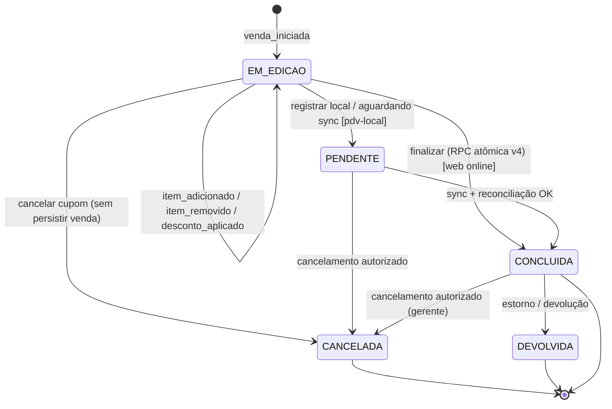

# Máquina de Estados da Venda (PDV)

> Documento complementar ao Plano Mestre. Define o **ciclo de vida da venda
> (cupom)** no PDV: estados, transições permitidas, regras de negócio e eventos
> emitidos.
>
> **Escopo:** este documento trata da venda **como entidade de negócio**. Não
> confundir com a máquina de estados **por bip** (`ScanState`), que é uma
> sub-máquina de cada leitura e está em
> [`docs/SCAN_PIPELINE_STATE_MACHINE.md`](../SCAN_PIPELINE_STATE_MACHINE.md).

---

## 1. Dois níveis de estado (não confundir)

| Nível | Entidade | Estados | Fonte canônica |
|-------|----------|---------|----------------|
| **Item / bip** | `QueuedScan` (`ScanState`) | `queued · processing · acknowledged · failed · cancelled` (+ `pending_resolution` reservado) | [`SCAN_PIPELINE_STATE_MACHINE.md`](../SCAN_PIPELINE_STATE_MACHINE.md) |
| **Venda / cupom** | `vendas.status` | `EM_EDICAO¹ · PENDENTE · CONCLUIDA · CANCELADA · DEVOLVIDA` | este documento + `vendaMaps.ts` |

> ¹ `EM_EDICAO` é o estado **não persistido** do cupom em montagem (carrinho
> Zustand + fila de bips). Os estados **persistidos** em `vendas.status` são
> `PENDENTE`, `CONCLUIDA`, `CANCELADA`, `DEVOLVIDA` (`vendaMaps.ts`). Cada bip
> aceito alimenta o cupom em edição via a sub-máquina `ScanState`.

## 2. Estados da venda

| Estado | Persistido? | Significado | Terminal? |
|--------|-------------|-------------|-----------|
| **EM_EDICAO** | Não (carrinho/fila) | Cupom aberto; itens sendo adicionados/removidos, descontos aplicados. Nada gravado em `vendas`. | Não |
| **PENDENTE** | Sim | Venda registrada **aguardando confirmação/reconciliação** (ex.: venda local sincronizada, fiscal/preço pendente). | Não |
| **CONCLUIDA** | Sim | Venda finalizada com sucesso; transação atômica gravada; evento `VENDA_REGISTRADA` emitido. | Sim (efeito reversível só via CANCELADA/DEVOLVIDA) |
| **CANCELADA** | Sim | Venda cancelada (antes de concluir, ou cancelamento autorizado por gerente). | Sim |
| **DEVOLVIDA** | Sim | Estorno/devolução **após** conclusão. | Sim |

> **Nota de precisão:** a semântica exata de `PENDENTE` e `DEVOLVIDA` deve ser
> confirmada com o dono do módulo Vendas (são status presentes em `vendaMaps.ts`;
> os eventos de barramento de `DEVOLVIDA` ainda são roadmap — ver
> [Contrato de Eventos, §3.3](./06-CONTRATO-DE-EVENTOS.md)).

## 3. Diagrama de estados



> Diagrama renderizado pelo GitHub (Mermaid). Cada transição de `EM_EDICAO` para
> si mesma representa a sub-máquina de bip (`ScanState`) alimentando o cupom.

## 4. Tabela de transições

| # | De | Para | Gatilho (breadcrumb) | Regra de negócio | Evento de domínio emitido |
|---|----|----|----------------------|------------------|---------------------------|
| 1 | `[*]` | EM_EDICAO | `venda_iniciada` | Abertura de cupom exige caixa **ABERTO**. | — (nada persistido) |
| 2 | EM_EDICAO | EM_EDICAO | `item_adicionado` / `item_removido` / `desconto_aplicado` | Bip aceito (`ScanState=acknowledged`); desconto acima do limite exige **aprovação de gerente** (`desconto_gerente_aprovado`). | — |
| 3 | EM_EDICAO | CONCLUIDA | `pagamento_processado` → `venda_confirmada_rpc` | **Web online:** preço revalidado no servidor; finalização **atômica** via `finalizar_venda_transacional_canonica_v4`. Total líquido ≥ 0. | **`VENDA_REGISTRADA`** (+ baixa de estoque na mesma transação) |
| 4 | EM_EDICAO | PENDENTE | `venda_enviada_sync` | **PDV local:** venda persiste localmente e entra no outbox; aguarda `sync-outbox`. | `VENDA_REGISTRADA` (outbox) |
| 5 | EM_EDICAO | CANCELADA | — | Cupom descartado antes de concluir; sem efeito de estoque/financeiro. | — (ou `VENDA_CANCELADA` se já havia rascunho persistido) |
| 6 | PENDENTE | CONCLUIDA | `venda_confirmada_rpc` | `registrar_venda_com_itens` confirmada + baixa de estoque aplicada; reconciliação OK. | `VENDA_REGISTRADA` consolidado |
| 7 | PENDENTE | CANCELADA | — | Cancelamento autorizado antes da confirmação. | `VENDA_CANCELADA` |
| 8 | CONCLUIDA | CANCELADA | `venda_cancelada` | **Somente gerente**, com **confirmação obrigatória** ([Pilar 3 §6](./03-PADROES-UX.md)); reverte estoque/financeiro. | `VENDA_CANCELADA` |
| 9 | CONCLUIDA | DEVOLVIDA | — | Devolução/estorno pós-venda; gera reversão fiscal/financeira. | `VENDA_DEVOLVIDA` *(roadmap)* |

## 5. Transições proibidas (bugs típicos)

| Transição | Por que é grave |
|-----------|------------------|
| CONCLUIDA → EM_EDICAO | "Reabrir" venda concluída corromperia totais, estoque e fiscal já efetivados. |
| CANCELADA / DEVOLVIDA → qualquer | Estados **terminais**; reabrir gera dupla baixa/estorno. Uma nova operação é uma **nova venda**. |
| EM_EDICAO → CONCLUIDA sem pagamento | Pular `pagamento_processado` quebra a garantia financeira. |
| CONCLUIDA → CONCLUIDA (reenvio) | Dupla finalização — barrada por idempotência (`advisory_lock` + `ON CONFLICT DO NOTHING`). |
| Qualquer → CONCLUIDA fora da RPC canônica | Finalização **só** via `finalizar_venda_transacional_canonica_v4` (web) / `registrar_venda_com_itens` (local). RPCs antigas: `LEGACY_DISABLED_USE_V4`. |

## 6. Garantias

- **Atomicidade (web):** `vendas` + `itens_venda` + estoque + `venda_eventos`
  numa única transação; rollback total em qualquer falha.
- **Idempotência:** `pg_advisory_xact_lock(hashtext(venda_id))` + `ON CONFLICT DO
  NOTHING` (web) e `ON CONFLICT (id) DO NOTHING` (local). Reentrega não duplica.
- **Não-bloqueio do fiscal:** emissão fiscal é assíncrona/best-effort; falha
  fiscal **não** reverte a venda nem altera o estado para não-CONCLUIDA.
- **ACK perceptivo ≠ commit:** o `acknowledged` de um bip (sub-máquina) **não**
  significa venda concluída — apenas que o item entrou no cupom. Ver
  [`VISUAL_TRANSACTION_STATES.md`](../VISUAL_TRANSACTION_STATES.md).

## 7. Relação com a sub-máquina de bip (`ScanState`)

Cada item do cupom `EM_EDICAO` passa pela máquina de leitura:

```
bip → queued → processing → acknowledged   (item entra no cupom)
                          ↘ failed / cancelled (não muta o cupom)
```

Regras de transição e proibições do bip são **enforced** em
`shared-core/src/pdv/scan-pipeline-transitions.ts` e documentadas em
[`SCAN_PIPELINE_STATE_MACHINE.md`](../SCAN_PIPELINE_STATE_MACHINE.md). A venda só
transita para CONCLUIDA/PENDENTE quando o operador **finaliza** o cupom — não a
cada bip.

---

## Referências

- [`06-CONTRATO-DE-EVENTOS.md`](./06-CONTRATO-DE-EVENTOS.md) — eventos emitidos em cada transição.
- [`05-ARQUITETURA-PDV.md`](./05-ARQUITETURA-PDV.md) — PDV como subsistema.
- [`docs/venda-golden-flow.md`](../venda-golden-flow.md) — fluxo de finalização (congelado).
- [`docs/SCAN_PIPELINE_STATE_MACHINE.md`](../SCAN_PIPELINE_STATE_MACHINE.md) — sub-máquina de bip.
- [`docs/VISUAL_TRANSACTION_STATES.md`](../VISUAL_TRANSACTION_STATES.md) — estados visuais (UX).
- `pdv-importados/app/admin/vendas/_components/vendaMaps.ts` — status persistidos.
